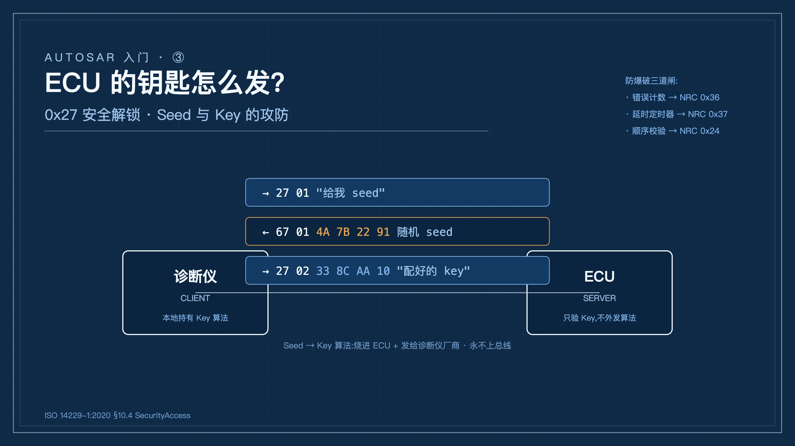
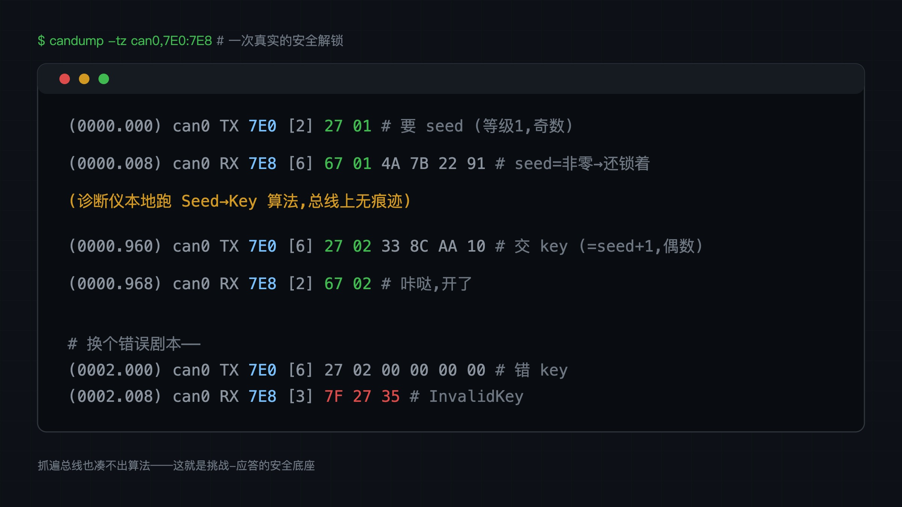
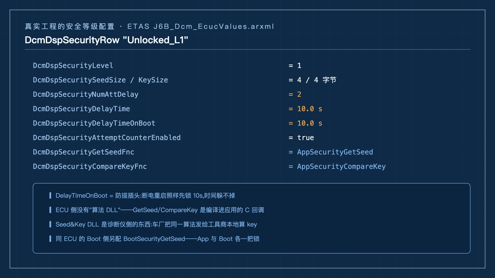

## 开场：第二道锁

上篇换了房间（`10 03` 进扩展会话），兴冲冲去写 VIN：

```
→ 2E F1 90 <20字节>
← 7F 2E 33        "securityAccessDenied"
```

NRC 0x33：安全访问未解锁。房间进对了，但**柜子还锁着**。

会话（0x10）决定"你能进哪个房间"，安全等级（0x27）决定"你能开哪个柜子"。这是 UDS 权限体系的第二层。



## Seed & Key：一场挑战应答

0x27 的流程是一场标准的挑战-应答（challenge-response，§10.4）：

```
→ 27 01           "给我一把钥匙胚（seed）"
← 67 01 4A 7B 22 91 <seed>      "拿去"
   （诊断仪用车厂保密算法算出 key）
→ 27 02 33 8C AA 10 <key>       "这是配好的钥匙"
← 67 02                        "咔哒，开了"
```

精髓在于：**密钥算法（Seed→Key 的换算）永远不经过总线**。ECU 只发随机 seed、只验 key，算法本身握在车厂手里，烧进 ECU 和发配给诊断仪厂商。抓遍总线上所有报文，也凑不出算法。



## 子功能的配对密码：奇数要，偶数给

0x27 的子功能成对出现（Table 40/41）：

- **requestSeed 恒为奇数**：0x01、0x03、0x05……0x7D
- **sendKey = requestSeed + 1**：0x02、0x04、0x06……0x7E

每对（如 0x01/0x02）对应一个**安全等级**。等级不是"从低到高爬楼梯"，而是不同柜子的不同锁——比如等级 1 开"写标定数据"的柜子，等级 3 开"刷写"的柜子。

## 冷知识：全零 seed 的暗号

一个写工具时常用的技巧（§10.4.1）：

- **锁定状态**：请求 seed，返回随机非零值
- **已解锁状态**：再请求 seed，返回**全零**

所以 `27 01` 本身就是一把"探测锁"——收到全零 seed，说明这级已经解锁，直接干活；收到非零，老老实实算 key。标准还特意注明：锁定状态下 seed **永不为零**，避免歧义。

## ECU 的防御机制：三道闸

对抗暴力试 key，规范给了三件武器（§10.4.1 + Table A.1）：

| 防线 | 触发 | NRC |
|---|---|---|
| 尝试计数 | 错 key 计一次，超限锁定 | 0x36 exceedNumberOfAttempts |
| 延时定时器 | 锁定后必须等冷却期（常见 10s 级） | 0x37 requiredTimeDelayNotExpired |
| 顺序校验 | 没要 seed 直接发 key | 0x24 requestSequenceError |

三条组合：试错 3 次锁 10 秒，一秒试一个 key 的暴力破解在车规场景里基本无解。（0x27 服务自己的 NRC 检查也讲先来后到：已解锁后再发 27 01 之类顺序不对，先回 0x24，再轮到延时/计数的码——① 篇那张流水线。）

还有一条隐蔽规则：**同一时刻只有一个等级生效**，且低等级解锁会撤销高等级已解锁的功能（§10.4.1）——防止"降级攻击"后残留权限。

## 报文逐字节

```
27 01                      请求 seed（等级 1）
67 01 <seed 4字节>          正应答 0x67 = 0x27+0x40
27 02 <key 4字节>           发送 key
67 02                      解锁成功
7F 27 36                   "次数超限"
```

典型的完整解锁序列（§10.4.1 给出的前置链）：

```
10 03 → 27 01 → <算key> → 27 02 → 2E F1 90 …
```

会话 → 解锁 → 操作，三步曲。

## 落到 AUTOSAR：DCM 怎么配安全等级

安全等级配在 `DcmDspSecurity/DcmDspSecurityRow`（TechnicalReference_Dcm §5.4）。看真实工程里的一行（ETAS `J6B_Dcm_EcucValues.arxml`，等级 L1）：

```
DcmDspSecurityRow "Unlocked_L1"
├── DcmDspSecurityLevel                = 1
├── DcmDspSecuritySeedSize / KeySize   = 4 / 4 字节
├── DcmDspSecurityNumAttDelay          = 2        ← 错 2 次进入延时
├── DcmDspSecurityDelayTime            = 10.0 s   ← 冷却期
├── DcmDspSecurityDelayTimeOnBoot      = 10.0 s   ← 上电即锁 10s（防断电绕过）
├── DcmDspSecurityAttemptCounterEnabled = true
├── DcmDspSecurityGetSeedFnc           = AppSecurityGetSeed
└── DcmDspSecurityCompareKeyFnc        = AppSecurityCompareKey
```

三个细节值得停下来看：

- **DelayTimeOnBoot 是防"拔插头"的**：错误次数被清零？没关系，断电重启后照样锁 10 秒——计数器可以清，时间躲不掉。这份工程里同一 ECU 的 boot 侧还配了另一个等级（`BootSecurityGetSeed`），App 和 Boot 各一把锁，互不通用。
- **ECU 侧根本没有"算法 DLL"**：`AppSecurityGetSeed`/`AppSecurityCompareKey` 就是两个 C 回调函数，算法实现编译在应用代码里，DaVinci 只负责在配置里挂上函数名。传说中的 Seed&Key DLL 是**诊断仪侧**的东西——车厂把同一个算法编成 DLL 发给工具商，供其本地算 key。
- **参数怎么组合有讲究**：TR 的 FAQ 明确列了哪些防爆破参数允许同时启用。这份配置用了"错误计数 + 延时"组合；另一个等级（level 49，seed/key 各 16 字节）则干脆关掉了计数器，只留长 key + 延时——安全策略是每个等级独立定的。



## 从 Seed&Key 到证书：0x29 的故事

2020 版标准新增了 0x29 Authentication（§10.6）——基于证书的挑战应答。Seed&Key 的问题在于：算法一旦泄露（车企供应商之间流转多年），全线失守，且无法远程吊销。证书体系可以。目前量产里 0x27 仍是主流，0x29 是电动智能时代的备胎转正之路。

## 收尾与预告

钥匙到手，柜门打开。下一篇把柜子里的东西摆出来看：**DID，ECU 数据的门牌号**——0x22 读与 0x2E 写。

## 参考资料

- ISO 14229-1:2020 §10.4 SecurityAccess（Tables 33~45）、Annex I 安全访问状态机
- ISO 14229-1:2020 §10.5 Authentication（2020 版新增）
- AUTOSAR_SWS_DiagnosticCommunicationManager（安全等级校验在 DSD，§7.4.4）
