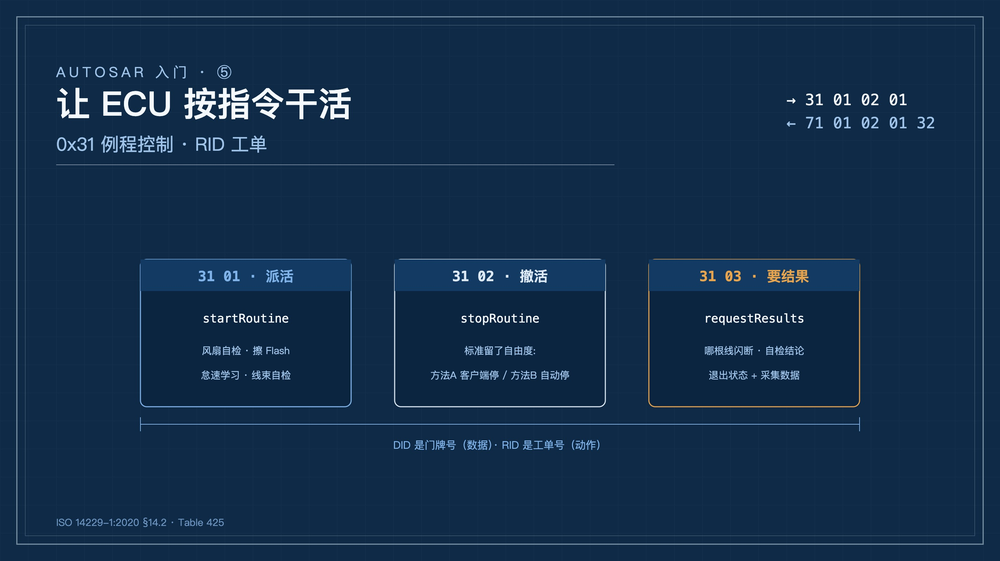
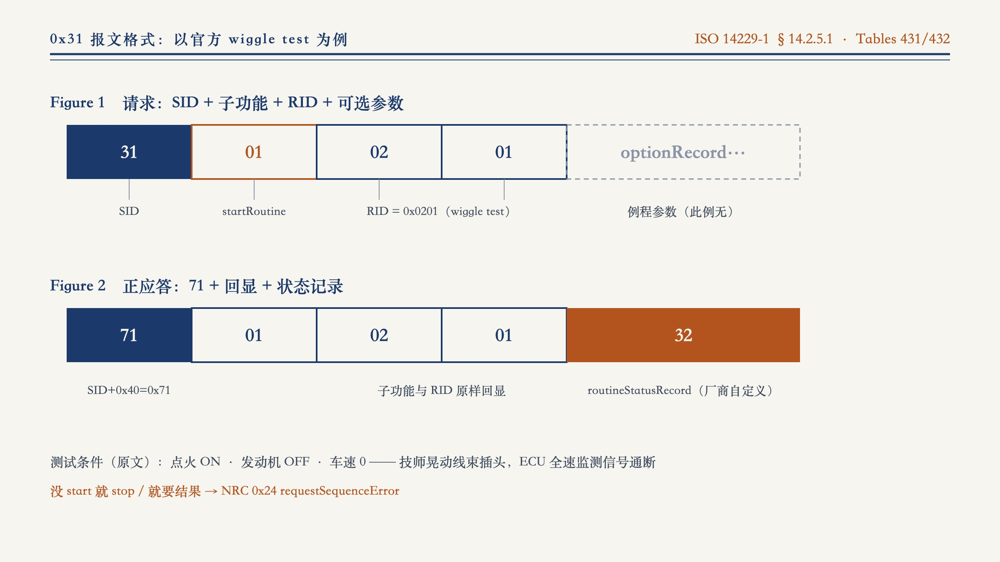
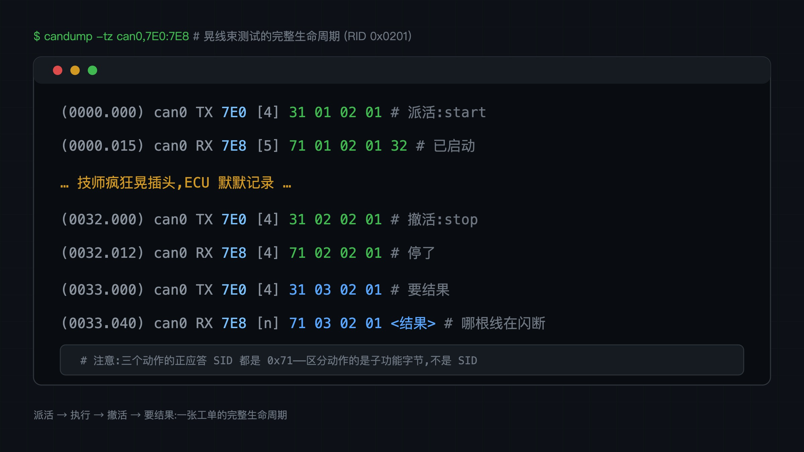

## 开场：读数据不够用了

前四篇你已经能"看"了：换会话、拿钥匙、按门牌号读写数据。但车间里真实的活儿是这样的：

- "让风扇转起来，我听听轴承响不响"
- "把 Flash 擦了，我要刷新固件"
- "跑一遍线束自检，技师去晃插头"

这些是**动作**，不是数据——DID 装不下"执行一段程序并等结果"这个语义。UDS 给动作另开了一套编号：**RID**（Routine Identifier），操作它的服务是 0x31 RoutineControl。

如果说 DID 是门牌号，RID 就是**工单号**：派活、撤活、要结果。



## 三段式：start / stop / requestResults

0x31 的子功能只有三个动词（§14.2.1.1，Table 425）：

| 子功能 | 动词 | 语义 |
|---|---|---|
| 0x01 | startRoutine | 派活 |
| 0x02 | stopRoutine | 撤活 |
| 0x03 | requestRoutineResults | 要结果 |

报文骨架：

```
→ 31 <子功能> <RID 高> <RID 低> [参数…]
← 71 <子功能回显> <RID 回显> [结果…]
```

RID 和 DID 一样是 2 字节，但语义完全不同：DID 指向"一条数据"，RID 指向"一段可执行的程序"。

## 标准原文的例子：晃线束测试

ISO 14229-1 §14.2.5.1 给了一个特别接地气的官方例程——**wiggle test**（晃动测试）：技师晃动线束插头，ECU 以最快速度连续监测所有输入输出信号的通断，把间歇性接触不良抓出来。这个例程的 RID 是 **0x0201**，条件是点火 ON、发动机 OFF、车速 0。

完整报文（Tables 431/432 原文）：

```
→ 31 01 02 01           "启动 RID 0201：开始晃线测试"
← 71 01 02 01 32        "已启动（0x32 是厂商自定义的状态字）"
   … 技师疯狂晃插头，ECU 默默记录 …
→ 31 02 02 01           "停止"
← 72 02 02 01           "停了"
→ 31 03 02 01           "结果呢？"
← 73 03 02 01 <结果>    "哪根线在闪断，看这里"
```

注意三个子功能的正应答 SID 都是 0x71——子功能区分动作，SID+0x40 的规则不变。





## 方法 A 与方法 B：谁来停例程

标准留了一个有意思的自由度（§14.2.1，Table 424）：例程的停止责任归谁？

- **方法 A**：客户端负责——启动了就必须显式 stop，ECU 不自作主张
- **方法 B**：服务器负责——例程按编程自动结束（比如自检跑完自己停）

选哪种是车厂和供应商的事，标准只要求想清楚。这类"标准不锁死、留实现自由"的设计，在 UDS 里俯拾皆是——这也是为什么不同车厂的诊断行为总有微妙差异。

## 典型工单清单

量产项目里常见的 RID（号码多为厂商自定义）：

- **Flash 擦除/校验**——OTA 刷写的前置工单（⑦篇主角）
- **自检序列**——继电器、风扇、指示灯逐个动作
- **自适应值学习**——怠速学习、节气门复位
- **快照预存触发**——配合 ⑥ 篇的 DEM

前提条件同 ②③ 篇：不少例程要求先切对会话、先解锁（§14.2.1.2 原文明确说了）。NRC 老三样也适用：没 start 就 stop → 0x24 顺序错误；例程访问 Flash 失败 → **0x72 generalProgrammingFailure**（这个码 ⑦ 篇还会见面）。

和 0x2F IO 控制的边界：0x2F 是"瞬时操纵一个执行器"，0x31 是"执行一段有始有终的程序"。拧一下灯（2F）和跑一遍全车灯光自检（31），粒度不同。

## 落到 AUTOSAR：DCM 只管派单，活儿在 SWC

DaVinci 里的配置出奇地薄（TechnicalReference_Dcm §5.23.4）：

```
/Dcm/DcmConfigSet/DcmDsp/DcmDspRoutine
├── DcmDspRoutineIdentifier   2 字节 RID
├── DcmDspRoutineUsePort      true → 走 RTE 端口
└── DcmDspStartRoutine / Stop / RequestResult  ← 支持哪些动词，按 RID 配
```

协议处理全由 DCM 代劳，但**例程本体是应用的事**：通过 RTE 的 `RoutineServices_<RoutineName>` 端口回调到 SWC。标准 0x31 的"start 之后必须先 stop 才能要结果"这类顺序校验，DCM 也不强制——SWC 自己实现状态机，顺序不对就回 NRC 0x24。还有一条工程细节：**切换会话时 DCM 不会自动停掉运行中的例程**，SWC 得自己监听模式切换去收尾。

看真实工程（ETAS `J6B_Dcm_EcucValues.arxml`）配的四个例程：

| RID | 十六进制 | 用途（从命名与配置推断） |
|---|---|---|
| 515 / 518 | 0x0203 / 0x0206 | 应用侧例程 |
| 44030 / 44031 | **0xABFE / 0xABFF** | Boot 侧：Flash 校验/擦除——⑦ 篇的伏笔就在这 |

0xABFF 正是刷写流程里"擦除 Flash"的那张工单。

## 收尾与预告

会话（②）、钥匙（③）、数据（④）、动作（⑤）——手上凑齐了刷写前的全部前置能力。但动作可能出错，出错谁来记？下一篇先讲**故障码**：DTC 三字节编码、八位状态字节，0x19 读码与 0x14 清码。

## 参考资料

- ISO 14229-1:2020 §14.2 RoutineControl（Tables 424~438）、wiggle test 示例 §14.2.5.1（RID 0201）
- Vector TechnicalReference_Dcm v9.5 §5.23 RoutineControl 配置
- ETAS RTA-CAR 实例工程 J6B_Dcm_EcucValues.arxml（DcmDspRoutine 配置）
