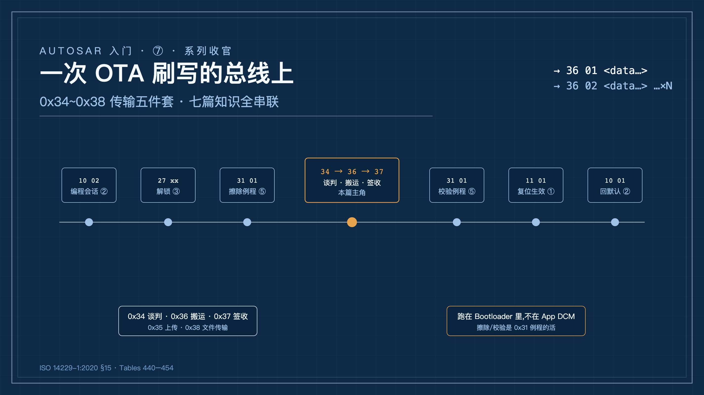
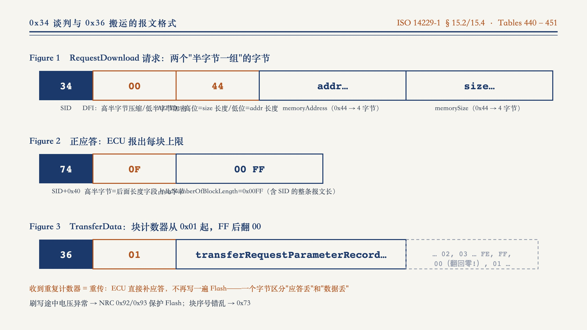
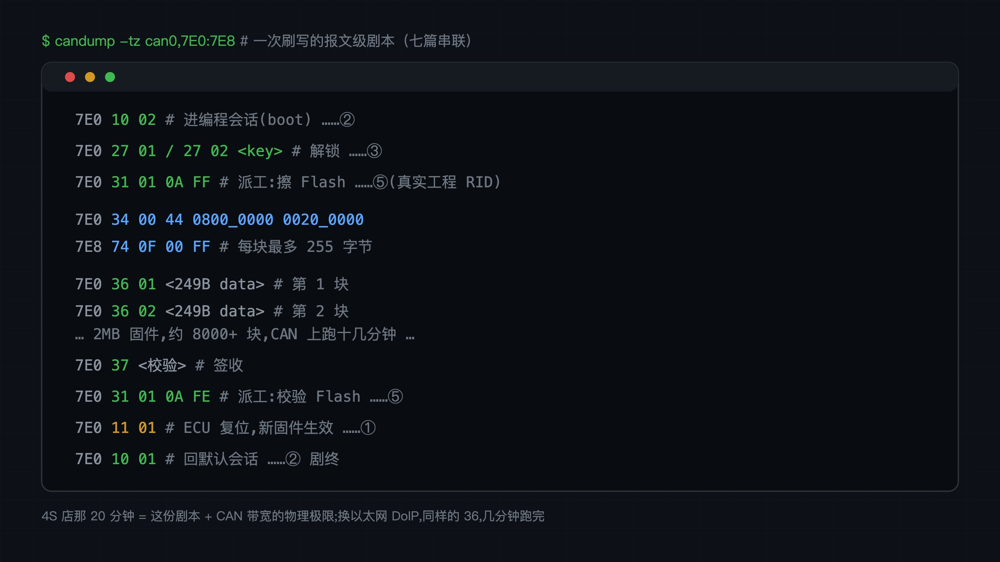

## 开场：4S 店那 20 分钟

刷 ECU 的进度条走了 20 分钟。这 20 分钟里，总线上没有黑魔法，只有一套谈判严密的报文剧本——本系列前六篇攒下的所有能力，在这一刻全部登场。

主角是传输五件套（§15）：



| 服务 | 名字 | 角色 |
|---|---|---|
| **0x34** | RequestDownload | 谈判：往哪写、写多大、每块多大 |
| **0x36** | TransferData | 搬运：数据一块一块过总线 |
| **0x37** | RequestTransferExit | 签收：运输结束 |
| 0x35 | RequestUpload | 反向：从 ECU 读出（标定数据导出） |
| 0x38 | RequestFileTransfer | 文件版：按文件名传输（非内存寻址） |

## 0x34：三件事的谈判

请求（§15.2.2，Table 440）：

```
→ 34 <DFI> <ALFID> <memoryAddress…> <memorySize…>
```

两个一字节参数各自半个字节一组用（Table 441）：

- **dataFormatIdentifier**：高半字节 = 压缩方法，低半字节 = 加密方法，`0x00` = 都不用（其余值厂商自定义）
- **addressAndLengthFormatIdentifier**：高半字节 = memorySize 占几字节，低半字节 = memoryAddress 占几字节——一个字节同时声明两个可变长字段的长度

memoryAddress 的高位字节还可以当**内存选择器**用（Table 441 原文）：双处理器 ECU 或内外 Flash 并存时，地址重叠，用最高位字节区分写到哪块器件。

正应答（Table 442/443）：

```
← 74 <lengthFormatIdentifier> <maxNumberOfBlockLength…>
```

**maxNumberOfBlockLength 是 ECU 报出的"每块最多收多少字节"**——注意它含 SID 和参数在内的整条报文长度。诊断仪据此切割数据，适配 ECU 的接收缓冲区。这是标准的流量协商：发送方的节奏由接收方定。

## 0x36：块计数器的容错设计

搬运阶段的每一块（Table 450）：

```
→ 36 <blockSequenceCounter> <transferRequestParameterRecord…>
← 76 <blockSequenceCounter 回显>
```

blockSequenceCounter 的规则（Table 451，原文值得细读）：

- 由 RequestDownload/Upload/FileTransfer 初始化为 **0x01**，每块 +1
- 到 0xFF 翻回 **0x00**（不是 01！）
- **收到重复的计数器 = 重传请求**：ECU 直接补发应答，不再写一遍 Flash——应答丢了但数据写成功了的重试场景
- 计数器没到预期的块 = 新数据，正常处理

一个字节的计数器，把"应答丢失"和"数据丢失"两种故障区分开了——这是整套刷写协议里最精巧的容错设计。



刷写途中 ECU 还会盯着电源：NRC 0x92/0x93（电压过高/过低）保护 Flash 写入——半途断电写坏 Bootloader 是最贵的事故。其他常客：0x71 transferDataSuspended（流程被打断后继续发 36）、0x72 generalProgrammingFailure（Flash 操作失败，⑤ 篇见过）、0x73 wrongBlockSequenceCounter（块序号错乱）。电压检查排在 0x36 流水线的很后面——收到 0x92 时说明谈判、会话、解锁全过了，纯粹是电源的锅（顺序规则见 ① 篇）。

## 0x37 与 0x38

`→ 37 <transferResponseParameterRecord>` → `← 77`（§15.5）——签收仪式，通常带上厂商自定义的校验信息。0x38 RequestFileTransfer（§15.6）把 memoryAddress 换成文件名路径，其余机制同 0x34——给车机这类有文件系统的 ECU 用的。

## 配角三件套：刷写前的预备动作

五件套开演前，还有一串配角服务把舞台收拾干净：

- **0x28 CommunicationControl**：静音总线（§10.5）。controlType 四档收发组合（Table 54），`28 03 <通信类型>` = 收发全停；通信类型是位编码、可组合（如同时关应用报文和网络管理报文，Annex B.1）。目的：给传输腾带宽，也防止半死不活的应用报文干扰刷写
- **0x85 ControlDTCSetting**：关掉 DTC 记录（⑥ 篇已拆——`85 02`/`85 01`），防止刷写中的电压波动写成假故障码
- **0x87 LinkControl**：切换波特率——500K 的诊断段刷 2MB 太慢，刷写前常用它协商提速（Table 22）
- **0x3E TesterPresent**：② 篇的老朋友，编程会话里照常保活
- **0x11 ECUReset**：落幕动作——`11 01` hardReset 让新固件真正跑起来；rapidPowerShutdown 变体还带 powerDownTime 参数（§10.3, Table 34）

配角们在 0x34 之前集体亮相，构成刷写的"预备节拍"。

## 完整剧本：一次刷写的报文级回放

把七篇文章串成一条时间线：



```
→ 7E0: 10 02                    进编程会话          （②）
← 7E8: 50 02 …
→ 7E0: 27 01 / 27 02 <key>      解锁（boot 侧等级） （③）
→ 7E0: 31 01 0A FF              派工单：擦 Flash    （⑤）
← 7E8: 71 01 0A FF
→ 7DF: 28 03 <通信类型>          静音总线            （本篇配角）
→ 7DF: 85 02                    暂停 DTC 记录       （⑥）
→ 7E0: 34 00 44 <addr> <size>   谈判：往哪写多大    （本篇）
← 7E8: 74 0F <maxBlockLen>
→ 7E0: 36 01 <data…>            第 1 块
→ 7E0: 36 02 <data…>            第 2 块 …（成百上千块）
→ 7E0: 37 <校验>                签收
→ 7E0: 31 01 0A FE              派工单：校验 Flash  （⑤）
→ 7E0: 11 01                    ECU 复位生效        （①提过 0x11）
← 7E8: 51 01
→ 7E0: 10 01                    回默认会话          （②）
```

擦除 RID 0xABFF / 校验 RID 0xABFE 不是标准号，是 ⑤ 篇那份真实工程（ETAS J6B）里的实际配置——**0x34~0x38 只管搬运，擦和校验是 0x31 例程的活**，两套服务在刷写流程里咬合在一起。

## 落到 AUTOSAR：这些服务不住在 DCM 里

翻遍 Vector DCM 的技术参考，你会发现一个事实：**0x34~0x38 不在应用侧 DCM 的服务清单里**。原因回看 ② 篇那句话——programmingSession 通常跑在 **Bootloader** 里。刷写时 App 要先复位进 Boot，传输五件套由 Boot 里的精简诊断栈实现；Flash 驱动、看门狗喂狗、电源监控也在 Boot 侧配合。AUTOSAR 的 FBL（Flash Bootloader）是独立于 Classic Platform 标准栈的一套实现生态。

这也是工程现实和协议理想的错位之处：ISO 14229 把五件套定义得整整齐齐，AUTOSAR 标准栈却基本不管刷写——各家 FBL 供应商（Vector、EB、ETAS 各有方案）在这一层各显神通。OTA 的更上层——差分包、回滚、双分区——则在 AUTOSAR 之外，属于每个 OEM 自己的软件资产管理。

CAN 上的限制也值得知道：经典 CAN + ISO-TP 的有效带宽有限，刷一个 2MB 的固件要十几分钟，这就是 4S 店那 20 分钟的物理来源；换以太网 + DoIP（UDP 13400），同样是 0x36 报文，几分钟跑完——UDS 服务层不变，传输层换代，这是协议分层的红利。

## 系列收尾：知识地图

七篇回望，一张图收拢：

- **①** 26 个服务全景：SID+0x40、NRC、功能/物理寻址——语法
- **②** 0x10 会话：进哪个房间——状态
- **③** 0x27 安全：开哪个柜子——权限
- **④** 0x22/0x2E DID：门牌号——数据
- **⑤** 0x31 RID：工单号——动作
- **⑥** 0x14/0x19 DTC：八盏灯——故障
- **⑦** 0x34~0x38：搬运——交付

从读一句 `22 F1 90` 到看懂整场刷写，这套协议的每个设计都值得多看一眼。下次诊断仪连上车，你听到的不该是蜂鸣，而是报文在唱歌。

## 参考资料

- ISO 14229-1:2020 §15.2 RequestDownload（Tables 440~444）、§15.4 TransferData（Tables 450~454，blockSequenceCounter 语义与重传设计）、§15.5 RequestTransferExit、§15.6 RequestFileTransfer
- ISO 15765-2:2016（CAN 传输层多帧机制，④ 篇已拆）
- ETAS RTA-CAR 实例工程 J6B_Dcm_EcucValues.arxml（擦除/校验例程 RID 0xABFF/0xABFE）
