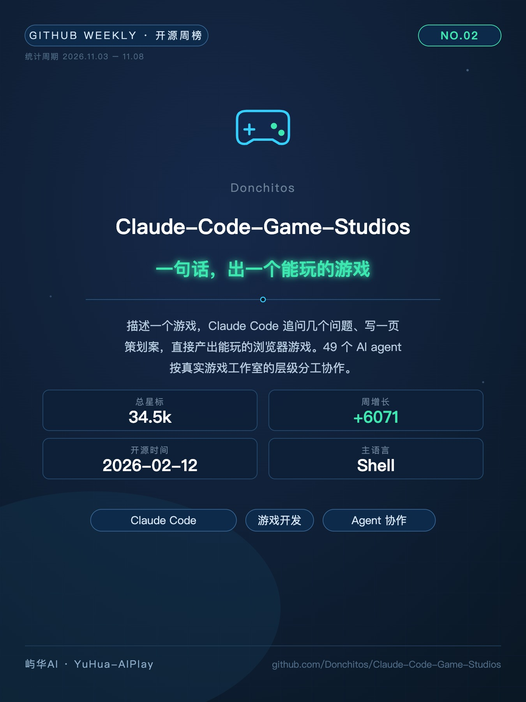
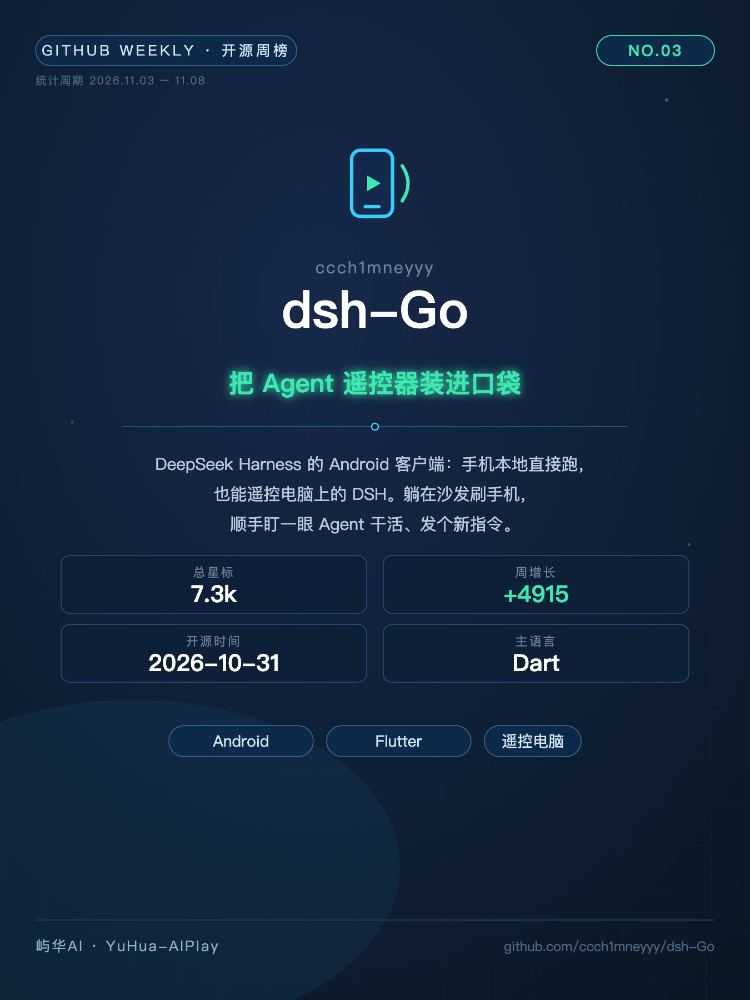
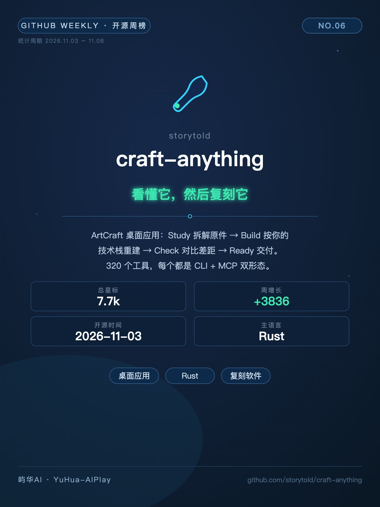
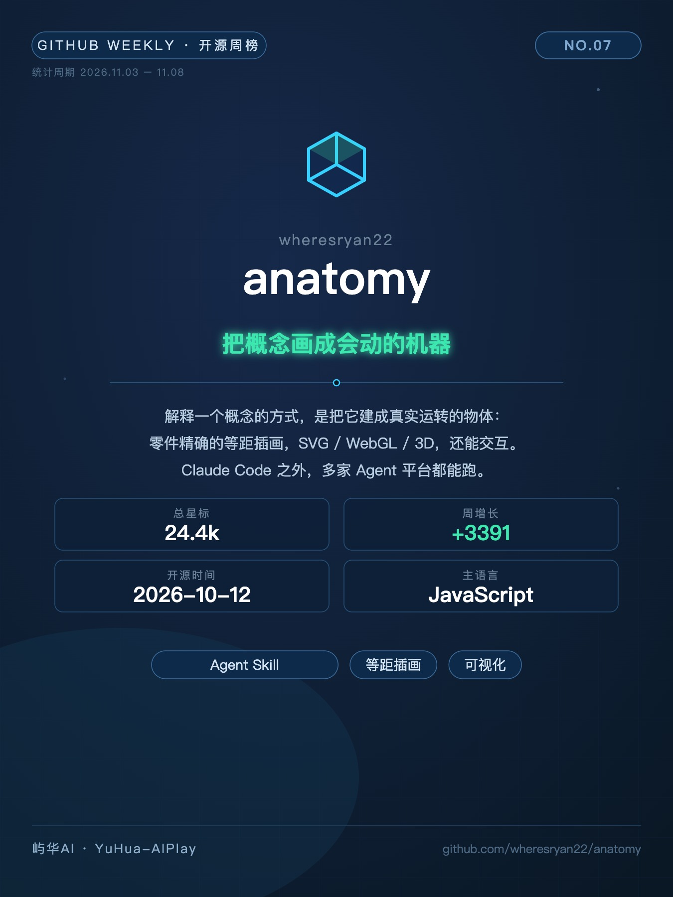
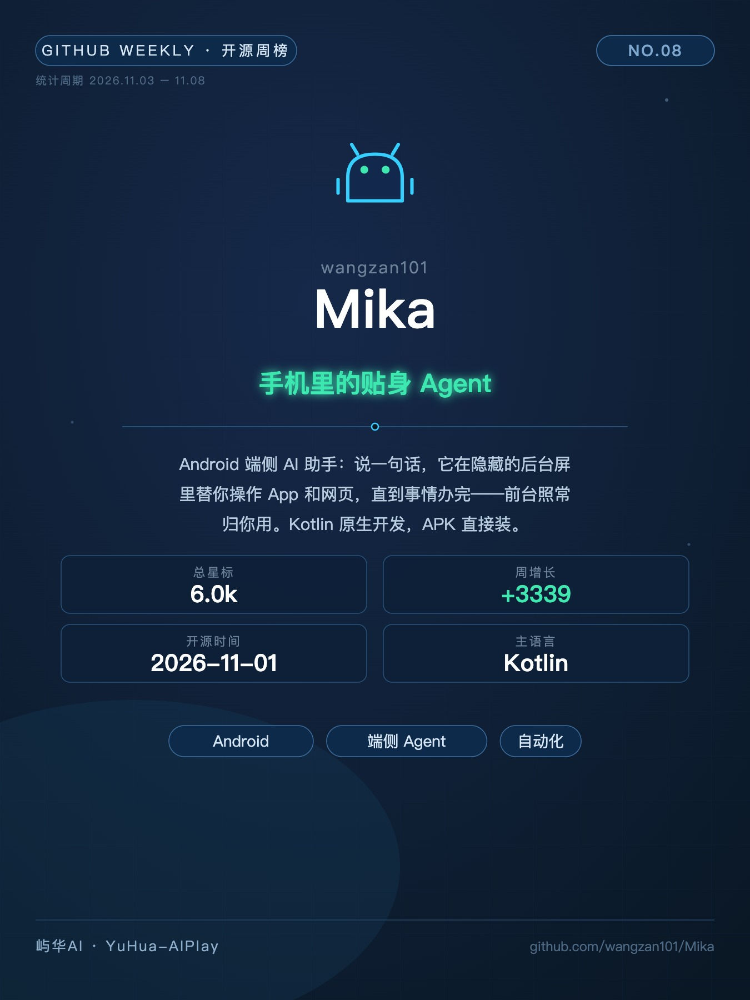

本周 GitHub 传递出一个很明确的信号：**涨星榜快被 Agent 包场了**。

我按「一周增长星数」拉了 github-weekly-rank 的周榜（统计周期 11 月 3 日～11 月 8 日），前 8 名里 7 个和 AI Agent 直接相关：DeepSeek 官方放出的超级 Agent 原型，建仓 6 天涨了 1.4 万星；《代码整洁之道》的作者 Uncle Bob，亲自下场写了一份给 Agent 看的「工程纪律」文件。

更值得玩味的是项目的形态——这一波上榜的不是大框架、大模型，而是**技能文件、客户端、工作流**。Agent 生态正在从「拼模型」进入「拼周边」的阶段。

完整榜单在上面，下面按名次一个个说。

## 01 · dsh-superagent-prototype：DeepSeek 的「超级 Agent」实验

第一名没什么悬念。DeepSeek 团队 11 月 1 日才建仓的研究原型，一周涨星 14286，总星标直接冲到 16.4k。

项目全名 dsh-superagent-prototype，定位是「迈向更自主的 Agent 系统」——来自团队的同名研究工作。README 里有两句大实话值得注意：

> 研究原型，仅供参考，不是 DeepSeek 官方产品；大量工程由 coding agent 完成。

「AI 写的 AI」，还坦诚地告诉你别当生产级软件用，这份克制反而加分。想追 Agent 前沿架构的，这是本周必读的源码。

## 02 · Claude-Code-Game-Studios：把 Claude Code 变成游戏工作室

第二名是个「造梦机器」：描述一个你想要的游戏，Claude Code 追问几个问题、写一页策划案，然后直接产出一个能玩的浏览器游戏。

它的玩法核心是**模拟真实游戏工作室的分工**：49 个 AI agent、72 个工作流技能，按制作人、策划、美术、QA 的层级协作。你负责提需求和拍板，工作室负责干活。

2 月建仓，靠口口相传滚到 34.5k 星，本周又涨 6071。不会写代码但脑子里有游戏想法的人，这是离「做出你的第一个游戏」最近的一条路。

## 03 · dsh-Go：把 DeepSeek Harness 装进口袋

第三名是中文开发者的作品，连仓库描述都是中文写的：「DeepSeek Harness 装进口袋：手机本机运行，也能遥控你的电脑。」

简单说，它是 DeepSeek Harness（DSH）的 Android 客户端，Flutter 编写。两种用法：手机本地直接跑，或者用它遥控你电脑上正在跑的 DSH。

想象一个场景：电脑里的 Agent 在干活，你躺在沙发上刷手机，顺手瞄一眼进度、发个新指令。**Agent 时代的新遥控器**，一周 4915 星就是对这个方向的投票。

## 04 · ub-mode：Uncle Bob 给 Agent 立规矩

第四名是本周最有故事性的项目。《代码整洁之道》作者 Robert C. Martin（Uncle Bob）的新仓库 ub-mode——点进去你会发现，**里面几乎没有代码**：一个 LICENSE、一份 README、一份 SKILL.md。

卖的不是程序，是「纪律」。这份技能文件把老先生几十年的工程原则浓缩成三段：

- **先让它工作**：测试先行、最小改动、先做减法
- **再让它正确**：修根因不修表象、测行为不测实现
- **保持实践**：记工作日志、小步提交、守好上下文窗口

还配了三个质量门工具：Crapper（函数复杂度必须压到 CRAP<10）、Dryer（结构性重复率<0.8 就消除）、Mutator（变异测试揪出没用的测试）。

用法也很「Skill 时代」：把 SKILL.md 拷进 `~/.claude/skills/` 这类目录，一句 `/ub-mode` 调用。**老一辈大师的毕生功力，如今是一份可以直接喂给 AI 的说明书。**

## 05 · unslop：一键去掉界面上的「AI 味」

AI 生成的界面有一种一眼假的味道，作者管它叫 slop：紫色渐变、到处发光、emoji 当标签、大惊小怪的文案。

unslop 是个 Claude Code / Codex / Antigravity 通用的技能，专治这个：先自动找出满屏的 slop，再根据你的产品气质定一个方向，然后把整个屏幕修成「有性格的设计」。

有点讽刺也很有趣——**用 AI 抹掉 AI 的痕迹**。做独立产品、又被「一眼 AI 味」困扰的开发者，本周给它投了 3945 星。

## 06 · craft-anything：看懂任何软件，然后复刻它

第六名 Craft Anything 是个 Rust 写的桌面应用，一句话概括：**指着一个软件说「我要复刻它」，它就帮你拆解并重建。**

工作流四步，每步都用人话跟你确认：

1. **Study**：用真实检查工具拆解原件——页面、代码、运行方式
2. **Build**：coding agent 按你指定的语言和框架重建项目
3. **Check**：和原件对比（三种屏宽、自测试跑分），列出不像的地方继续磨
4. **Ready**：打开、试玩、或者继续提修改

底下是 320 个工具，每个既是命令行又是 MCP 工具，任何 Agent 都能驱动同一套引擎。对想「吃透」某个软件原理的人来说，这是台学习加速器。

## 07 · anatomy：把概念画成会动的机器

第七名 anatomy，一个 Agent 技能，解释概念的方式很特别：**不是写文档，而是把概念建成一个真实运转的物体。**

它生成的是精致的等距视角插画——SVG、WebGL、3D 都行，零件精确、还能交互。给发动机画一台能转的发动机，给分布式系统画一套会收发消息的机柜。

而且不锁 Claude Code：Antigravity、OpenCode、Codex、MiniMax Code 都能跑。10 月中旬建仓，总星标已到 24.4k，光本月就涨了两万多。**科普作者和博主们的生产力神器**，做示意图比手画快太多了。

## 08 · Mika：手机上的贴身 Agent

压轴的 Mika 是个 Android 端侧 AI 助手：你说一句「帮我订明早的闹钟并查一下天气」，它就替你操作 App 和网页，直到事情办完。

最妙的设计是它在**隐藏的后台屏幕**里干活——手机前台照常归你用，Agent 在「另一个桌面」里默默点按，不抢你的屏幕。

Kotlin + Jetpack Compose 原生开发，Apache-2.0 协议，APK 直接下载安装。端侧运行 + 界面自动化，相当于把一套 RPA 机器人装进了手机。本周 3339 星，是榜单里离普通用户最近的一个。

## 本周观察：三条线

回头看这 8 个项目，能拎出三条清晰的线：

**技能文件成了新的开源品类。** ub-mode、unslop、anatomy 上榜的都不是传统软件，而是一份份 SKILL.md——写给 Agent 的说明书正在变成新的发行方式，就像当年的包管理器改变了代码分发。

**老炮进场了。** Uncle Bob 用一份技能文件证明：几十年的工程经验不用重写，整理好直接喂给 AI 就行。经验和判断力，反而在 Agent 时代升值了。

**Agent 钻进口袋。** dsh-Go 和 Mika 都把落点放在手机上——遥控电脑的、本地干活的。云端 Agent 卷完，端侧是下一站。

下周榜单见。

---

**聊聊：你最近一次 star 一个项目，是因为真用得上，还是「先收藏吃灰」？评论区报上项目名。**

下一篇继续拆周榜里的宝藏项目，关注不迷路。这里是屿华 AI，零基础玩转科技工具。
