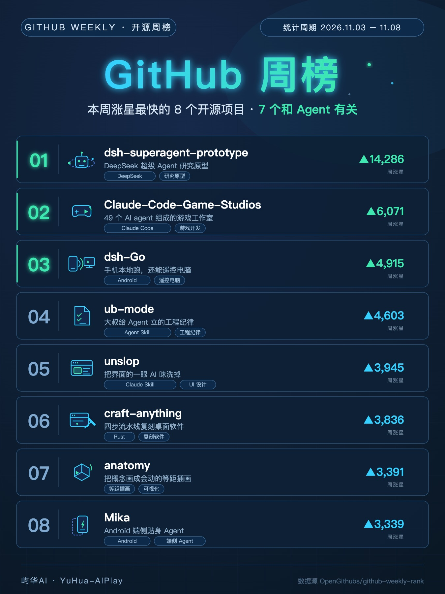
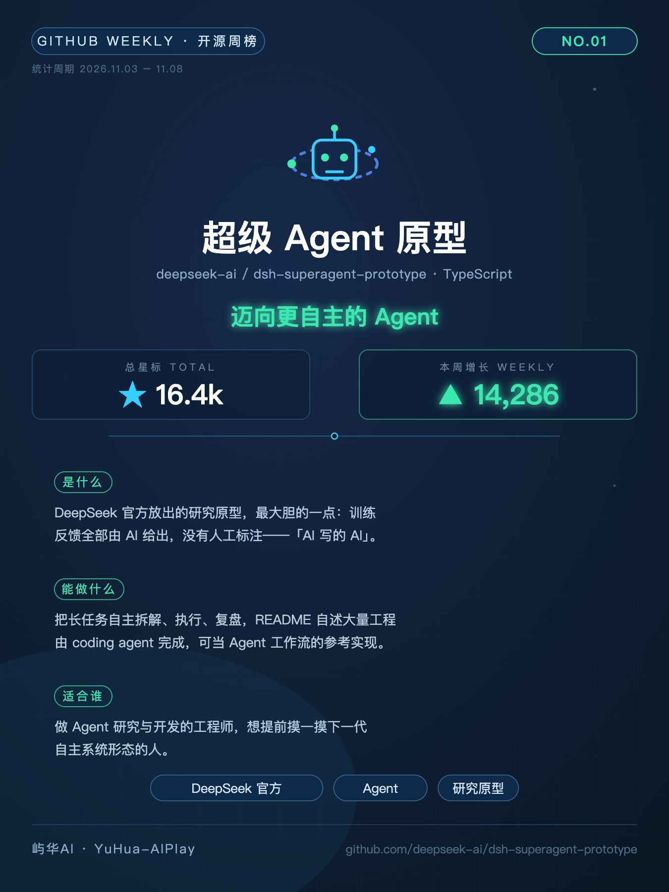
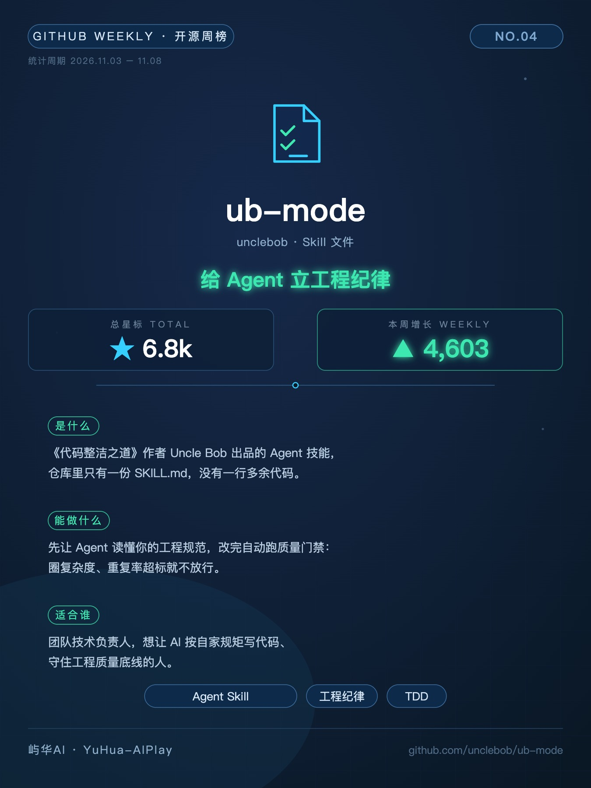
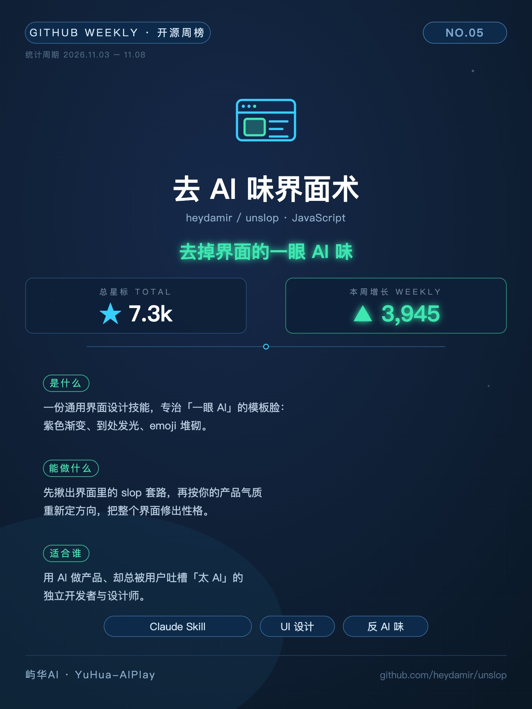

本周 GitHub 涨星榜，快被 Agent 包场了——前 8 名里 7 个和 Agent 直接相关。

更值得玩味的是形态：上榜的不是大框架、大模型，而是技能文件、客户端、工作流。**Agent 生态正从「拼模型」进入「拼周边」。**

9 张图看完这一周。

---

聊聊：你最近一次 star 一个项目，是真用得上，还是「先收藏吃灰」？评论区报上项目名。

下一篇继续拆周榜宝藏项目，关注不迷路。这里是屿华 AI，零基础玩转科技工具。
