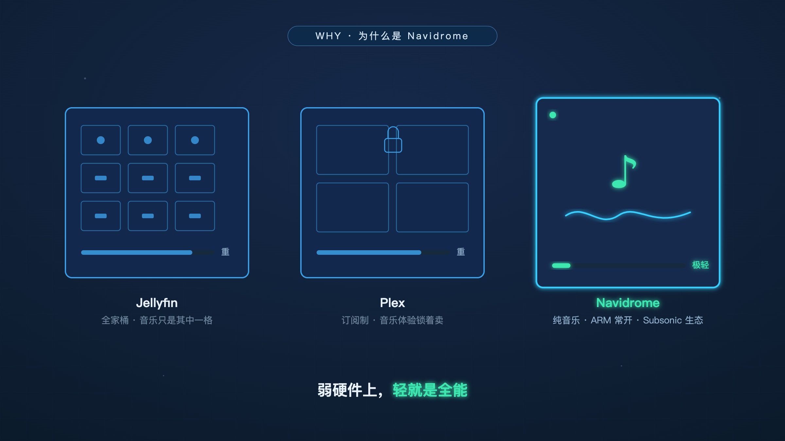
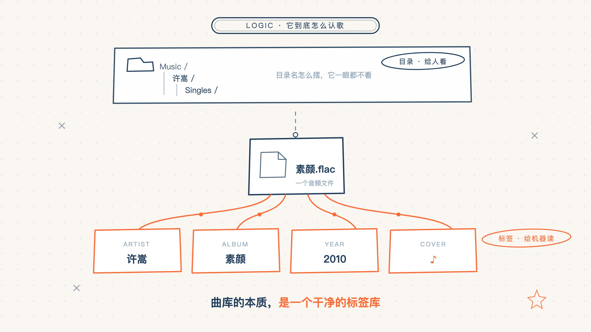
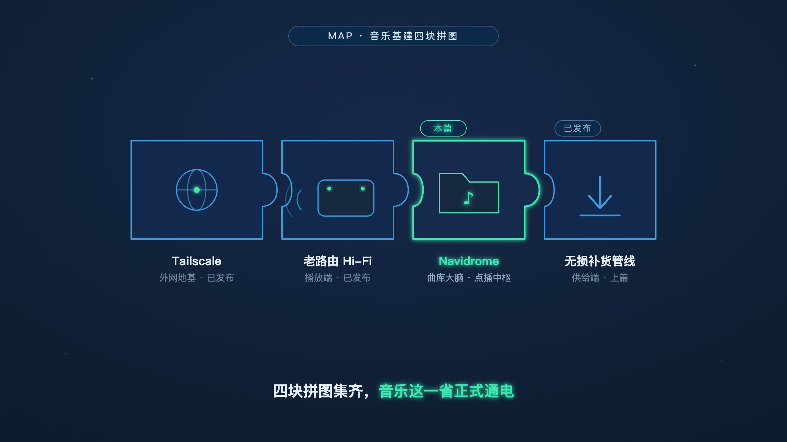

手机里装了五个音乐 App，想听的歌还是找不到。

周杰伦在这个家、林俊杰在那个家，无损要顶级会员；最扎心的是下架——昨天还能唱的歌，今天灰了一片。

我这几百 GB 无损攒在 NAS 里的人，听歌姿势更原始：开电脑、挂网络盘、翻文件夹、靠文件名认歌。

**文件叫存储，能点播才叫曲库。**

差的从来不是更大的硬盘，而是中间那一层——把文件夹变成流媒体服务的「大脑」。今天补上这块拼图：Navidrome。

## 一、背景：歌越来越多，听歌越来越累

平台侧的痛点大家都熟：版权分散在几家 App，会员得买好几份；音质分级，想听无损得再加钱；最难受的是下架，歌单里灰掉的每一行都在提醒你——**歌是租的，不是你的。**

自建侧呢？把无损攒进 NAS，主权确实回来了，但只解决了「存」，没解决「听」：文件夹不是曲库，文件名不是歌名，找一首歌全靠记忆翻目录。

两边一夹，需求浮出水面：

**歌在自己手里 + 像 Spotify 一样点播。**

缺口画在这了，这东西有个名字——音乐服务端。

## 二、Navidrome 是什么

一句话：**开源免费的自托管音乐流媒体服务器——你给它一个音乐文件夹，它还你一个私人 Spotify。** GitHub 上两万多个 Star，全球玩家的私人曲库都跑在它上面。

选它之前我对比过一圈，三个特质决定了没有悬念：

1. **只为音乐而生**。没有电影、剧集、播客，所有功能都长在音乐上，界面就是一张干净的曲库；
2. **轻到离谱**。Go 编写、单个二进制、自带数据库，部署只要 16 行配置——我的群晖 DS218play，ARM 架构的老两盘位，就是很多人眼里早该吃灰的那种，跑它常开毫无压力；
3. **Subsonic 生态白嫖**。它兼容 Subsonic API 这个存在了二十年的开放协议，iOS、Android、桌面端的成熟客户端随便挑，官方一个客户端都不用写。

为什么不是 Jellyfin / Plex？一张图看懂：



吃灰 NAS 的算力是稀缺资源，**在弱硬件上，「只跑对的服务」比「跑得动什么」更重要。**

## 三、能做什么

- **网页端开箱即用**：点播、歌单、收藏、最常播放、随机电台，一个浏览器全搞定；
- **全平台客户端**：iOS 我实测 Substreamer，Android 推荐 Symfonium，桌面端 Feishin，连上就是本地音乐 App 的体验；
- **自动扫描**：新歌丢进文件夹，最多一小时自动上架，不用碰任何按钮；
- **多用户**：给家人开独立账号，收藏和播放记录互不干扰；
- **外网点播**：配合之前装好的 Tailscale，出门用流量照样听自家曲库，零额外配置。

Spotify 的体验，歌单的主权在自己手里——这两件事，第一次不用二选一。

## 四、实操：从零到手机点播

### 第 1 步：准备一个音乐文件夹

我的库结构长这样，供参考：

```
Music/
├── inbox/                    # 新下载的歌先丢这，边听边整理
├── 许嵩/
│   ├── Singles/              # 单曲虚拟专辑
│   └── 2017 - 寻宝游戏/      # 整张专辑按「年份 - 专辑名」归档
```

但先剧透一句：**这个结构是给人看的，Navidrome 其实不看目录**（第 4 步细说）。所以最低要求只有一个——一个装着音频文件的文件夹。

### 第 2 步：16 行配置，把服务跑起来

完整 docker-compose 就这么多，逐段拆给你看：

```yaml
services:
  navidrome:
    image: deluan/navidrome:latest   # ARM 设备会自动拉对应架构镜像
    container_name: navidrome
    restart: unless-stopped
    ports:
      - "4533:4533"                  # Web 界面端口
    environment:
      ND_SCANSCHEDULE: 1h            # 每小时自动扫一次库
      ND_LOGLEVEL: info
      ND_SESSIONTIMEOUT: 24h         # 手机端一天只需登录一次
      ND_BASEURL: ""                 # 不上反向代理就留空
    volumes:
      - /volume1/Workspace/04_Media/Music:/music   # 音乐库（建议加 :ro 只读更安全）
      - /volume1/Workspace/06_Tools/Docker/Nas/navidrome/data:/data  # 数据库和缓存
```

几个设计上的「省心」：

- **不用装数据库**——自带 SQLite，`/data` 目录就是全部状态；
- **不用反向代理**——默认端口直接能用，`ND_BASEURL` 留空即可。

音乐目录换成你自己的路径，然后：

```bash
docker compose up -d
```

没有然后了，服务已经在跑了。

### 第 3 步：三分钟初始化

浏览器打开 `http://<NAS 的 IP>:4533`，首次访问直接弹出**创建管理员**界面——没有默认密码，第一眼看到的就是设置页，安全上先给个好评。

填好用户名密码，登录，它会立刻开始首次扫描。歌越多扫得越久，几百 GB 的库也就几分钟。刷新一下，整个曲库带着封面整整齐齐出现在网页里——那一刻有点小感动。

### 第 4 步：搞懂它怎么认歌（全文最重要的认知）



Navidrome 靠音频文件的**内嵌标签**（ID3、Vorbis 注释）识别艺人、专辑、年份、封面，**不读目录名**。

这个设计推论出三件事：

1. 目录结构随意折腾，库里纹丝不动——因为目录是给人看的；
2. 标签乱的歌，再规范的目录也救不了——最终都会塞进「Unknown Artist」集合；
3. 封面优先读内嵌，专辑目录里放张 `cover.jpg` 也认。

**目录给人看，标签给机器读。** 我的新歌入库链路：下载丢 `inbox` → 脚本归档到 `艺人/Singles/` → 每小时扫描自动上架。这套「无损补货管线」上一篇刚拆完——AI 逆向拿链接、一条命令批量出码，想看的翻主页 NAS 合集。

### 第 5 步：手机连上，大功告成

以 iOS 的 Substreamer 为例，设置里 Add Server，就填三样：

- **地址**：`http://<NAS 的 IP>:4533`
- **用户名 / 密码**：第 3 步建的账号
- **协议**：Subsonic

连上的瞬间，曲库、歌单、封面、播放记录全部同步——体验和本地音乐 App 几乎没有差别，只是歌存在你家 NAS 里。

### 第 6 步：出门在外，零配置

这是整个架构最爽的部分。手机装好 Tailscale（前情提要见旧文），客户端里服务器地址从局域网 IP 换成 Tailscale IP，**其他什么都不用改**。

没有公网 IP、不开放任何端口、不用折腾证书——**安全性和便利性，这次居然不用二选一。**

### 第 7 步：日常运维，记住三件事

1. **弱 NAS 别开转码**。ARM CPU 转码是自找卡顿，而现代手机的解码能力严重过剩，直接推原始流反而最稳；
2. **等不及扫描**，网页里手动触发一次，立即生效；
3. **备份策略简单到奢侈**：compose 文件是唯一真本，`/data` 里的数据库删了会自动重建——所谓灾备，就是保存好一个 16 行的 yml。

我在 Mac 侧留了一条 `make status`，SMB 挂载、首页、Navidrome 存活状态一眼看完——你哪怕只用一条 `curl` 探活，也算给曲库上了保险。这种「一眼看完」的安全感，是自建服务的隐性收益。

## 屿华的极客小结

1. **文件叫存储，能点播才叫曲库**——差的中间层是个服务，不是更大的硬盘；
2. **弱硬件选轻服务**，吃灰 NAS 上「跑对的东西」比「跑得动的东西」重要；
3. **目录给人看，标签给机器读**——曲库的本质是一个干净的标签库；
4. **生态比本体值钱**——Navidrome 本体只有 16 行，全平台的体验来自 Subsonic 生态十几年积累。



至此，音乐基建四块拼图集齐：Tailscale 打地基、老路由发声、Navidrome 管库。数字岛屿上，音乐这一省正式通电。

想上车的朋友，项目地址收好：**github.com/navidrome/navidrome**——开源免费，用着顺手就给作者点个 Star。

---

**评论区聊聊**：你在哪个音乐 App 上经历过「收藏的歌突然没了」？后来是重新找资源，还是直接弃了？

NAS 合集四篇已齐，主页一次看全。下一步给无损验真——频谱当照妖镜，假 FLAC 原形毕露。关注不迷路，零基础玩转科技工具。
