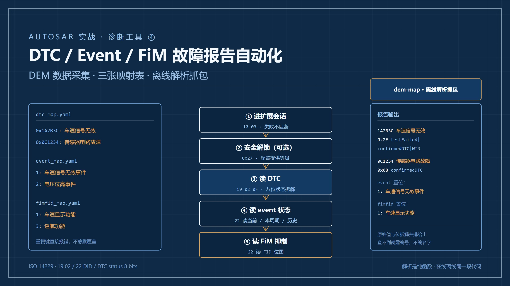
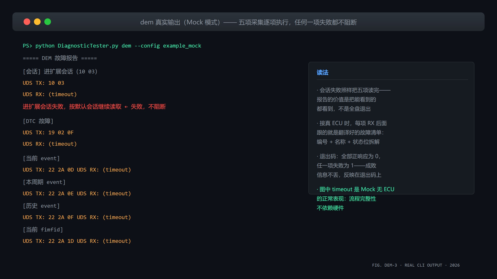
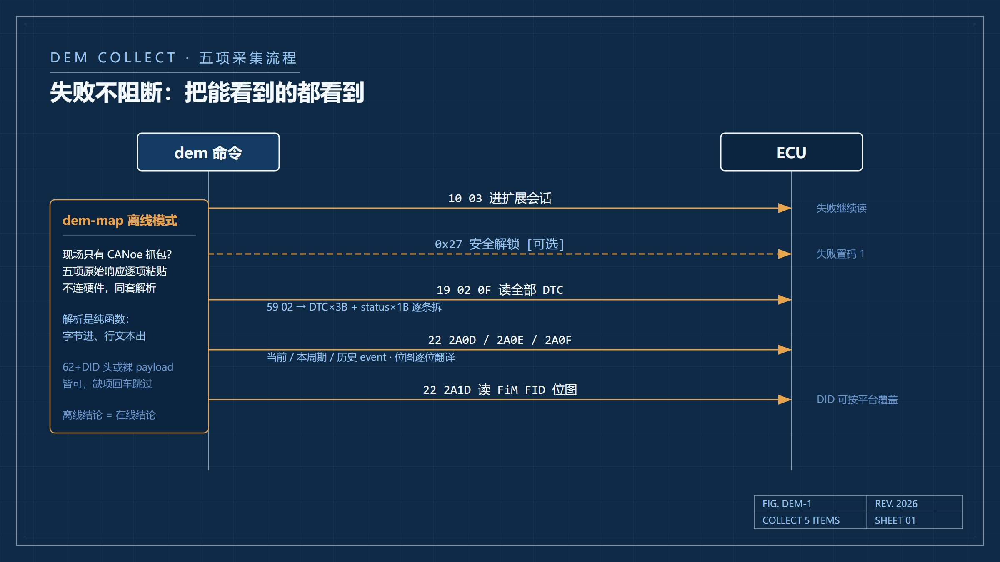
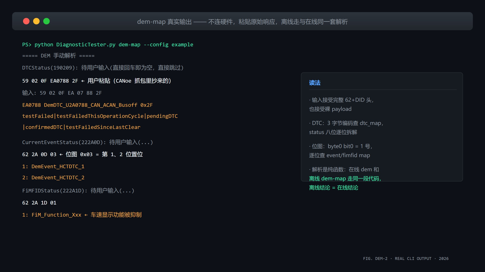

诊断测试里有个高频动作：**拉一遍全车故障**。版本交付前要看有没有历史遗留 DTC，联调出问题要先确认不是故障降级闹的。流程不复杂，但琐碎到让人怀疑人生——19 02 0F 读 DTC，再按 DID 逐个读 event 状态、FiM 抑制状态，然后对着一张 Excel 把 `1A2B3C 0x2F` 翻译成「某传感器信号无效」。本系列 AUTOSAR 正传的 DTC 篇拆过 DEM 数据模型（DTC 状态位、事件、FiM 抑制三者的关系），这一篇回到实战：这套活怎么用一条命令做完。



## dem 命令：五项采集，一次拉全

工具的 `dem` 子命令按固定流程拉五项数据，下面是 Mock 模式下的**真实运行**——会话失败也照样把五项读完：



流程本身：

1. **进扩展会话**（10 03）——部分 ECU 默认会话下不响应 19/22 请求（实测有一台 ECU 上电初期就出现），失败不阻断，继续按默认会话读
2. **安全解锁**（0x27，可选）——目标 ECU 需要解锁才应答 19/22 时由配置提供等级；解锁失败同样不阻断，退出码置 1
3. **读 DTC**：`19 02 0F`，按 reportDTCByStatusMask 拉全部记录
4. **读 event 状态**：三个 DID——当前 event、本操作周期 event、历史 event
5. **读 FiM 状态**：FID 抑制位图

完整时序（含解锁可选步骤与 DID 覆盖说明）：



「失败不阻断」是刻意设计：故障报告的价值在于**把能看到的都看到**。会话进不去、解锁被拒，剩下的项照样读——比「一步失败全盘退出、报告空空如也」有用得多，成败信息最终反映在退出码上。

## 三张映射表：编号进，人话出

DEM 诊断数据在总线上全是编号：DTC 是 3 字节码，event/FiM 是位图里的位序号。工具的做法是**把翻译表放进配置目录**，与项目配置同目录、按表分文件：

```yaml
# dtc_map.yaml —— 3 字节 DTC 编码 → 描述
0x1A2B3C: 车速信号无效
0x0C1234: 进气压力传感器电路故障

# event_map.yaml —— 位序号（从 1 起）→ 事件名
1: 车速信号无效事件
2: 电压过高事件

# fimfid_map.yaml —— 位序号 → FID 功能抑制项
1: 车速显示功能
3: 巡航功能
```

规则从严：键必须是合法十六进制且在位宽范围内（dtc_map 六位、event/fimfid_map 八位），值必须是非空字符串，**同一文件内重复键直接报错**——这个校验是踩过坑的：PyYAML 默认对重复键静默「后者覆盖前者」，映射表里两个编码撞到一起，故障描述错位，排查半天发现是表自己写重了。加载器里专门做了个拒绝重复键的 SafeLoader，把这类错误挡在运行之前。

DID 也有讲究：三个 event DID 和一个 FiM DID 工具给了默认值（2A0D/2A0E/2A0F/2A1D），不同平台对不上时用 `dem_dids.yaml` 覆盖——map 表和 DID 定义都可配置，dem 命令本体就零改动地跨项目复用了。

## 解析层：把字节拆成人话

**DTC 侧**，`59 02` 正响应的格式是「掩码 1 字节 + 若干条（DTC 3 字节 + status 1 字节）」。解析器校验响应头、校验记录长度是 4 的整数倍，然后逐条拆：3 字节拼成 DTC 编码查 dtc_map，status 字节按 ISO 14229 的八位定义拆开——testFailed、confirmedDTC、warningIndicatorRequested……每位一个状态，逐位映射。报告里一行是：

    1A2B3C  车速信号无效  0x2F  testFailed|confirmedDTC|warningIndicatorRequested

status 原始值和位拆解并排给出：位拆解给人读，原始值留给和规范逐位核对。

**event/FiM 侧**，22 读回来的正响应去掉 `62 + DID` 头就是一段位图。位图编号规则是 byte0 bit0 = 1 号、byte1 bit0 = 9 号（从 1 起连续编号），逐位置位后查 event_map / fimfid_map 翻译。位图里没置位就明说「无置位」，查不到编号也如实标注——**宁可露原始编号，不编一个似是而非的名字**。

这套解析是纯函数：字节进、行文本出，不碰任何硬件。这个性质直接促成了下一篇要讲的测试策略，也引出了 dem 家族的第二个命令。

## dem-map：现场只有抓包时的救场模式

真实世界有个尴尬场景：现场出了问题，手里只有 CANoe 抓的包（或者干脆只有别人粘过来的一段响应 hex），ECU 已经不在手边。等回到台架复现？黄花菜都凉了。

`dem-map` 为此而生：**不连任何硬件，把五项原始响应逐项粘贴进去，离线走同一套解析**。输入支持完整的 `62 <DID> <payload>` 格式，也支持裸 payload；哪项没有就回车跳过。因为解析层是纯函数，在线 `dem` 和离线 `dem-map` 走的是**同一段代码**——离线解析出来的结论，和在线跑完全一致，不存在「离线版和真机行为不一样」的猜疑。

这个模式的实战价值在复盘：现场拿到抓包，当场 `dem-map` 一遍，故障清单立刻成形；带回的 hex 进聊天记录就是证据，事后任何人复核都跑得出同样结果。下面是刚在示例 map 表上跑的**真实输出**——DTC 一条、event/FiM 位图各一条：



## 报告之外：留给续作的钩子

dem 命令把「拉故障」这件事从十分钟的手工活变成了十秒的命令。但报告里的 FiM 位图只是「哪些功能被抑制了」，**抑制的判定链路——event 怎么映射到 FID、降级策略在哪配置、老化自愈怎么走——是 DEM 内部的另一片天地**，埋个伏笔，续作单开一篇深讲。

## 写在最后

- **⑤ 用 Claude Code 开发诊断测试工具**——这个工具本身的人机协作开发全过程，系列收官

这个系列持续更新——每篇都从真实工程出发：协议事实以 ISO 14229 为准，设计决策讲清取舍，代码与配置思路都可以照着复现。

诊断测试的坑，先替你踩；工具设计的门道，陪你逐层拆。关注、收藏「屿华AI」，AUTOSAR 实战系列不迷路；转载请注明出处并保留链接。
