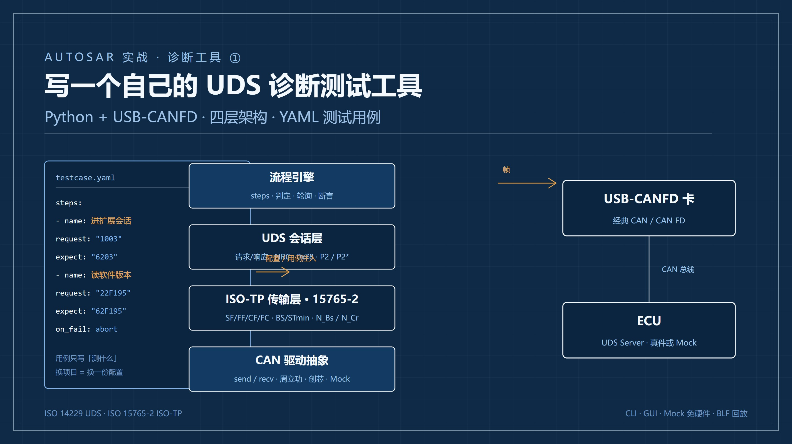

做诊断测试的工程师，大多数时间泡在两个工具里：CANoe 和诊断仪。

CANoe 无疑强大，但它也有另一面：授权按模块计费，一套下来不便宜；诊断测试台架要针对每个项目搭一遍，换个 ECU 就得改工程；测试脚本绑在 CAPL 上，想做版本管理和自动化回归，总隔着一层。

这个系列介绍一套自研的替代方案：**用 Python 和一张 USB-CANFD 卡，把 UDS 诊断测试做成「YAML 写用例、命令行跑回归」的轻量管线。** 全部代码约 2400 行，支持周立功和创芯两种主流 USB-CANFD 卡，经典 CAN 与 CAN FD 通吃，另配图形界面和免硬件的 Mock 模式。

第一篇讲设计与实现。先看架构。



## 四层架构：每一层只做一件事

整个工具自下而上分四层，层与层之间只通过明确的接口通信：


**第一层：CAN 驱动抽象。** 定义了一个极简的帧级接口——`send` 同步发帧，`recv` 阻塞取帧。周立功卡、创芯卡、Mock 驱动三个实现都挂在这个接口后面，上层代码完全不知道底下插的是什么卡。换卡 = 换一行 YAML 配置。

**第二层：ISO-TP 传输（ISO 15765-2）。** 负责 UDS 报文的拆包组包：单帧（SF）、首帧（FF）、连续帧（CF）、流控帧（FC）四种帧类型，收发双方的流控（BS 块大小、STmin 最小间隔），以及三个超时守护——N_Bs（等流控超时）、N_Cr（连续帧间隙超时）。CAN FD 下单帧容量从 7 字节扩到 62/63 字节，转义形式的 SF 帧也处理了。

**第三层：UDS 会话。** 把字节流升级成「请求-响应」语义：解析正负响应、识别 NRC 否定响应码、处理 0x78（responsePending）的循环等待，并实现 P2 / P2* 两个定时器——P2 是单响应超时（默认 50 ms），收到 0x78 后切换到 P2* 窗口（默认 5000 ms）继续等。这两个参数都能在配置里按 ECU 调整。

**第四层：流程引擎。** 把测试用例翻译成一次可执行的诊断会话：逐步发送请求、按期望前缀判定 PASS/FAIL/TIMEOUT、处理轮询和失败策略。下一节细讲。

分层的收益在出问题时最明显：总线上少收了帧，查传输层；响应判错，查流程引擎——各管各的。

## 配置与用例：把诊断流程写成 YAML

工具把「项目差异」和「测试流程」拆成两个文件，这正是它能跨项目复用的关键。

**项目配置**（每 ECU 一份）描述「这台 ECU 怎么测」：

```yaml
can:
  device: CX-USBCANFD      # 创芯卡，换周立功卡只改这里
  channel: 0
  fd: true
  baudrate: 500000
diagnostic:
  request_id: 0x7E0        # 物理寻址请求 ID
  response_id: 0x7E8       # 响应 ID
  functional_id: 0x7DF     # 功能寻址（可选）
timing:
  p2_ms: 50                # 单响应超时
  p2star_ms: 5000          # 0x78 后的等待窗口
```

**测试用例**（每流程一份）描述「测什么」，只有 steps / on_fail / timing 三节。一个最小的用例：

```yaml
steps:
  - name: 进扩展会话
    request: "1003"
    expect: "6203"
  - name: 读软件版本
    request: "22F195"
    expect: "62F195"
on_fail: abort
```

`expect` 是期望响应的前缀，不是全等——响应里跟在 SID 后面的数据长度可变，按前缀判定才是诊断测试的实际情况。

两个进阶机制值得一提。

**while 轮询步骤**，专治「发一条请求等标定完成」这类异步流程：响应命中 `in_progress` 前缀就等 `delay_ms` 再发，直到响应变化或达到 `max_cycles` 上限（防死循环）：

```yaml
- name: 等待标定完成
  request: "3101FF00"
  while:
    in_progress: "7101FF0001"   # 末字节 01 = 进行中
    delay_ms: 200
    max_cycles: 100
  expect: "7101FF0000"          # 末字节 00 = 完成
```

**跨步骤变量断言**，能把「两次响应必须一致」写成用例。典型场景是 0x27 安全访问的种子记忆特性：同一周期内重复取种子，ECU 必须返回逐字节相同的结果：

```yaml
- name: 取种子（记录）
  request: "2701"
  expect: "6701"
  set_var: seed1
- name: 再取种子（必须与上次一致）
  request: "2701"
  expect: "6701"
  expect_equals_var: seed1
```

判定顺序是先查 `expect` 前缀，再做变量比较，两条都过才算 PASS。

## 三个命令，覆盖日常测试

日常使用只需要记住三个命令。

**probe**——单发一条请求，最快的问题定位手段：

    python DiagnosticTester.py probe --config configs/example_cx.yaml 22F195
    响应：62F19520533031302E303039

**chat**——交互模式，逐条输入十六进制请求，即时显示响应与耗时，负响应自动翻译出 NRC：

    diag> 2701
    6701  15ms
    diag> 22F1AA
    7F2231（NRC 0x31） 请求超范围

**run**——跑完整用例，输出汇总并给出 CI 友好的退出码：

    PASS 3 / FAIL 0 / TIMEOUT 0 / 共 3/3     # 退出码 0

退出码约定全套对齐自动化场景：0 成功、1 有失败或超时、2 配置错误、3 运行期异常。把它塞进 CI 流水线时，不需要任何包装脚本。

## 三路落盘：人读、机器读、总线回放

每次运行，三个文件同时落盘到时间戳目录：


- **run.log**——人读的事件流水：每步的请求响应、NRC、判定结果、0x78 事件、解锁过程，排查问题从这里开始
- **result.csv**——结构化结果表，一行一个步骤（序号/请求/响应/NRC/判定/耗时），给脚本和报表消费
- **trace.blf**——总线原始帧，**CANoe 可以直接回放**。工具只记录诊断相关的三个 CAN ID，总线其余流量也照收不误

这套组合的价值在联调阶段：测试 FAIL 时，先看 run.log 定位是哪步、什么 NRC；需要分析总线行为时，把 BLF 丢给 CANoe 逐帧回放。诊断仪和 CANoe 的强项，一个都不缺。

## Mock 驱动与测试策略：免硬件也能跑

工具内置一个 Mock 驱动——不插卡、不接 ECU，在纯软件环境里走通整个协议栈。它既是新人的免硬件体验入口（README 的第一个示例就是 Mock 用例），更是工具自身的测试基建。

配套的是一套 pytest 测试：传输层的拆包组包、流控超时、UDS 层的 0x78 循环、流程引擎的判定与轮询、UI 的会话管理……共 17 个测试文件，全部跑在 Mock 之上，CI 上几秒钟跑完，不需要任何硬件在环。

这就是分层架构的红利：`CanDriver` 接口够窄，Mock 二十几行就能顶替真卡；协议栈每一层都能被独立验证。

另外还有一个 PyQt 图形界面：配置下拉、手动收发（类 chat，双击历史回填）、固定例程（会话切换 / 解锁 / 读 DTC 一键跑）、用例执行、日志与报文双视图。命令行是骨干，UI 是给临时接手项目的同事准备的易用入口，两者共用同一套协议栈。

## 写在最后

这个系列接下来四篇，都从这个工具出发：

- **② 0x27 安全访问的配置化实现**——六类种子密钥算法怎么做成插件，新 ECU 只写配置不改代码
- **③ 基于 YAML 的诊断测试用例工程**——轮询、断言、失败策略与回归闭环的完整实践
- **④ DTC/Event/FiM 故障报告自动化**——一条命令拉全车故障，离线解析现场抓包
- **⑤ 用 Claude Code 开发诊断测试工具**——这个工具本身的人机协作开发全过程

如果你也在被诊断测试的重复劳动消耗，欢迎系列追更。
