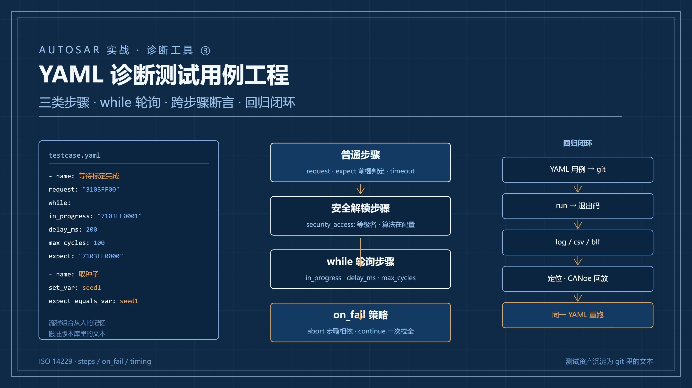
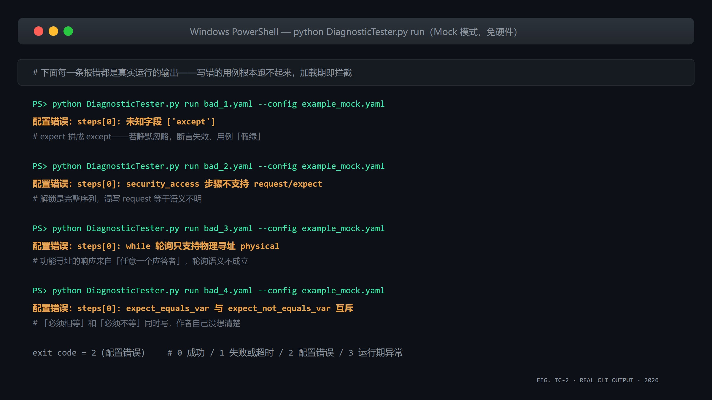
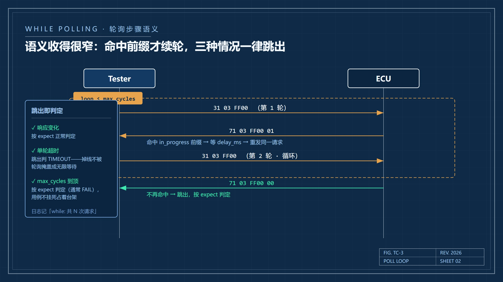
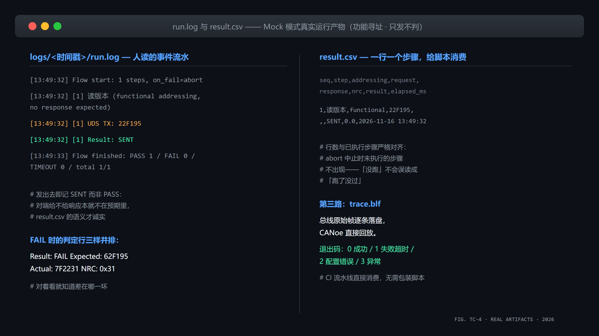
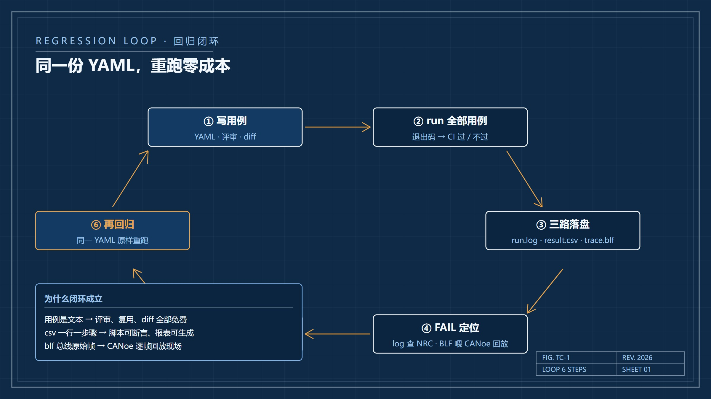

前两篇解决了「工具怎么搭」和「解锁怎么配置」，这一篇回到测试的本体——**用例**。诊断测试的日常痛点不是不会发请求，而是流程组合：进会话、解锁、跑例程、等完成、验结果，一套动作重复几十遍。用例工程的全部意义，就是把这套动作从「人的记忆」搬进「版本库里的文本」。



## 用例模型：一门刻意做小的语言

一个用例文件只有三节：`steps` / `on_fail` / `timing`。没有变量作用域、没有函数、没有分支嵌套——这些复杂度是故意不加的，诊断流程不需要图灵完备，需要的是**每个测试工程师五分钟能读懂另一份用例**。

最小用例第①篇出现过，这里给一个把进阶机制全用上的版本：

```yaml
steps:
  - name: 进扩展会话
    request: "1003"
    expect: "6203"
  - name: 安全解锁
    security_access: app          # 等级名，算法与密钥在项目配置里
  - name: 等待标定完成
    request: "3103FF00"
    while:
      in_progress: "7103FF0001"   # 末字节 01 = 进行中
      delay_ms: 200
      max_cycles: 100
    expect: "7103FF0000"          # 末字节 00 = 完成
  - name: 取种子（记录）
    request: "2701"
    expect: "6701"
    set_var: seed1
  - name: 清 DTC
    request: "14FFFFFF"
    addressing: functional        # 功能寻址，不判响应
on_fail: continue
timing:
  p2_ms: 50
```

步骤是三类之一：**普通步骤**（`request` + 判定）、**安全解锁步骤**（`security_access` + 等级名）、**while 轮询步骤**（普通步骤加 `while` 块）。

`expect` 是**期望响应的前缀，不是全等**——响应里跟在 SID 后面的数据长度可变，按前缀判定才是诊断测试的实际情况。反过来，没有 `expect` 的步骤「只发不判、超时不算失败」，判定逻辑里显式记 PASS：给「发完即生效」类请求（清 DTC、会话切换）留了口子，也保证了落盘的判定值永远明确。

## 校验哲学：把错误挡在总线上

用例工程最容易烂掉的地方不是「功能不够」，而是**静默失效**。想象一个场景：把 `expect` 拼成 `except`，用例照跑、响应照收、结果一片绿——而那条断言根本没生效。这种「假绿」比崩溃可怕得多，它会让一个真故障顺利溜进量产。

所以这个工具的加载器贯彻一条铁律：**拼错的键必须报错，不能静默忽略后回落默认值**。每个节的合法字段是一个封闭集合，多出来的未知字段一律拒绝，错误信息直接指到位置——`steps[2].request: 缺失`、`timing.p2s_ms: 未知字段`，改起来不用翻源码。

在这条铁律之上，是一批**跨字段的一致性规则**，全部在加载期完成：

- `security_access` 步骤不支持 `request`/`expect`/`while`/变量字段——解锁有自己的完整序列，混写等于语义不明
- `expect_equals_var` 与 `expect_not_equals_var` 互斥——「必须相等」和「必须不等」同时写，说明作者自己没想清楚
- 功能寻址要求配置里先声明 `functional_id`，且请求长度不超过单帧上限（经典 CAN 7 字节、CAN FD 62 字节）——超长请求在总线上必然拆帧出错，这是协议事实，提前挡下
- 变量名必须是标识符风格——变量会进日志和 CSV，名字自由发挥会污染产物

这套校验不是纸上谈兵，下面是**真实运行**的报错输出（Mock 模式，免硬件可复现）：



这套校验的体验是：**写错的用例根本跑不起来**。宁可加载时多报十个错，不在总线上猜一次错。

## while 轮询：等一个异步流程跑完

诊断里最尴尬的场景是 0x31 例程控制：发 `31 01` 启动自检或标定，ECU 不会立刻给结果，要反复发 `31 03` 问「好了没」。手工时代靠人肉连发，脚本时代靠写循环——用例里把它做成声明式，语义收得很窄：**响应命中 `in_progress` 前缀 → 等 `delay_ms` → 重发同一请求；响应不再命中（成功、失败或超时）→ 跳出，按 `expect` 正常判定**。



三个细节是实战喂出来的：

- **超时不算「进行中」**。某一轮没收到响应就跳出判 TIMEOUT——ECU 掉线不该被轮询掩盖成无限等待，这是「假绿」戒律在轮询上的延伸
- **`max_cycles` 强制上限**。哪怕 ECU 永远回「进行中」，到上限也跳出、按 `expect` 判定（通常是 FAIL）——防止用例挂死占着台架，同时把「ECU 卡在异步流程出不来」这个事实显式暴露在报告里
- **轮询计数留痕**。每个轮询步骤在日志里记下「while: 共 N 次请求」，标定到底转了多久，数据说话

## 跨步骤断言：把「必须一致」写进用例

有些验证不是「响应等于某个值」，而是「两个响应彼此相等」。最典型的是 0x27 种子记忆特性：同一操作周期内重复取种子，ECU 必须返回逐字节相同的结果——这是检验对端实现的探针。

工具用 `set_var` / `expect_equals_var` / `expect_not_equals_var` 三个字段表达。实现上有个值得说的选择：**变量存的是完整原始响应**（含正响应头），比较按字节全等。存完整响应而不是「剥掉头的数据段」，意味着断言的语义最诚实——头都对不上，本身就该 FAIL。

```yaml
- name: 取种子（记录）
  request: "2701"
  expect: "6701"
  set_var: seed1
- name: 再取种子（必须一致）
  request: "2701"
  expect: "6701"
  expect_equals_var: seed1
```

边界情况也处理得干净：引用了一个从未设置的变量，判 FAIL 并在日志里明说「需先经 set_var 步骤记录」——不会抛异常中断流程，也不含糊放行；`set_var` 那步没收到响应，日志记「未记录」，后续断言自然失败，因果链在 log 里完整可读。

## 失败策略与 timing 覆盖

`on_fail` 只有两个值：`abort`（默认，首个 FAIL/TIMEOUT 即中止）和 `continue`（跑完全部步骤）。选择依据是步骤间的依赖关系：清 DTC 之后读 DTC，前一步失败后一步必然失真，用 `abort`；一批互相独立的 DID 读取，用 `continue` 一次拉全结果，省得来回跑台架。

`abort` 的行为也有讲究：中止时已执行步骤照常计数汇总，**未执行步骤不出现在结果里**——run.log、result.csv 的行数与真实执行的步骤严格对齐，事后翻表不会把「没跑」误读成「跑了没过」。

timing 是两层覆盖，粒度从粗到细：

- **用例级**：testcase 的 `timing` 节覆盖项目配置默认值，只覆盖出现的键，其余继承——某台 ECU 的 P2 特别长，只在它的用例里调，不影响别的项目
- **步骤级**：单步 `timeout_ms` 覆盖 P2，`delay_after_ms` 整体覆盖步骤间隔（是覆盖不是叠加）——标定例程那一步单独放宽到 10 秒，其余步骤保持节奏

## 功能寻址：一句话与一段公案的差别

`addressing: functional` 把请求发往功能寻址 ID（如 7DF），分两种用法。

**不带 expect**——发完即记，响应根本不看。落盘时记为 `SENT` 而非 PASS：请求确实发出去了，但对端给不给响应本来就不在预期里。`SENT` 和 `PASS` 分开，result.csv 的语义才诚实。

**带 expect**——请求照发功能寻址 ID，但按 response_id 收响应、正常判定。这是本工具最有故事性的场景：某功能寻址请求经网关组播后，部分 ECU 的响应交付出了问题，且只在**总线上有其他负载**时偶发。把这个请求写成带 expect 的功能寻址用例，配合总线压力反复跑，几轮就稳定复现，最终定位到 PduR TP 网关在过期长度处理上的缺陷。这类「时序相关的组播交付」问题，手发 hex 永远复现不出来——**用例化之后才能加压、才能回归**。

## 回归闭环：从 result.csv 到 CANoe 回放

用例跑完，闭环才刚开始。三路落盘各司其职，下面是 Mock 模式一次真实运行的两个产物（trace.blf 是二进制，图里略去）：



run.log 给人翻现场，result.csv 给脚本出报表，trace.blf 丢给 CANoe 逐帧回放。加上第①篇说的退出码约定（0 成功 / 1 失败 / 2 配置错误 / 3 异常），一条完整的回归链路是：



1. 版本交付前，`run` 跑全部用例，退出码直接决定流水线过/不过
2. FAIL 的用例，看 run.log 定位步骤和 NRC（判定行同时给出 Expected / Actual / NRC 三样，对着看就知道差在哪），需要看总线行为就把 BLF 喂给 CANoe
3. 修复后，**同一份 YAML** 原样重跑——用例是文本，重跑零成本

最后一点是整个用例工程的地基：**测试资产沉淀为 git 里的文本**。评审、复用、diff 出「这个版本改了哪条期望值」，全部免费获得。诊断测试从「老师傅的手艺」变成「团队的工程」，跨过的就是这一步。

## 写在最后

到这里，工具的三大件——架构、解锁、用例——都讲完了。下一篇处理数据量最大的场景：一条命令拉全车 DTC/Event/FiM 故障并翻译成人话，外加一个离线解析 CANoe 抓包的救场模式。

- **④ DTC/Event/FiM 故障报告自动化**——一条命令拉全车故障，离线解析现场抓包
- **⑤ 用 Claude Code 开发诊断测试工具**——这个工具本身的人机协作开发全过程

这个系列持续更新——每篇都从真实工程出发：协议事实以 ISO 14229 为准，设计决策讲清取舍，代码与配置思路都可以照着复现。

诊断测试的坑，先替你踩；工具设计的门道，陪你逐层拆。关注、收藏「屿华AI」，AUTOSAR 实战系列不迷路；转载请注明出处并保留链接。
