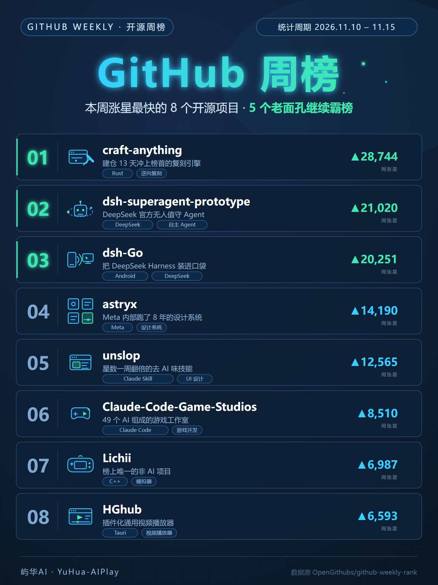
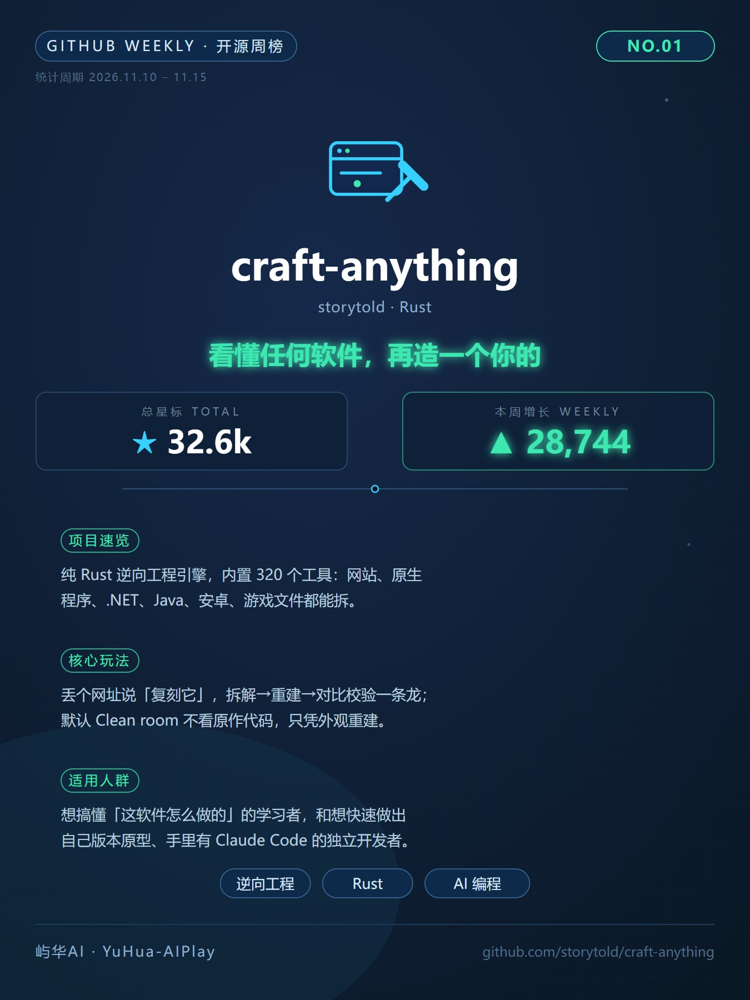
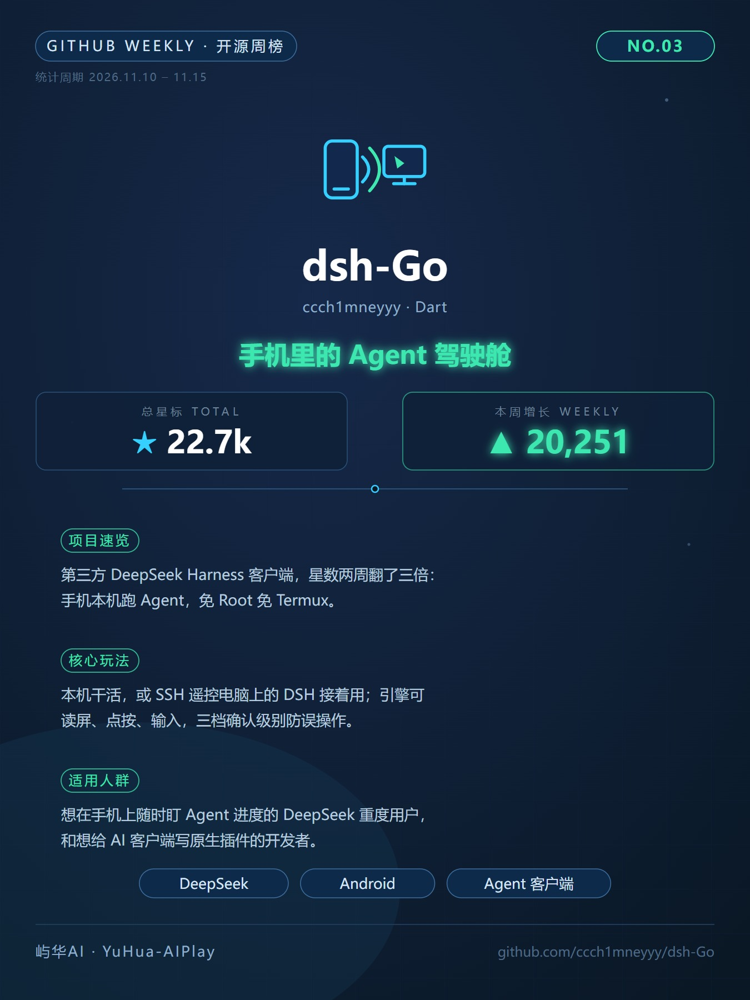
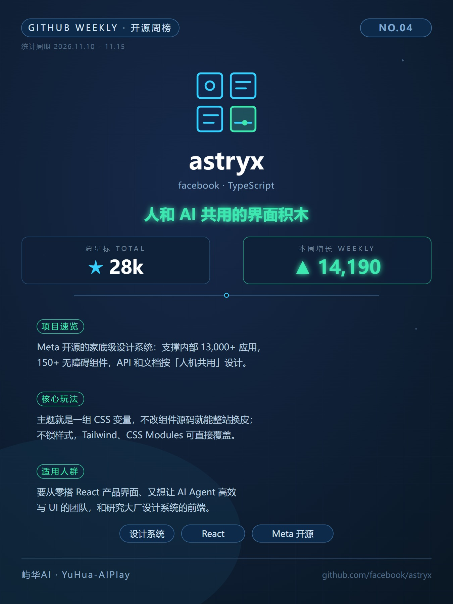
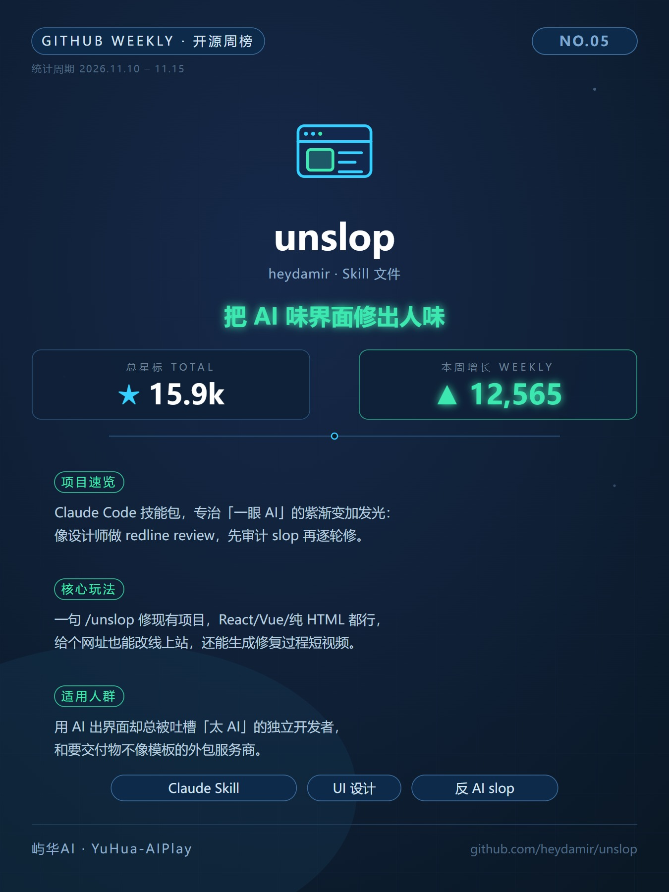
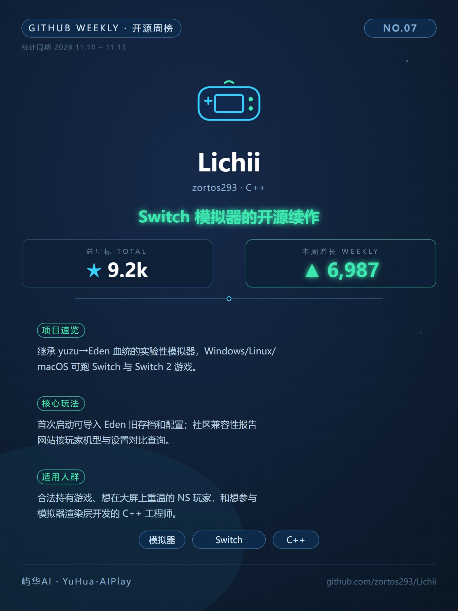
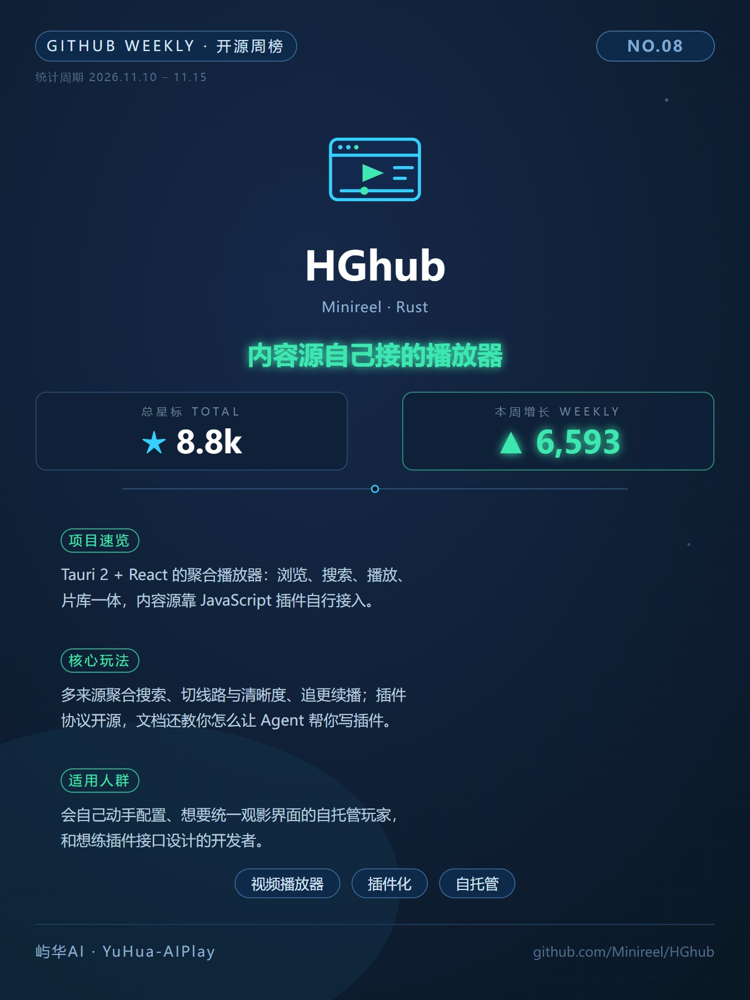

本周涨星榜出了件新鲜事：**上周的 8 席，这周有 5 席原班人马继续霸榜。**

榜首 craft-anything 一周再涨 2.8 万星，dsh-Go 的星数两周翻了三倍。新面孔里最重的是 Meta——把内部跑了 8 年、支撑 1.3 万个应用的设计系统 astryx 直接开源了。

9 张图看完这一周。

---

聊聊：这 5 个老面孔里，有没有你上周就 star 过的？这周你还会继续追，还是已经「收藏吃灰」了？评论区报个数。

下一篇继续拆周榜宝藏项目，关注不迷路。这里是屿华 AI，零基础玩转科技工具。
