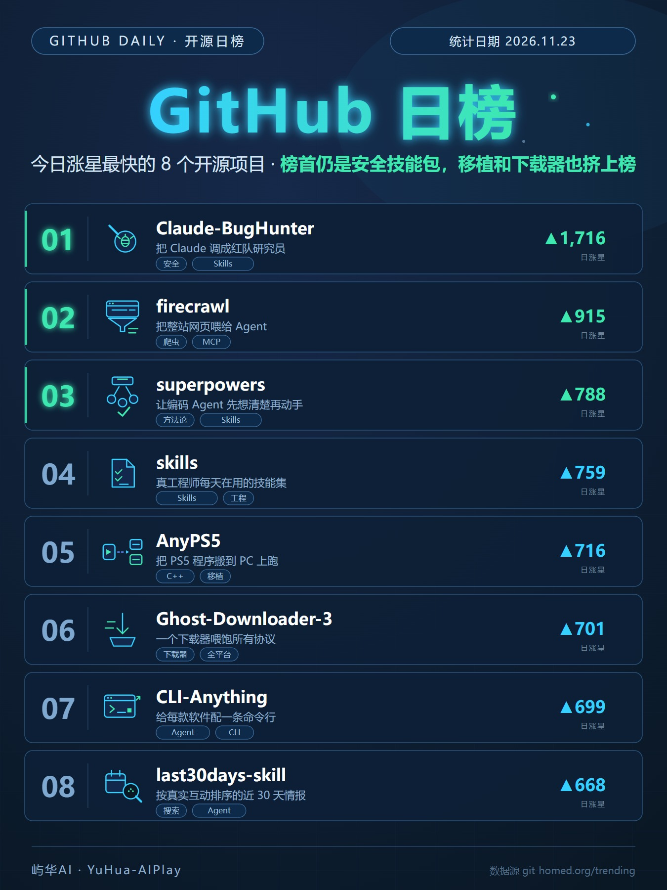

<!-- 数据口径：滚动 24 小时，截至 2026-11-23 06:48 UTC，来源 https://git-homed.org/trending -->

今天的榜不再清一色 Agent：除了技能包和网页爬虫，PS5 移植、全能下载器、Agent 原生 CLI 也都挤进了前八。

榜首 Claude-BugHunter 日涨 1,716 星；firecrawl 以 915 星排第二，superpowers 和 mattpocock/skills 继续稳在前四。

---

聊聊：今天这 8 个项目，有你想马上试的吗？

每天一张日榜，关注不迷路。这里是屿华 AI，零基础玩转科技工具。
