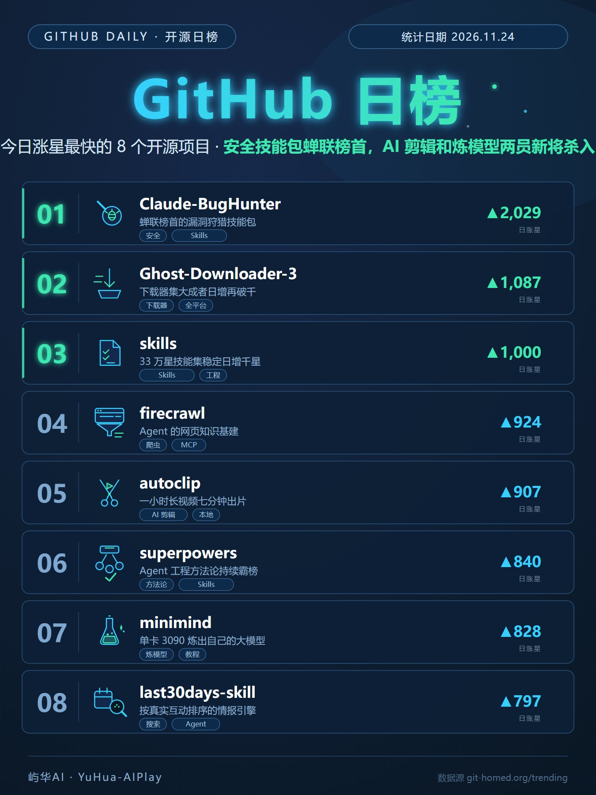
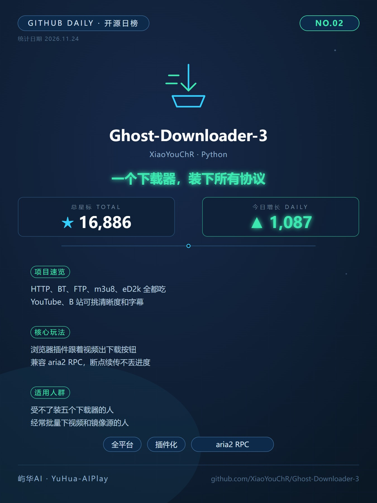
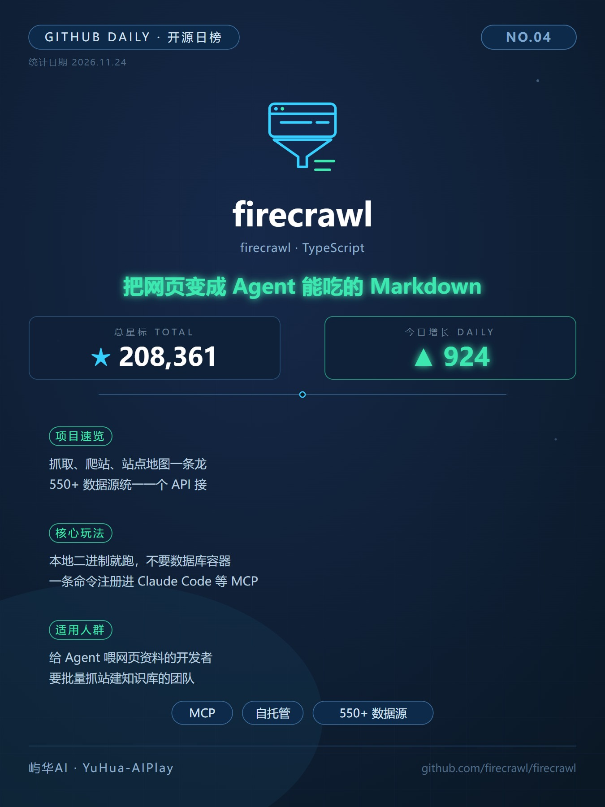

<!-- 数据口径：滚动 24 小时，截至 2026-11-24 10:58 UTC，来源 https://git-homed.org/trending -->

今天的榜 Skills 生态继续霸屏：前十里六个 Agent 技能类项目，安全包 Claude-BugHunter 蝉联榜首，日涨 2,029 星。

两员新将值得看：本地 AI 剪辑 AutoClip 一条链接出片，一小时视频七分钟剪完；MiniMind 教你单卡 3090、两小时从 0 炼出自己的大模型。

---

聊聊：AutoClip 和 MiniMind 这两个新面孔，有你今天就想装的吗？

每天一张日榜，关注不迷路。这里是屿华 AI，零基础玩转科技工具。
