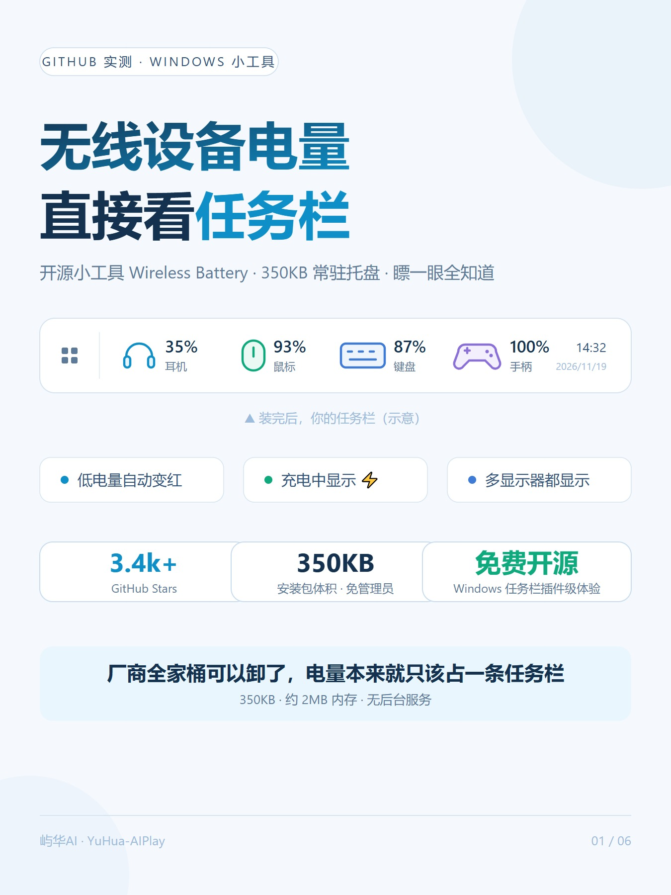
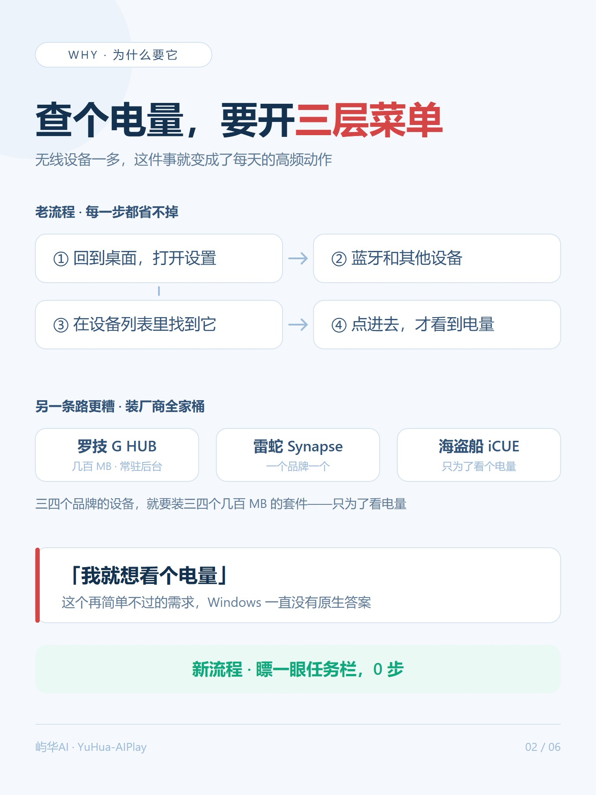
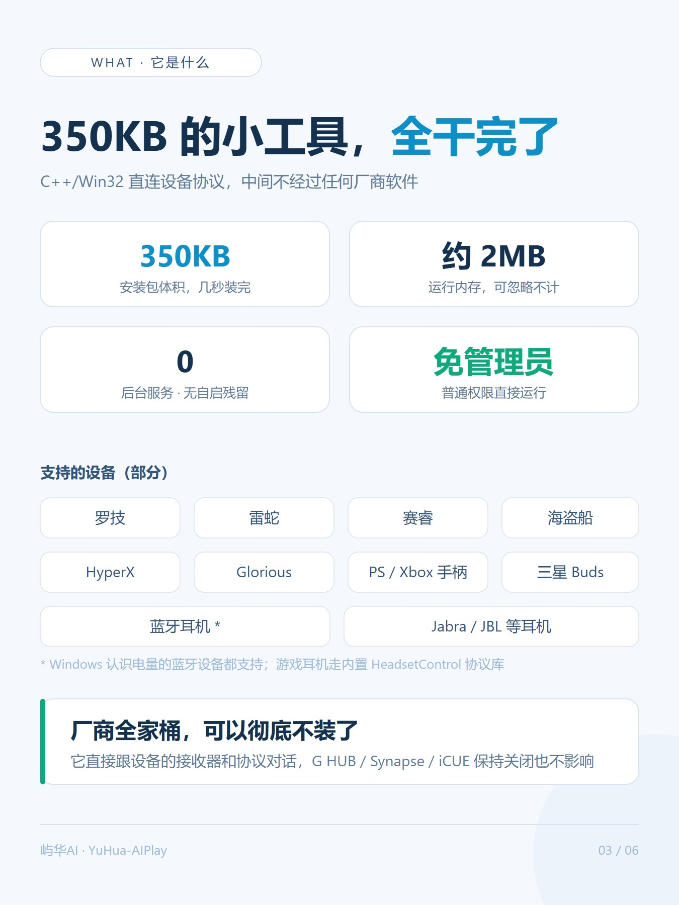
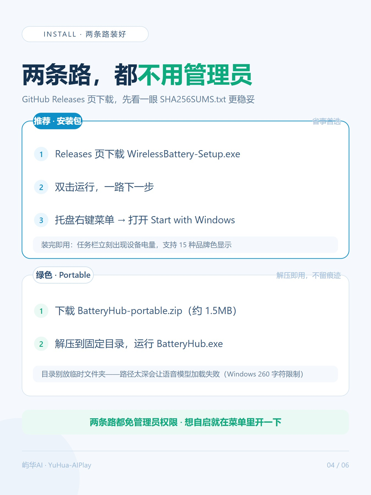
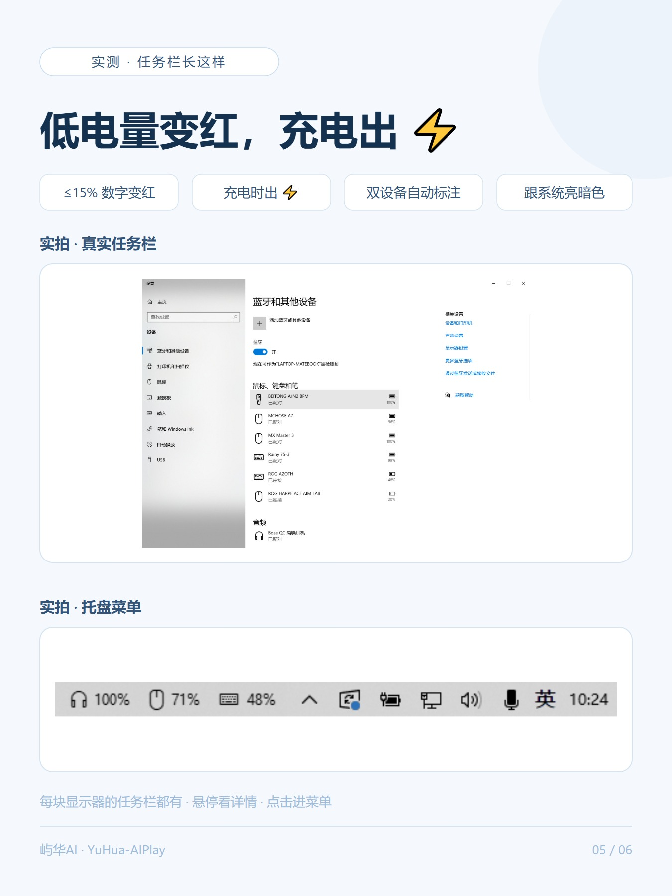
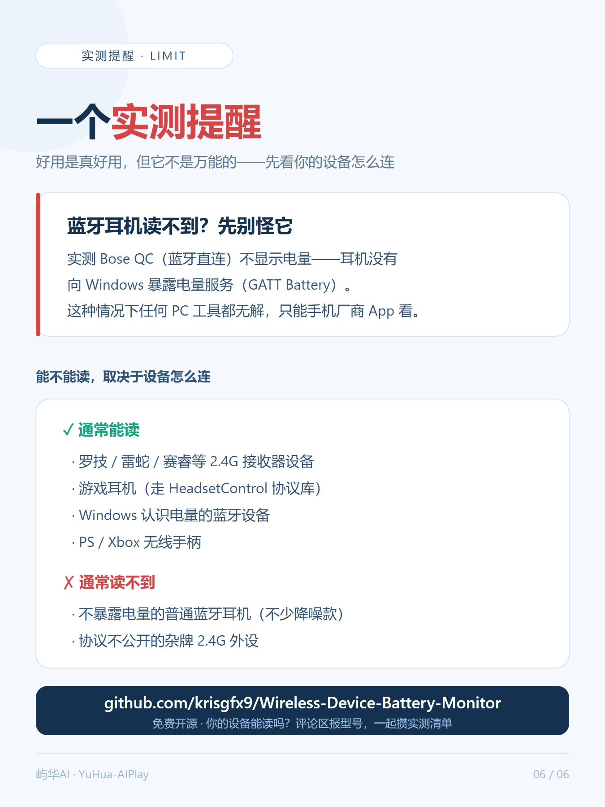

家里无线设备一多，查电量就成了高频动作：打开设置 → 蓝牙和其他设备 → 逐个点进去看，一步都省不了。

后来在 GitHub 上刷到一个 3000 多星的小工具——Wireless Battery，350KB，装完后所有无线设备的电量直接常驻任务栏：🎧 耳机、🖱 鼠标、⌨ 键盘、🎮 手柄，一眼全看完。

它解决的就是这么件小事：**电量查看从「开三层菜单」变成「瞟一眼任务栏」**。罗技、雷蛇、赛睿、海盗船、HyperX 这些牌子的无线设备，还有 Windows 认识电量的蓝牙设备，都支持。关键是厂商全家桶（G HUB、Synapse、iCUE）可以彻底不装了。

工具本身很小：C++/Win32 写的，350KB、约 2MB 内存、没有后台服务，也不用管理员权限。别看个头小，支持的设备列表相当长——手柄（PS/Xbox）、三星 Buds、各种蓝牙耳机都在列。

安装两条路：官网 Release 下载 Setup 下一步装完，或者下 portable 包解压即用。开机自启在托盘菜单里一键打开。

装完长这样：低电量数字变红（≤15%）、充电时出 ⚡、同一类设备有两个会自动加标注、还跟着系统亮暗色走。多显示器的话每块屏的任务栏都有。

一个实测提醒：我的 Bose 蓝牙耳机它读不到。原因是耳机没有向 Windows 暴露电量服务，这种情况任何 PC 工具都无解——2.4G 接收器的游戏耳机（罗技/雷蛇/赛睿那类）才是它的主场。

项目地址：github.com/krisgfx9/Wireless-Device-Battery-Monitor

你的无线设备能被它认出来吗？评论区报个型号，攒一份「能读 / 不能读」实测清单。
