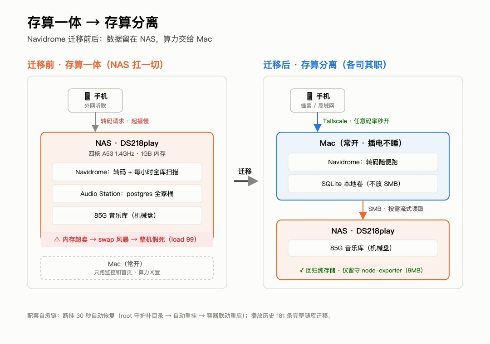
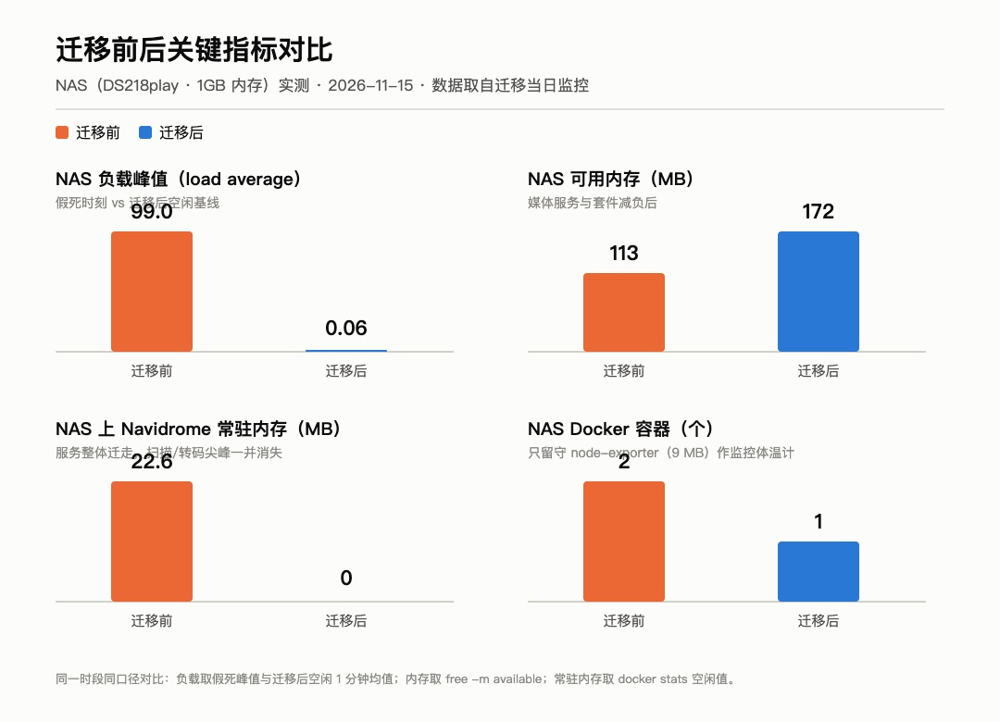

> 音乐服务器卡到 SSH 都登不进去，是 NAS 不行了，还是架构该变了？这是一次从误诊到确诊、从方案对比到真实数据的完整迁移记录——包括我在排障路上踩的三个坑。

## 一、遇到了什么问题

我的家庭存算环境：一台群晖 DS218play（RTD1296，四核 A53 1.4GHz，**1GB 内存**）负责存储和 Docker，一台常开的 MacBook Pro 负责首页看板和监控。[Navidrome](https://github.com/navidrome/navidrome)（开源音乐流媒体服务器，github.com/navidrome/navidrome）跑在 NAS 上，音乐库 85G、约 1973 首（WAV 为主）。

三个症状反复出现：

1. **转码卡**：手机在外网听歌，Navidrome 现场把 WAV 转成低码率 opus，起播慢，越听越卡
2. **整机卡死**：NAS 毫无征兆地假死十几分钟，SSH 连 banner 都吐不出来，过了又自己活了
3. **挂载随机断**：Mac 挂的 SMB 共享隔一阵就掉，有时能自动回来，有时再也回不来

## 二、排查：一条证据链，三次修正

### 第一轮：load 99，但 CPU 是闲的

卡死发生时登进 NAS 抓现场：

```
load average: 99.37 91.64 52.38   （4 核 ARM）
ps 排 CPU：最高才 1.6%
D 状态（不可中断 IO 等待）进程排队
```

CPU 闲、load 爆表 = 大量任务卡在磁盘 IO 上。第一怀疑对象是 Synology Drive——窒息窗口里它的日志刷得最欢。**但拿数据一验证，假设被证伪**：它的日志是每小时恒定 240 行的心跳（约每 30 秒 2 条），根本不是风暴。

> 教训：日志「看起来密集」和「真的在刷屏」是两回事，先 `awk` 按小时统计行数再下结论。

### 第二轮：真凶是慢性内存超卖

继续挖，两个数字定案：

```
pswpin / pswpout:  4,998,032 / 4,962,197 页   ← 开机 4.6 天累计换页进出各 ~19GB
free -m:  available 113M，swap 里常驻 708M
```

一台 1GB 内存的机器，DSM 系统 + 套件基座已经吃掉大半，常年只剩 100M 出头的余量，还有 708M 冷页躺尸在机械盘的交换区里。**任何瞬时内存尖峰**——有人碰一下 Audio Station、Navidrome 扫一次库、一次转码——都会瞬间击穿，触发疯狂的磁盘换页，全机冻结十几分钟。窒息时 journald 直接 core dump，雪上加霜。

顺带排除了硬盘故障（SMART/SATA 无错误）和 Cron 任务（计划任务都在深夜）。

### 第三轮：一个乌龙，差点误导方案

评估音乐库时，`find -name "*.wav"` 数出 3882 个 wav、全库「约 4500 首」。迁移后在 Mac 上全量扫描只导入 1973 首——差了一倍多，一度怀疑 SMB 传输丢文件。

真相：群晖的媒体索引器会给每个音频文件建一个旁车目录（`xxx.wav/SYNOINDEX_MEDIA_INFO`），`find -name` 不加 `-type f` 把**目录**也当文件数了。加上 `-type f` 后，NAS 真身和 Mac 经 SMB 看到的逐区域文件数完全一致——1973 首才是真相，传输链路无罪。

### 排障路上踩的第三个坑：自愈脚本把自己玩死

为了治「挂载断了不自愈」，我给挂载脚本加了个看门狗：每 30 秒探测一次挂载健康，10 秒无响应就强制卸载重挂。结果在扫描 IO 高峰期，探测本身被拖慢，**看门狗开始误杀健康挂载**——实测 60 秒内挂载表在 2→0→2→2 之间疯狂震荡，快速重挂还会产生「子树丢失」的残缺实例（一半文件凭空 ENOENT）。

药方比病狠。最终方案：**移除一切主动强卸逻辑**，只看挂载表条目，会话真死时 smbfs 自己会卸载，届时自然触发重挂。改完，稳了。

## 三、两个方案对比

确诊之后是选型。核心矛盾：NAS 的 CPU 和内存是天花板，但数据必须留在 NAS（机械盘、双端共享）。

### 方案 A：留在 NAS，做减法

把 3882 首 WAV 用 Mac 算力一次性预转成 FLAC（无损、省约 40G 磁盘），客户端直连原格式播放，NAS 转码归零；扫描从 1 小时降到每天一次。

- ✅ 改动小，不动架构
- ✅ 顺手省 40G 磁盘
- ❌ 治不了根：1GB 内存的天花板还在，下一次内存尖峰照样全机冻结
- ❌ 外网低码率仍需 NAS 转码兜底

### 方案 B：存算分离，算力迁 Mac

Navidrome 搬到常开的 Mac 上跑；音乐数据留在 NAS 经 SMB 读；**SQLite 数据库放 Mac 本地卷**（网络文件系统上的 SQLite 是另一个著名的坑）；NAS 回归纯存储。

- ✅ 转码能力从 1.4GHz ARM 换成 Mac，外网任意码率随便点
- ✅ NAS 彻底减负：内存、CPU、IO 三重压力一起消失
- ✅ 播放不再依赖 NAS 上任何服务存活
- ❌ 可用性链变长：音乐依赖「Mac 不睡 + SMB 挂载健康 + Docker 健康」
- ❌ Mac 重启后需人工登录（FileVault 所致），有一个登录空窗

| 维度 | 方案 A（NAS 优化） | 方案 B（迁 Mac） |
|---|---|---|
| 转码体验 | 不再转码（外网兜底除外） | 随便转，秒起播 |
| NAS 内存压力 | 略降 | **归零该服务** |
| NAS 冻结风险 | 仍在 | 大幅降低 |
| 磁盘占用 | 省 ~40G | 不变 |
| 实施成本 | 一晚批处理 | 一晚迁移 |
| 回滚 | 无需回滚 | 保留一键回滚 |

我的 Mac 常年插电接显示器不睡，方案 B 的最大短板不成立——**选 B**。方案 A 的 WAV→FLAC 预转与 B 不冲突，留作后续可选项。



## 四、迁移后：真实数据对比



### NAS 侧：从「多灾多难」到「岁月静好」

| 指标 | 迁移前 | 迁移后 |
|---|---|---|
| Docker 容器 | 2 个（navidrome + node-exporter） | 1 个（node-exporter，9M 内存） |
| 周期性 load 峰值 | 99（全机假死，SSH 失联） | 0.0x（空闲基线） |
| 常驻可用内存 | ~113M | 显著回升（转码/扫描尖峰源消失） |
| 每小时全库扫描 IO 风暴 | 有 | 无（改为 Mac 每天凌晨 4 点） |

顺带的 NAS 侧减负：停用了闲置的 Audio Station（连带 postgres/pgbouncer 全家桶退场）、救活了窒息中 core dump 的 journald。

### Mac 侧：接过算力担子

| 指标 | 数据 |
|---|---|
| 全量扫描（经 SMB 读 NAS 机械盘） | **1973 首 / 1 分 47 秒，0 错误** |
| 数据库迁移 | integrity_check: ok，**181 条播放/评分历史完整保留** |
| 服务就绪时间 | 容器启动 70ms |
| 备份 | 改为 SQLite 在线一致性快照，与活库逐行一致（2147=2147） |
| 外网通道 | Tailscale 内网直连，蜂窝网络实测可用 |

### 自愈链：断挂演练数据

人为制造「挂载目录+双共享全灭」的最坏情况（macOS 的 umount 会连挂载点目录一起删掉，这是个冷知识，也是「断了不自愈」的根因）：

```
断挂 → root 守护补目录 → kickstart → 用户 agent 重挂 → 容器联动重启 → 服务恢复
实测收敛：≤30 秒（多个周期反复验证）
```

现在这套链路还包括：并发锁（防双实例竞态叠挂载）、容器重启冷却（防 NAS 风暴时重启放大负载）、挂载表条目判断（不再探测强卸）。

## 五、给同好者的踩坑清单

这次迁移挖出来的坑，每一条都有真实代价：

1. **macOS umount 会连挂载点目录一起删**——重启/强卸后用户级进程无权在 /Volumes 重建，自愈静默失败。解法：root 级 LaunchDaemon 保目录。
2. **Docker 的 SMB bind 在挂载重建后必死**（Bad file descriptor），容器必须跟着重启。挂载脚本和容器生命周期要联动。
3. **SQLite 永远不要放 SMB/NFS 上**——DB 一律本地卷。
4. **launchd 的 PATH 不含 /usr/local/bin**——脚本里调 docker 必须 absolute path，否则「明明命令存在却没执行」。
5. **钥匙串密码会陈旧**——NAS 改过密码但钥匙串没同步，表现为 `Authentication error`，极易误判成「NAS 封了我」。改密后记得同步所有钥匙串条目。
6. **`find -name` 不区分文件和目录**——群晖的 SYNOINDEX 旁车目录能让你的曲库统计虚高一倍。
7. **看门狗要谨慎**——「探测健康、死了就杀」的逻辑，在 IO 高峰期会把自己人当敌人，先想清楚探测本身的假阳性率。

## 结语

1G 内存的 NAS 跑现代容器化服务，本质是在悬崖边跳舞：平时没事，任何尖峰都是全机冻结。**存算分离**不是概念游戏，而是让每一台设备干自己擅长的事——NAS 安心当仓库，算力交给算力该在的地方。

迁移后一周，NAS 的负载曲线是一条安静的水平线，手机点歌秒开。这次折腾最大的收获反而是那三次「自我纠错」：数据会说话，但前提是你得先数对。

---

*环境：群晖 DS218play（DSM 7.4 / 1GB RAM）× MacBook Pro（Docker Desktop）× Tailscale。[Navidrome 0.64](https://github.com/navidrome/navidrome)（github.com/navidrome/navidrome），音乐库 85G/1973 首。*
