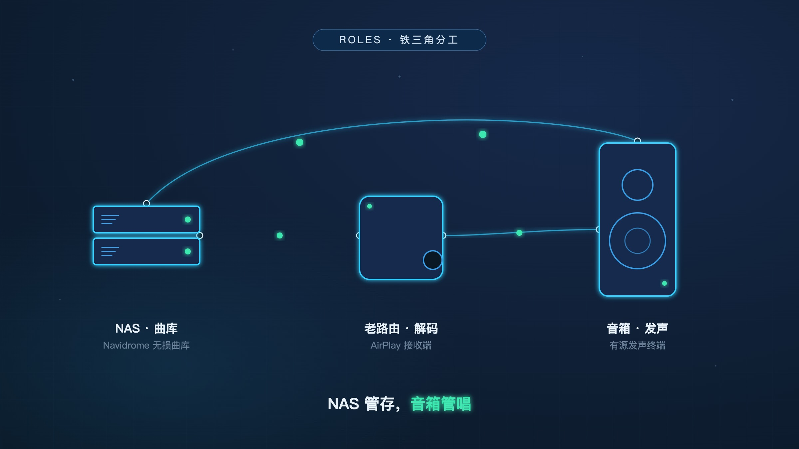
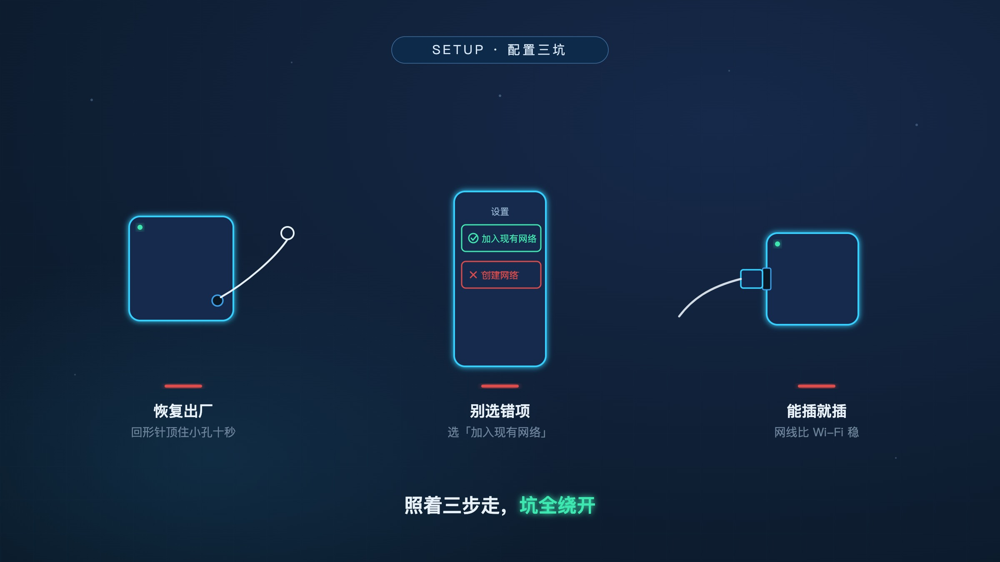
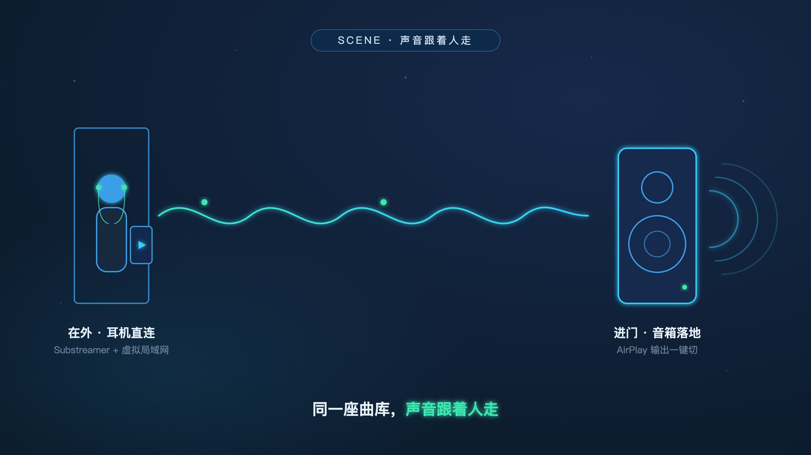

一套无线 Hi-Fi 的最低成本是多少？我的答案：三件吃灰的老设备，加一根二十块的音频线。

上一篇聊完「人在外面无感连回家里」，评论区问得最多的是：曲库在 NAS 里，声音呢？总不能天天插耳机吧。

今天就补上这块拼图：让家里的书架，变成一对接着 NAS 曲库的无线音箱。手机只是遥控器——人走开，音乐不断。

## 先泼盆冷水：老 NAS 插不了声卡

搜「NAS 接音箱」，老教程清一色教你买 USB 声卡插上去。省下这笔钱吧：新版系统在底层删掉了 USB 音频驱动，插上去连个响都听不到。

背后的道理，是这个系列一直在讲的**算力归属**：NAS 天生管「存」，不管「唱」。曲库放它那儿没问题，发声要交给专职选手——上上篇再就业的那台老 Mac 是一个思路，今天的主角是另一个吃灰多年的小东西。

## 三件老设备，一个铁三角

这套方案的角色分工非常清楚：

- **老 NAS**：曲库。Navidrome 音乐服务器一直在上面跑着，无损专辑全躺在硬盘里；
- **苹果老路由**：解码器。就是那个带耳机孔的小方盒（插线款），停产多年，二手白菜价，肚子里还藏着一颗素质不错的解码芯片；
- **有源音箱**：发声。带红白莲花头输入的那种就行，蓝牙是它的备选项，不是主力。

关键在中间那位：它支持的 AirPlay 协议，让家里几乎所有设备都能把声音「投」过去——苹果设备原生支持，不少第三方 App 也内置了投送按钮。

一根线把它们串起来：音频线一头插老路由的耳机孔，红白两头插音箱背面的线路输入，插完即通电，物理部分就结束了。

## 配置半小时，注意三个坑

**第一坑：别让它「创建网络」。** 回形针顶住背面小孔十秒恢复出厂，配置时一定选「加入现有网络」——手滑选成创建或扩展，家里就多出一个副路由，Wi-Fi 干扰能让你排查到怀疑人生。

**第二坑：名字要起给人看的。** 用官方那个配置工具开启隔空播放，给设备起个一眼认出的名字，比如「书房音箱」。以后全家抢 DJ 位，全靠认名字。

**第三坑：能插网线就插网线。** 小方盒要是放在路由器附近，直接网线接上，串流稳定性上一个台阶；离得远就走 Wi-Fi，也够用。

最后把音箱切到对应的有线输入档，指示灯一变，链路全通。

## 日常使用：手机只是遥控器

晚上做饭，掏出手机，打开 Substreamer 连上家里的 Navidrome，控制中心把输出一切——声音从书架传来，手机揣兜里熄屏照放。

Substreamer 走 Subsonic 协议直连 Navidrome，歌单和播放记录都存在服务端——换台手机登录，一切照旧，这是网盘听歌永远给不了的体面。

谁连着家里 Wi-Fi，谁就能推歌。家人抢 DJ 位，可比抢电视遥控器文明多了。

上一篇的虚拟局域网在这里也有戏：人在外面，Substreamer 直连家里 Navidrome；进家门，输出一切到音箱——同一个 App，同一座曲库，声音跟着人走。

## 音量避坑：三级音量，只动最后一级

这套链路的音量有三层：App 音量、解码端音量、音箱物理音量。

结论先行：**前两层拉满，日常只动音箱遥控**。这样动态范围最好，也不会出现「软件音量一半、音箱一半」的闷声。深夜例外——音箱拧小，动态让位给邻里和睦。

## 曲库怎么补货

音箱响了，下一个问题自然来了：歌从哪来。两条路：

**路 A（简单直接）**：电脑把 NAS 的音乐文件夹挂载成本地盘，下载工具的保存目录直接指过去——下完即入库，零搬运。顺手用标签工具补齐专辑封面和歌曲信息，不然手机里一片空白方块，很影响心情。

**路 B（全自动挂机）**：网盘转存 + NAS 端同步任务自动拉取。涉及第三方工具，来源和安全性自己把好关——这条路值得单开一篇，下一篇就拆它。

还有个顺手的细节：Navidrome 每小时自动扫一次库。新专辑丢进文件夹就不用管了，最多一小时，Substreamer 里刷新一下，就能点播。

## 屿华的极客小结

1. **别给老 NAS 买声卡**：新系统删了驱动，钱省下来买根好线；
2. **铁三角分工**：NAS 管存、老路由管解码、音箱管发声，谁也别抢谁的活；
3. **配置只记三件事**：加入现有网络、起个好名字、能插网线就插网线；
4. **音量只动最后一级**：前面拉满，动态最好。

一套无线 Hi-Fi 的门槛，从来不是预算，而是舍不舍得把吃灰的盒子翻出来。数字岛屿今天又补上一块拼图：声音，落地了。

---

**评论区聊聊**：你家有哪些「退役多年其实还能战」的设备？后来都翻出来干了什么？（当解码器、软路由、电子相框的都欢迎报个到）

我是屿华，下一篇就顺着路 B 展开：怎么让无损音乐自动「喂」进 NAS。关注「屿华AI」（YuHua-AIPlay），零基础玩转科技工具，咱们下篇见。
