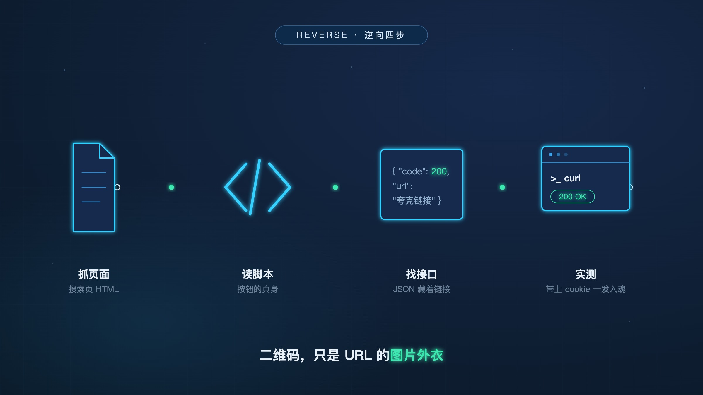
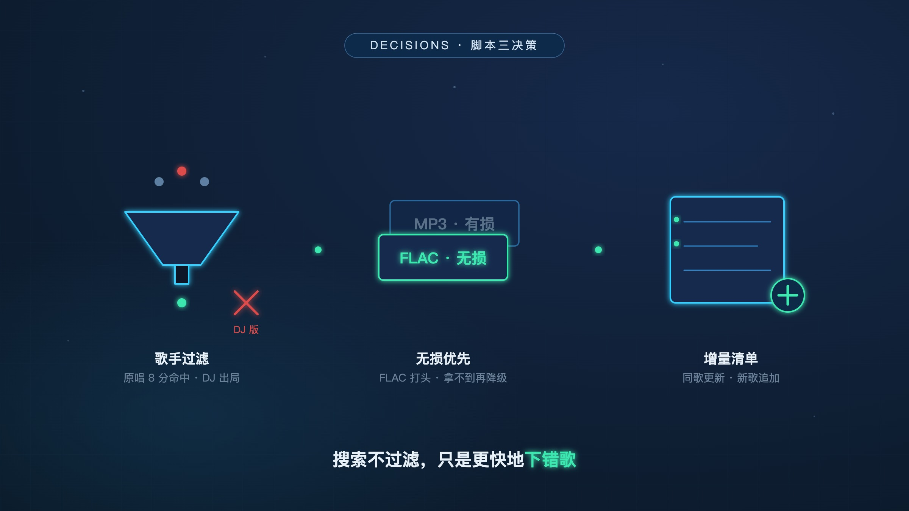
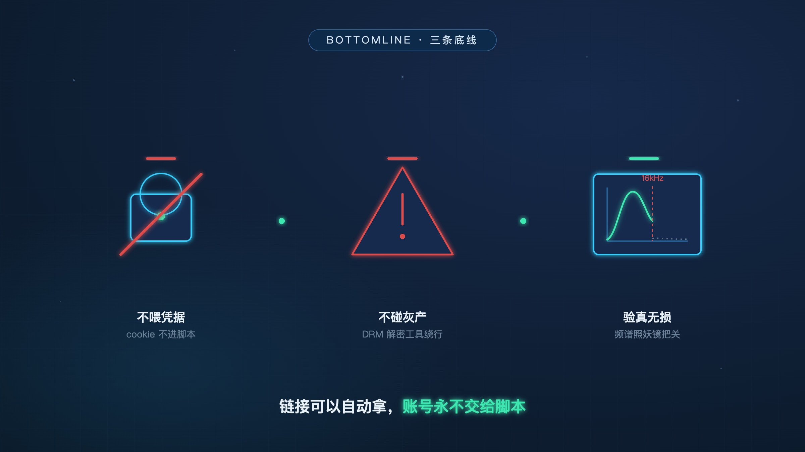
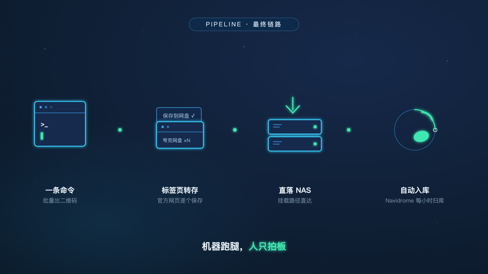

上一篇聊完「声音跟着人走」，文末留了个尾巴：曲库怎么补货。路 A（下载目录直指 NAS）三句话讲完了，今天来拆承诺过的路 B——结果剧本跑偏：**AI 顺手把网站逆向了，说好的挂机工具根本没出场。**

## 先看手动流程有多蠢

我有一个 17 首歌的清单，想把它们补进 NAS 曲库。每首歌要走四步：

1. 打开 5song.xyz，搜歌名，肉眼从一堆同名结果里认出原唱——搜「晴天」能出 163 条，DJ 版、伴奏版、翻唱版全在里面凑热闹；
2. 点「夸克无损下载」，等网页弹二维码；
3. 掏手机，扫码，转存到网盘；
4. 电脑登夸克网盘客户端，下载到 NAS 挂载路径。

四步乘以 17 首，中间还夹着「下到一半发现是 DJ 版」的返工。这种重复劳动，就该交给机器。

## AI 的侦探四步

把流程丢给 AI，它没急着写代码，而是先当了一次侦探。这个过程值得复述，因为它就是一套通用的「网页接口逆向方法论」：

**第一步，抓页面。** 命令行把搜索页的 HTML 拉下来，肉眼可辨的结构机器也能解析：每条结果就是「链接 + 标题 + 歌手」三个字段。

**第二步，找下载按钮的真身。** 歌曲详情页里根本没有下载链接——按钮是个空壳，等着 JavaScript 去填。顺着页面里的脚本读下去，找到了真相：点击按钮时，网页会向站点的后端接口发一个请求，返回一个 JSON，里面装着真正的网盘链接。

**第三步，关键洞察：二维码是画出来的。** 脚本里写得明明白白——网页拿到链接后，用一个前端二维码库现场把它画成图。**二维码从来不是什么凭证，它只是 URL 的一件图片外衣。** 这意味着：只要拿到链接，我在本地生成的二维码，和网站弹出来的那个一模一样。

**第四步，实测接口。** 带上会话 cookie，照着脚本里的参数发一次请求——接口乖乖返回了 `{"code":200, "url":"..."}`。全链路打通，不需要浏览器，不需要掏手机。

## 脚本要做对的三件事

逆向只是拿到了零件，组装时的三个决策才是工具好不好用的分水岭：

**一是搜索必须按歌手过滤。** 「晴天 + 周杰伦」一起打分：歌手对得上加分，标题里带 DJ、伴奏、铃声的降权。实测两首测试曲都 8 分命中原唱——这一步不过关，自动化只是更快地下错歌。

**二是格式有优先级。** 同一首歌有无损和有损两个渠道时，永远先拿无损，拿不到再降级。

**三是清单要增量累积。** 这里踩了个真实的坑：测试时跑了一首，发现链接清单被整个重写成只剩这一首——脚本每次运行都覆盖旧文件。改成「同歌更新、新歌追加」，跨批次下载才不丢账。顺手加了总表二维码的重新拼装，也按目录全量重建，同一个道理。

最后再配一个十行的伴生脚本：把清单里所有网盘链接一次性开成浏览器标签页。转存这件事夸克网盘网页版就能干，逐个点「保存到网盘」就行——手机可以彻底不出场。

## 自动化的三条底线

这次的流程里，有三处我明确喊了停，值得单独写出来：

**不给脚本喂账号凭据。** 网盘转存理论上也能「全自动」——把登录 cookie 塞进脚本调私有接口就行。但这意味着凭据躺在一个随时会翻旧账的脚本里，而且非官方调用量一大，封的是整个账号，盘里其他东西一起陪葬。自动化的边界划在「拿链接」为止，转存留在官方页面人工点——每首五秒钟，买一个安心。

顺带交代一个「为什么没用更强的」：开源圈的命令行底层 glomatico/gamdl，直连 Apple Music 官方曲库拉 ALAC 无损，一条命令全程无人值守——论硬实力，全面碾压我这套土办法。但我没选它：工作前提是导出订阅账号的登录 cookie 喂给工具，正是第一条红线拦下的东西；而且它押上的是 Apple ID，真出事，陪葬的是 iCloud 全家桶。**不是工具不强，是它的入场券我不肯付。**

**不碰 DRM 剥离工具。** 网上流传的「会员歌曲解密下载」类工具一律不碰，那是另一个性质的问题。灰色聚合站自己已经够灰了，能少踩一脚是一脚。

**「自称无损」不算无损。** 聚合站的 FLAC 十有八九是从有损源转码的假无损——频谱图上一看便知，16kHz 以上一片空白。所以入库前要过一道频谱检测，这事机器比人眼靠谱，留给下一站的自动化流水线。

## NAS 能不能全接管？

顺手回答一个自然延伸的问题：群晖的网盘同步能不能让 NAS 自己从网盘拉歌？

查了一圈：那套件原生不支持夸克，因为没有开放协议。社区标准玩法是在 NAS 的 Docker 里跑一个转接服务（挂网盘、转成 WebDAV 再喂给同步套件），技术上成立——直到撞上我给自己定的红线：**这台 1GB 内存的老 NAS，新增容器一律不超过 50M 内存**。转接服务空载就贴着线走，还有同步时的内存峰值，直接一票否决。

这又回到了这个系列一直在讲的**算力归属**：NAS 管存，重活交给 Mac。下载那一会儿 Mac 开着、夸克网盘客户端直下 NAS 挂载路径——文件直落硬盘，没有二次搬运。为省「开一会儿电脑」引入一个吃内存的常驻服务外加 cookie 定期过期的维护负担，这笔账怎么算都不划算。

## 现在的完整链路

    歌单文本 → 一条命令 → 二维码 + 链接清单
      → 浏览器批量开标签，逐个「保存到网盘」
      → 网盘客户端下载目录直指 NAS 挂载路径
      → Navidrome 每小时自动扫库，手机刷新即可点播

17 首歌的实际操作量：跑一次命令，开一批标签页点一轮保存，客户端下一晚上。人参与的只有「点保存」和偶尔确认一下低置信度的匹配。

## 屿华的极客小结

1. **二维码是 URL 的图片外衣**：看清「扫码 = 传网址」，一大类「自动化」难题当场消失；
2. **逆向四步**：抓页面 → 读脚本 → 找接口 → curl 实测，AI 干这个又快又稳，方法比工具值钱；
3. **搜索必须带过滤**：没有歌手过滤的批量下载，只是更快地下错歌；
4. **清单要增量累积**：覆盖式写入是批量工具的隐形地雷，测试时必查；
5. **自动化的边界是凭据**：链接可以自动拿，账号永远不交给脚本；
6. **算力归属定方案**：内存红线一票否决了「NAS 全接管」，老设备各司其职才是长久之计。

机器跑腿，人只拍板——曲库这块拼图，今天补齐。

---

**评论区聊聊**：你为省事干过最硬核的一次操作是什么——写过什么脚本、逆向过什么网站、还是搭过什么流水线？

我是屿华，下一篇给无损音乐验真：频谱当照妖镜，假 FLAC 原形毕露，入库归位全自动。关注「屿华AI」（YuHua-AIPlay），零基础玩转科技工具，咱们下篇见。
