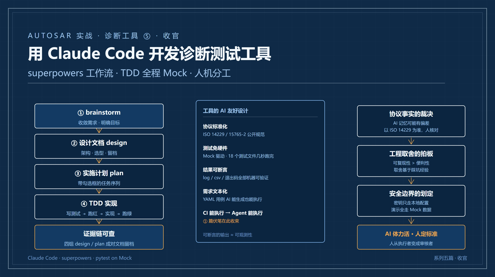
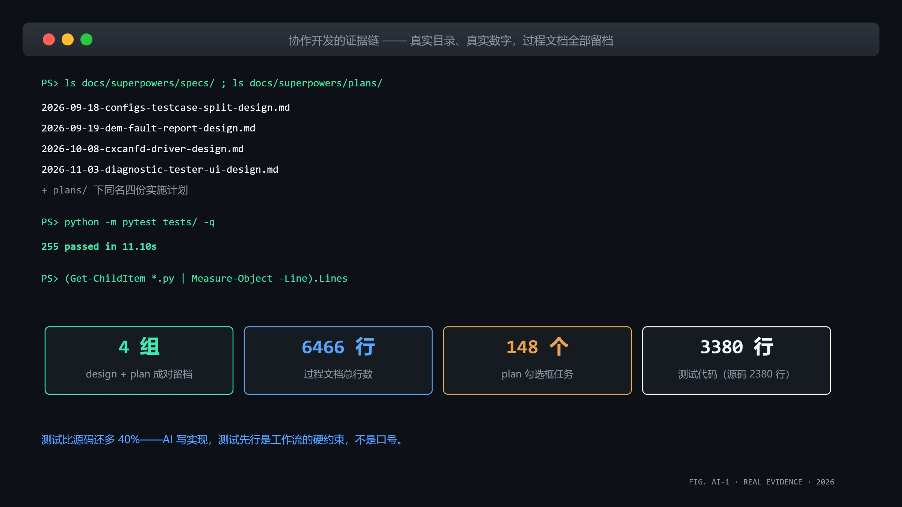
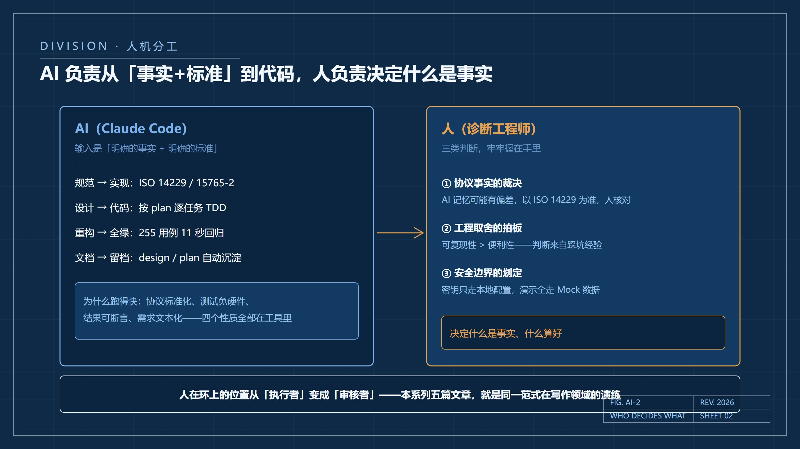

系列写到这里，该交底了：前面四篇介绍的这个诊断测试工具，本身就是**人机协作开发的产物**——主体代码由 Claude Code 完成，工程师的角色是定方向、定协议事实、做工程判断。第①篇埋过一个伏笔：「当诊断流程变成结构化文本，CI 能执行，AI Agent 同样能执行」。收官篇把镜头反过来，讲讲这个工具是怎么被 AI 开发出来的。

## 证据链：工作流不是理念，是目录

协作开发最怕事后讲故事。这个项目的好处是**过程文档全部留档**，工具仓库的 docs/superpowers/ 目录下躺着四组成对的文档：

- configs-testcase-split——配置与用例拆分
- dem-fault-report——故障报告子命令
- cxcanfd-driver——创芯卡驱动接入
- diagnostic-tester-ui——PyQt 图形界面

每组两份：**design（设计文档）**讲目标、架构、技术选型；**plan（实施计划）**把设计拆成带勾选框的任务序列，每个任务都是「写测试 → 跑红 → 实现 → 跑绿」的完整循环。拿 dem 子命令那组看：design 文档定下「纯函数解析 + map 表放配置目录」的架构，plan 文档开头就给实现者列出「现有代码要点」——CLI 入口怎么挂子命令、ConfigError 怎么走退出码 2、mock driver 怎么注入响应——连 ISO 14229 的 DTC 状态位八位定义都直接贴在文档里，实现者（无论人还是 AI）不需要自己再去查规范。

这套流程来自 Claude Code 的 superpowers 工作流：**brainstorm 收敛需求 → 写设计文档 → 拆实施计划 → 逐任务 TDD 实现**。四组文档对应工具演化的四个里程碑。证据链不止是「有文档」，数字也可以实测量化：

工具从千把行长到两千四百行的轨迹，在这些带时间戳的文档里清晰可查。

## 为什么这个工具特别适合 AI 开发

不是所有项目 AI 都能干好。回看这个工具，它恰好踩中了几个让 AI 发挥的关键性质：

**协议是标准化的。** ISO 14229、ISO 15765-2 都是公开规范，帧格式、状态机、超时语义都有明确定义——AI 训练语料里有大量相关内容，从规范到实现的翻译是它的强项。反例是那些「规范在某人脑子里」的项目，AI 每一步都要猜。

**测试是免硬件的。** 第①篇讲的 Mock 驱动在这里展现了第二重价值：AI 开发和测试全程不需要插卡、不需要 ECU。18 个测试文件、3380 行测试代码（比 2380 行的源码本体还多四成）——ISO-TP 拆包组包、流控超时、0x78 循环等待、流程判定与轮询、UI 会话管理——全部跑在 Mock 之上，255 个用例 11 秒跑完，AI 在本地就能完成「写测试、跑红、实现、跑绿」的闭环。**如果这个工具必须真硬件才能验证，AI 协作开发的迭代速度会掉一个量级。**

**结果可机器验证。** run.log 是格式化事件流、result.csv 是结构化表、退出码有明确约定——AI 改完代码，跑一遍用例、断言 CSV 某行是不是预期值，成没成不用人看界面猜。「可断言的输出」对 AI 的意义，等同于「可观测性」对运维的意义。

**需求是文本化的。** YAML 用例和配置本身就是结构化需求。改一个新功能，AI 拿到的输入是现成的 YAML 例子和预期的判定结果，而不是一段口头描述。

## 人的位置：判断在哪里

AI 干得多，不代表人没事干。复盘下来，人牢牢握在手里的是三类判断：

**协议事实的裁决。** AI 对规范的记忆可能有偏差（比如某个 NRC 的确切语义、SF 帧补齐的细节），「以 ISO 14229 为准」这件事需要人拿着规范核对。本系列每篇反复强调协议事实，源头在这里。

**工程取舍的拍板。** 「会话前置要不要自动切换」这种问题，AI 能列出两种方案的利弊，但「用例的可复现性优先于便利性」是工程师基于踩坑经验做的价值判断——它最终成了工具的一个刻意设计。哪些算法按结构归类、哪些细节值得配置化，同理。

**安全边界的划定。** 密钥材料只走本地配置、内部算法细节不进代码仓库的公开部分、演示一律走 Mock 数据——这些红线是人定的，AI 执行时也严格遵守（本系列文章的脱敏处理就是同一套纪律的延续）。

说白了，分工是：**AI 负责从「明确的事实 + 明确的标准」到代码的全部体力活，人负责决定什么是事实、什么算好。**

## 范式的迁移：从工具到方法

这篇其实讲了两层协作。第一层是「AI 开发诊断工具」——上面已经展开。第二层藏得深一点：**这个工具本身就是为「被 AI 使用」设计的**。YAML 用例 AI 能生成，CLI 退出码 AI 能编排，结构化日志 AI 能断言——诊断工程师 + AI 的下一站，就是工程师说「把这个 ECU 的读写 DID 用例跑一遍，FAIL 的分析给我」，剩下的事交给 Agent 编排。

工具、用例、报告全部是文本，人在环上的位置从「执行者」变成「审核者」。这不是遥远的畅想——本系列五篇文章的写作过程，就是同一个范式在另一个领域的完整演练。

## 写在最后

五篇收官。从四层架构到安全访问配置化，从用例工程到故障报告自动化，最后到人机协作开发本身——希望这套「轻量诊断测试管线」的完整拼图，能让某个被 CANoe 授权和手发 hex 折磨的同行少熬几个夜。

这个系列持续更新——每篇都从真实工程出发：协议事实以 ISO 14229 为准，设计决策讲清取舍，代码与配置思路都可以照着复现。

诊断测试的坑，先替你踩；工具设计的门道，陪你逐层拆。关注、收藏「屿华AI」，AUTOSAR 实战系列不迷路；转载请注明出处并保留链接。
