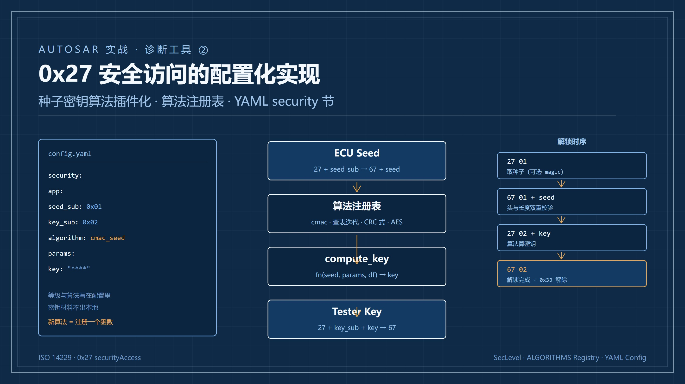
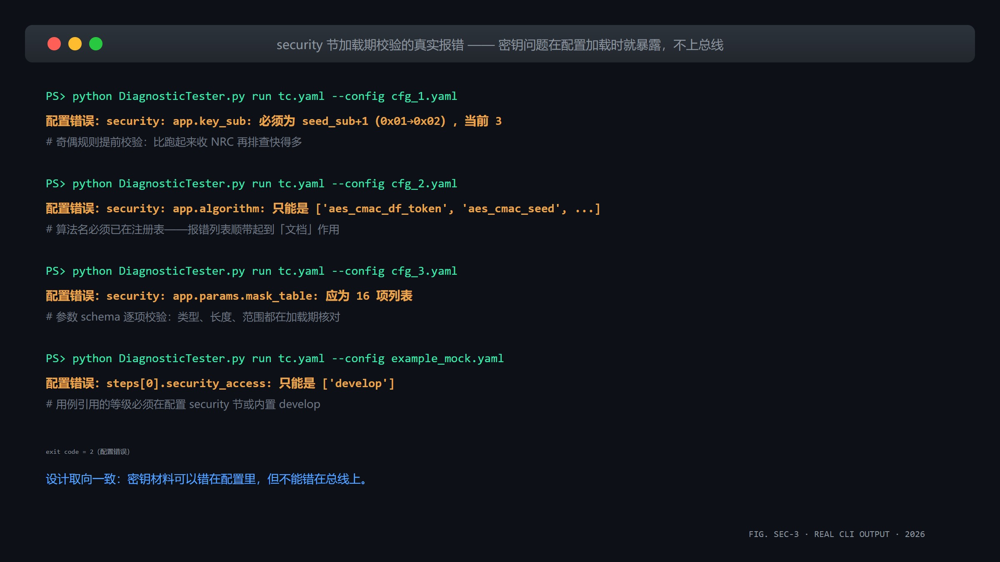
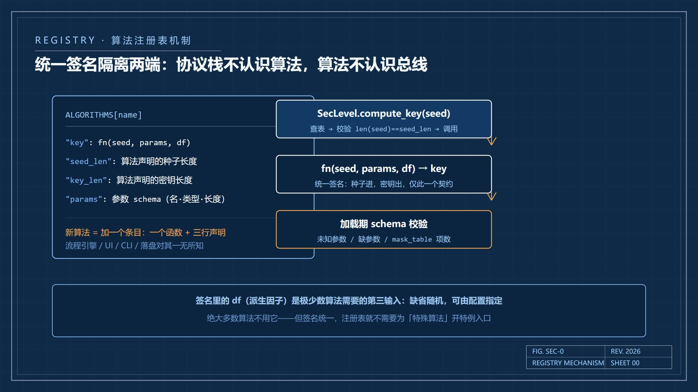
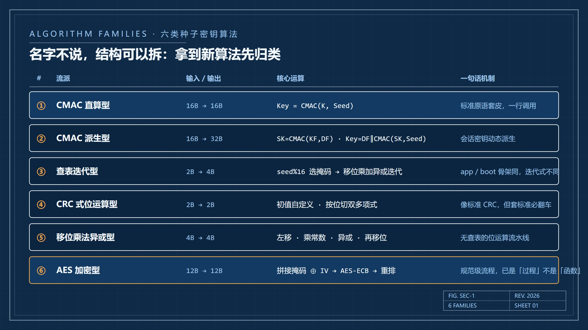
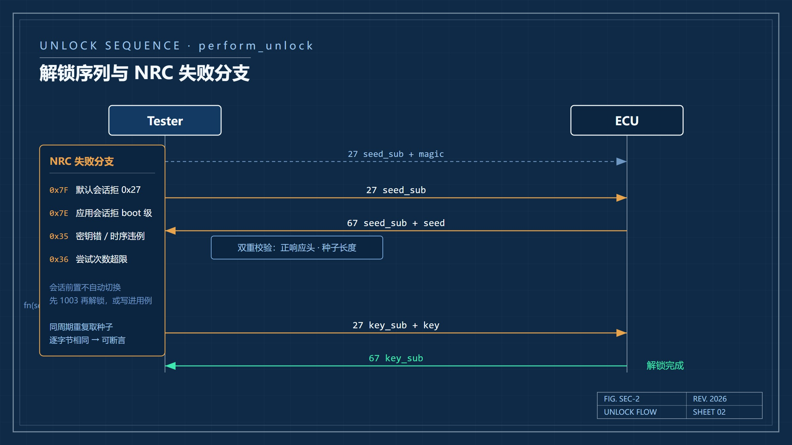

上一篇搭好了工具的四层架构：CAN 驱动、ISO-TP、UDS 会话、流程引擎。但真拿它去测一台 ECU，很快会撞上一堵墙——**0x27 安全访问**。不先解锁，写 DID、跑例程、刷固件，ECU 一律回你 NRC 0x33（securityAccessDenied）。



## 为什么解锁是最值得配置化的一件事

0x27 的协议机制本身不复杂（ISO 14229 讲得很清楚，本系列前置的 0x27 理论篇已拆过）：Tester 发 `27 + seed_sub` 取种子，ECU 回 `67 + seed_sub + seed`；Tester 用种子算出密钥，发 `27 + key_sub + key`；ECU 校验一致，回 `67 + key_sub`，解锁完成。

真正复杂的是**算法**。协议只规定了握手流程，密钥怎么从种子算出来，完全由 OEM 自定义——而每家 OEM、每个平台，甚至同一车型的 app 区和 boot 区，用的算法都不一样。工程上的现状是：

- **每个项目一份解锁脚本**。Python 的、CAPL 的、Excel 宏的，散落在各个项目的角落里，换台电脑就找不齐
- **算法和密钥焊死在代码里**。想换个等级、换个 ECU，得改代码重新发版
- **没有统一入口**。解锁不是独立能力，它要嵌进「进会话 → 解锁 → 干活」的流程里，脚本很难被测试用例直接调用

所以这个工具把 0x27 做成了**配置**：等级、子功能号、算法选择、密钥材料，全部写进项目的 YAML 配置；算法本体在代码里注册表化，**新增一个 OEM 算法 = 注册一个函数，不改任何现有代码**。上一篇用例示例里的 `security_access: app` 步骤，背后就是这套机制。

## 设计：一个等级就是一个 SecLevel

先定义数据结构。一个「安全等级」在工具里是一个不可变的数据类：

```python
@dataclass(frozen=True)
class SecLevel:
    name: str        # 等级名，如 app / boot，用例里按名引用
    seed_sub: int    # 取种子子功能号
    key_sub: int     # 发密钥子功能号，必须 = seed_sub + 1
    seed_len: int    # 种子长度，由算法决定
    key_len: int     # 密钥长度，由算法决定
    algorithm: str   # 算法名，指向注册表
    params: dict     # 算法参数（密钥材料、掩码表等），来自 YAML
```

几个设计决策值得展开：

**key_sub 必须等于 seed_sub + 1**，在构建时就校验。这不是协议要求（0x27 的奇偶规则是事实上的行业惯例），而是早点把配置错误挡在总线上——比跑起来收个 NRC 再排查快得多。种子/密钥长度也由算法声明，响应校验时逐字节比对。

这组校验不是纸面设计，下面是**真实运行**的报错输出（Mock 模式，免硬件可复现）：



**params 是个开放的 dict**。不同算法要的材料天差地别：有的要一把 AES 密钥，有的要一张 16 项的掩码表，有的什么都不用。注册表里每个算法声明自己的参数 schema，配置加载时按 schema 校验——未知字段、缺字段，错误信息直接指到 `security.app.params.key` 这一层。

**等级按名字组织**。配置里写 `app:`、`boot:`，用例和解锁命令都按名字引用，子功能号这些细节不外泄到用例层。

## 算法注册表：新增算法 = 注册一个函数

算法本体集中在一个注册表里，每个条目三样东西：密钥计算函数、种子/密钥长度、参数 schema。

```python
ALGORITHMS = {
    "cmac_seed": {
        "key": _key_cmac_seed,     # fn(seed, params, df) -> bytes
        "seed_len": 16, "key_len": 16,
        "params": {"key": "hex16"},  # 参数 schema
    },
    ...
}
```

密钥计算函数的签名是统一的：`fn(seed, params, df) -> bytes`。`seed` 是 ECU 给的种子，`params` 是 YAML 里来的参数，`df` 是极少数算法需要的派生因子（后面讲）。注册之后，`SecLevel.compute_key()` 只做一件事：查表、校验种子长度、调用。



这就是插件化的全部含义——**流程引擎、会话层、落盘逻辑对算法一无所知**，它们只认「给种子、还密钥」这个契约。OEM 算法再怪，也怪不进协议栈。

## YAML：解锁写在配置里

项目配置的 `security` 节长这样（数值为演示用的假数据）：

```yaml
security:
  app:
    seed_sub: 0x01
    key_sub: 0x02           # 必须 = seed_sub + 1
    algorithm: cmac_seed
    params:
      key: "00112233445566778899aabbccddeeff"
  boot:
    seed_sub: 0x11
    key_sub: 0x12
    algorithm: mask_iterate_boot
    params:
      mask_table: [0x0a1b2c3d, ...]   # 16 个 u32
```

一个 ECU 多个等级（app 区一个、boot 区一个）就是多写几行。密钥材料只存在于本地配置，**不入仓库、不入文章**——测试脚本能进 git 的前提，就是敏感数据只走配置这条道。

内置还有一个 `develop` 等级（子功能 61/62），所有项目开箱即用，配置写 `security.develop` 可覆盖——公司内部通用算法没必要每个项目抄一遍。

## 六类算法，按结构拆

注册表里目前躺着六个实现，来自六个不同的 OEM/平台。名字都不能说，但**结构**可以——它们恰好代表了行业里种子密钥算法的几种典型流派，按机制拆开讲。



**① CMAC 直算型**：`Key = CMAC(K, Seed)`。K 是配置里的一把 AES 密钥，Seed 进、密钥出，长度 16 字节。AES-CMAC 是标准原语，`cryptography` 库现成支持，函数体只有一行。最简单，也最常见——不少 OEM 的内部通用算法就是它的变体。

**② CMAC 派生型**：多了一层。先由密钥因子和派生因子 DF 算出会话密钥 `SK = CMAC(KF, DF)`，再算 `Key = DF || CMAC(SK, Seed)`——密钥是「DF 拼接 CMAC」共 32 字节。DF 可由配置给出，缺省随机。这类设计的意图是每次会话密钥都不同，盲抄一把静态密钥没用。

**③ 查表迭代型**：seed 对 16 取模选出掩码表里的一项，然后围绕「移位、相加、相乘、异或」迭代若干轮，2 字节种子出 4 字节密钥。app 区和 boot 区共用「查表 + 迭代」的骨架，迭代式不同。这类算法是典型的「自定义混淆」——不指望密码学强度，只指望没人愿意逆向它。

**④ CRC 式位运算型**：长得像 CRC16 但不是标准 CRC——初值不是约定值，移位过程中还要按某一位的取值在两个多项式之间切换。2 字节种子出 2 字节密钥。逆向时最容易踩的坑就是拿标准 CRC 去套，怎么都对不上。

**⑤ 移位乘法异或型**：循环左移、乘常数、异或常数、再移位，一条流水线打完，4 字节进出。和③同属位运算流派，区别是没有查表，全部常量都写在参数里。

**⑥ AES 加密型**：OEM 诊断规范里定义的一类，结构最工程化——种子拼接掩码后与 IV 异或，做 AES-ECB 加密，最后按规范里的密钥顺序重排输出。12 字节种子出 12 字节密钥。前五类是「函数」，这一类已经是「流程」。

拆这六类的意义在于：**拿到一份新的 OEM 算法��述（往往是一段 C 代码或一份 Excel），先归类**——它是标准原语套皮、查表混淆、还是位运算流水线——归类对了，照着结构写注册表函数，十分钟的事。

## perform_unlock：把流程也工程化

算法之外，解锁序列本身也有几处容易翻车的细节，工具把它们全部内置在 `perform_unlock` 里：

**magic 前置请求。** 有的 ECU 不接受「裸取种子」，要求 `27 + seed_sub` 后面跟一段固定魔数，否则当作无效请求。SecLevel 把它做成了可选参数：配置里有 `magic` 就拼上，没有就不拼。

**响应双重校验。** 取种子的响应先验正响应头 `67 + seed_sub`，再验种子长度与算法声明一致——长度不对直接报错，绝不让垃圾数据流进密钥算法。

**会话前置不自动处理。** 默认会话下发 0x27 收 NRC 0x7F，boot 级在应用扩展会话下收 NRC 0x7E（要 boot/编程上下文才行）。工具刻意不做「自动切会话」——会话状态是测试流程的一部分，藏在解锁命令里黑箱切换，反而会让用例失去可复现性。chat 里先 `1003` 再 `unlock`，或用例里把进会话写成显式步骤。

**种子记忆是可断言的。** 同一周期内重复取种子，ECU 必须返回逐字节相同的值——这是 0x27 的标准行为，也是检验 ECU 实现对不对的探针。上一篇讲的跨步骤变量断言正好用上：

```yaml
- name: 取种子（记录）
  request: "2701"
  expect: "6701"
  set_var: seed1
- name: 再取种子（必须一致）
  request: "2701"
  expect: "6701"
  expect_equals_var: seed1
```

另外两条 NRC 也值得记住：解锁未完成就发受保护的请求收 **0x36**（exceededNumberOfAttempts，错误次数超限），种子请求节奏太快收 **0x35**（invalidKey，密钥错或时序违例）。排查时看 NRC 就知道卡在哪一环。



## 新增一个算法要写多少代码

把前面的机制串起来，回答标题里的问题：

1. 在注册表里加一个函数——照着算法结构写位运算或标准原语调用，十行上下
2. 在注册表条目里声明 seed_len / key_len / 参数 schema——三行
3. 在项目 YAML 的 security 节里填等级与参数——纯配置

流程引擎、UI、CLI、测试落盘，一行都不用动。实际上本系列后续项目里接入新 ECU 的解锁，稳定保持在这个工作量——这也是第①篇说的「换项目只换配置」在安全访问维度的兑现。

## 写在最后

这一篇把诊断测试里最「各不相同」的环节收进了配置。下一篇讲用例工程本身：轮询步骤、跨步骤断言、失败策略与回归闭环，把「YAML 写用例」从一个口号变成一套可维护的工程方法。

- **③ 基于 YAML 的诊断测试用例工程**——轮询、断言、失败策略与回归闭环的完整实践
- **④ DTC/Event/FiM 故障报告自动化**——一条命令拉全车故障，离线解析现场抓包
- **⑤ 用 Claude Code 开发诊断测试工具**——这个工具本身的人机协作开发全过程

这个系列持续更新——每篇都从真实工程出发：协议事实以 ISO 14229 为准，设计决策讲清取舍，代码与配置思路都可以照着复现。

诊断测试的坑，先替你踩；工具设计的门道，陪你逐层拆。关注、收藏「屿华AI」，AUTOSAR 实战系列不迷路；转载请注明出处并保留链接。
