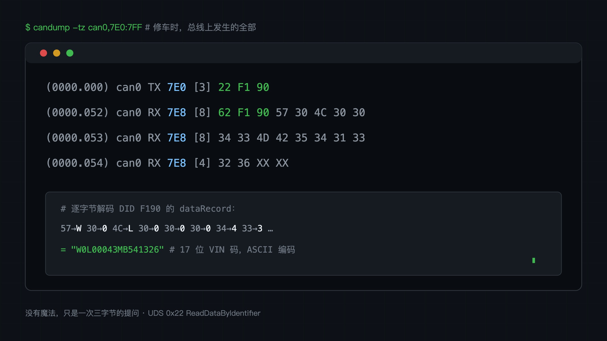
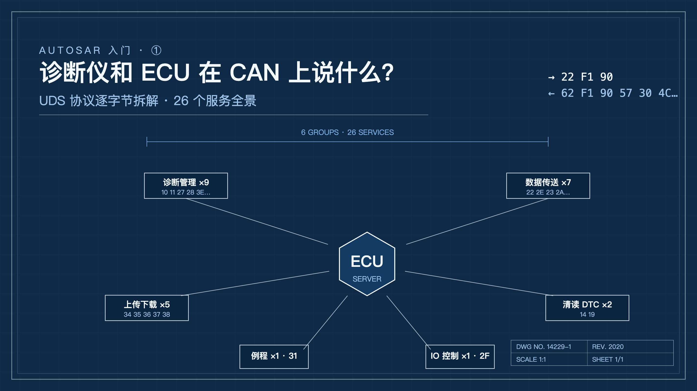
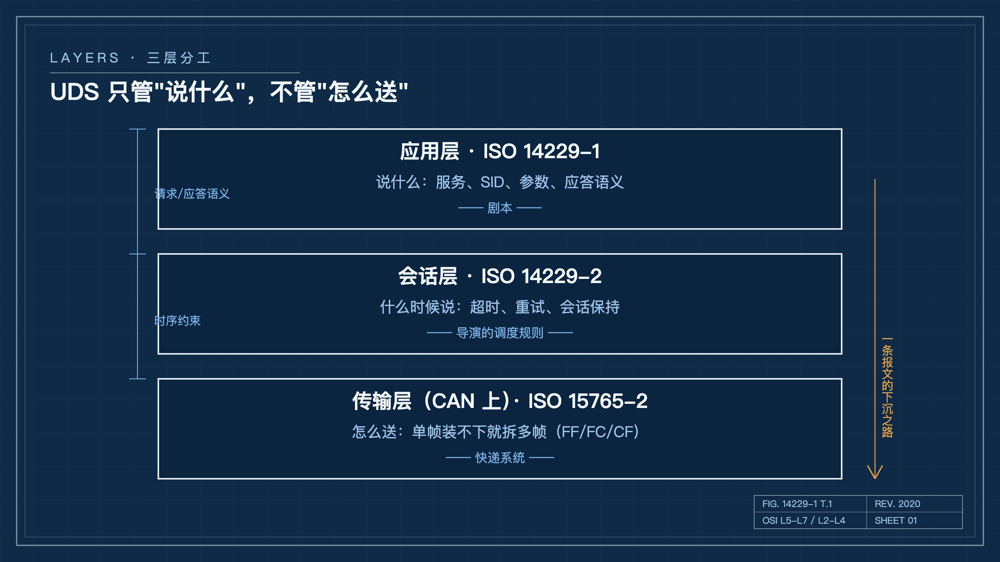
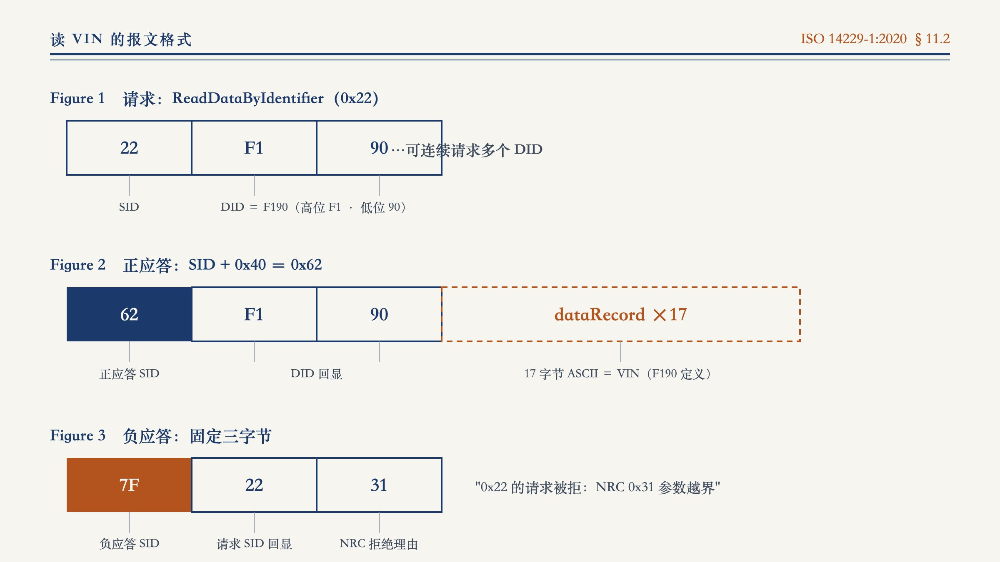
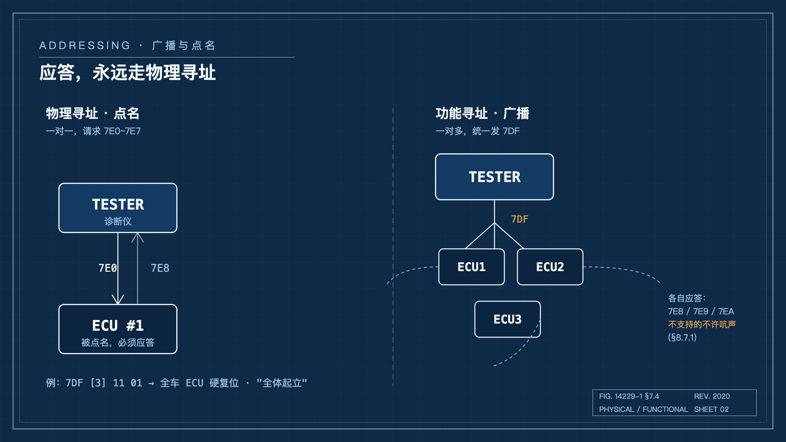
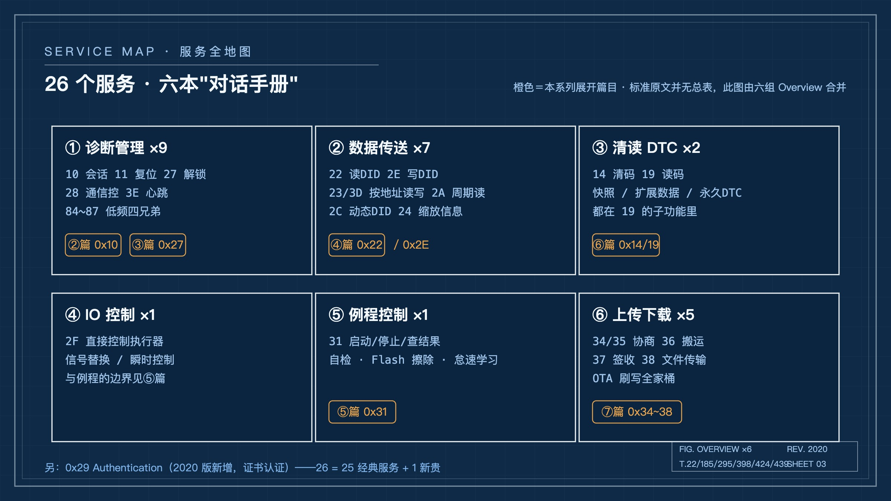
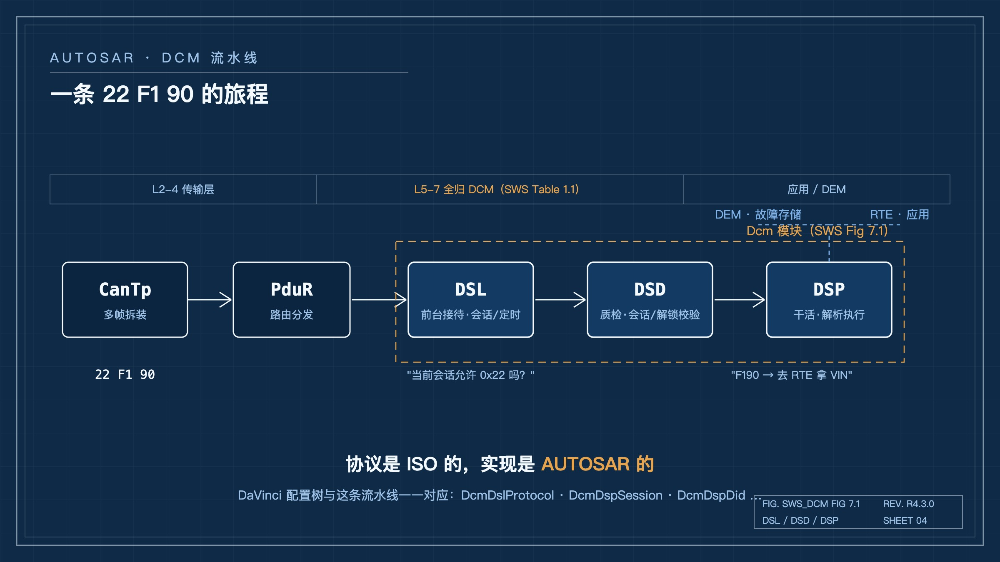

## 开场：一条 CAN 报文引发的"对话"

修车时，师傅把诊断仪插上 OBD 口，屏幕上跳出车架号、软件版本、故障码。

看起来像魔法，其实在 CAN 总线上，只发生了一次极简的对话：

```
诊断仪 → ECU:  22 F1 90          "把 F190 号数据给我看看"
ECU → 诊断仪:  62 F1 90 57 30 4C 30 30 30 34 33 4D 42 35 34 31 33 32 36 31
                                    "给，这是车架号"
```

后面那串数字，每个字节都是 ASCII 字符，拼出来正是一个 17 位 VIN 码。



这不是哪家车厂的私有协议。全世界的 ECU，讲的都是同一种"诊断语言"——**UDS**（Unified Diagnostic Services，统一诊断服务），标准编号 ISO 14229。

这个系列，我们就把这门语言拆开揉碎讲。今天是第一课：先看懂一条报文的每个字节，再拿到全部 26 个服务的地图。



## UDS 是什么：不是协议栈，是一套"对话剧本"

先纠正一个常见误解：UDS 不是一个"协议栈"，它只管**应用层**——规定诊断仪（client，客户端）和 ECU（server，服务端）**说什么**，不管**怎么送**。

ISO 把这件事拆成了三层（ISO 14229-1, Table 1）：

| 层 | 标准 | 管什么 |
|---|---|---|
| 应用层 | ISO 14229-1 | 说什么：服务、SID、参数、应答语义 |
| 会话层 | ISO 14229-2 | 什么时候说：超时、重试、会话保持 |
| 传输层（CAN 上） | ISO 15765-2 | 怎么送：单帧装不下怎么办 |

一个类比：14229-1 是剧本，14229-2 是导演的调度规则，15765-2 是快递系统。



所以别把 `7F 22 31` 这种字节流归功于"CAN 协议"——CAN 只负责把这 3 个字节送到，至于它们什么意思，全是 UDS 说了算。

## 解剖第一条报文：SID、+0x40 与子功能

回到开头那条报文。`22 F1 90` 三个字节，逐个拆：

**第一个字节 `22`：SID（Service Identifier，服务标识符）。**

UDS 里每个"动作"有一个编号，`0x22` 是 ReadDataByIdentifier（按标识符读数据）。你让它干活，先报工号。

**应答的第一个字节 `62`：就是 SID + 0x40。**

这是 UDS 最漂亮的规律：**正应答 SID = 请求 SID + 0x40**。对应到二进制，就是把 bit 6 置 1（ISO 14229-1, §8.4, Table 2）。

所以你看到的每一对请求/应答，都遵循这个规律：

| 请求 | 正应答 | 服务 |
|---|---|---|
| 0x10 | 0x50 | 会话控制 |
| 0x22 | 0x62 | 读数据 |
| 0x19 | 0x59 | 读故障码 |
| 0x2E | 0x6E | 写数据 |
| 0x31 | 0x71 | 例程控制 |

下次抓 CAN 报文，看到 `5x/6x/7x` 开头的应答，减去 0x40 就知道在应答谁。



**负应答则统一用 `0x7F`**，格式固定三字节：

```
7F <请求SID> <NRC>
```

比如 `7F 22 31`：你用 0x22 读数据，被拒了，拒绝理由 NRC=0x31（请求超出范围——这个 DID 不存在）。

**还有一个隐藏角色：子功能字节的 bit 7——抑制位。**

带子功能的服务（如 0x10、0x19、0x3E），请求第二个字节是子功能，它的最高位是 suppressPosRspMsgIndicationBit——置 1 表示"这事办了别回话"（§8.7.3）。诊断仪保活常用的 `0x3E 80`，那个 80 就是"我在，但不用回我"。（注意 0x22 没有子功能——第二个字节直接就是 DID 高位，别把 `F1` 的最高位当成抑制位。）

## ECU 说"不"的方式：NRC 速览

UDS 里 ECU 拒绝你的方式，比你想的有礼貌得多——每一个"不行"都有编号，叫 **NRC**（Negative Response Code，否定应答码，Annex A.1, Table A.1）。

写代码调试时 90% 的挫败感，来自这几个：

| NRC | 名称 | 人话 |
|---|---|---|
| 0x11 | serviceNotSupported | 我不提供这个服务 |
| 0x12 | subFunctionNotSupported | 服务有，子功能没有 |
| 0x22 | conditionsNotCorrect | 现在条件不满足（车速不为 0 想刷写？） |
| 0x31 | requestOutOfRange | 参数越界，没这个 DID |
| 0x33 | securityAccessDenied | 没解锁，别碰（下篇主角） |
| 0x78 | responsePending | 收到了，在处理，稍等（刷写擦 Flash 期间的高频应答） |

后面五篇，几乎每一篇的开场都是一个 NRC 引发的血案——记住这张小表，系列就赢了一半。

## NRC 是有先来后到的

新手最容易忽略的一件事：**一次请求可能同时踩好几条红线，但 ECU 只回一个 NRC——回哪个，标准规定了检查顺序。**

每个服务在 ISO 14229-1 里都配了一张 NRC 处理流程图。拿 0x2E 写数据当例子（Figure 26），ECU 收到请求后从头到尾过筛子：

1. 报文长度够不够？→ 不够，**0x13**（格式错误）
2. 这个 DID 在当前会话支持写吗？→ 不支持，**0x31**
3. （2020 版新增）认证过没过？→ 没过，**0x34**
4. 安全等级解锁了吗？→ 没解锁，**0x33**
5. 现在的条件允许写吗？→ 不允许，**0x22**
6. 数据本身合法吗？→ 不合法，**0x31**
7. 最后一关：真写进内存失败 → **0x72**

顺序有讲究：**先查身份，再查条件，最后才干活**。所以你在默认会话、没解锁、车速还 60 km/h 的状态下发 `2E F1 90`，同时踩了三条红线，但回给你的只有一个——排在最前面的"这个 DID 当前会话不支持"（② 篇的 0x7F/0x31 一族）。条件 0x22 和解锁 0x33 排在它后面，轮不到开口。

实战意义：**调试时 NRC 是二分查找的线索**。收到 0x33 别急着查算法——先确认前面的关卡（会话、DID 存在性）都已经过了，0x33 才真的意味着"就差钥匙"。后面各篇遇到 NRC 时，记住它只是这条流水线上**第一个没过的检查站**。

## 广播与点名：功能寻址 vs 物理寻址

诊断报文在 CAN 上怎么寻址？两种方式（§7.4）：

**物理寻址——点名。** 一对一，请求发 `0x7E0~0x7E7`，应答固定用 `0x7E8~0x7EF`。不管你怎么问，**应答永远走物理寻址**。

**功能寻址——广播。** 统一发 `0x7DF`，总线上所有 ECU 都听。典型用途：`7DF: 02 11 01`，一句话让全车 ECU 硬复位——刷写前的"全体起立"。

一个细节：广播模式下，部分 NRC（如 0x11 服务不支持）**不允许应答**（§8.7.1）——不然全车 30 个 ECU 同时喊"我不支持"，总线直接堵死。



**那 VIN 那 20 个字节的应答怎么塞进一帧 8 字节的 CAN 报文？** 塞不进。这时候传输层 ISO 15765-2 出场：拆成首帧（FF）、等流控帧（FC）、连续帧（CF）搬运。本篇只记一句：**多帧搬运是 15765-2 的活，与 UDS 无关**，细节等第 ⑦ 篇刷写时展开。

## 全景地图：26 个服务，六本"对话手册"

重头戏。UDS 一共定义了 26 个服务（25 个经典服务 + 2020 版新增的 0x29 认证），按功能分成六组（各组的 Overview 表，Table 22/185/295/398/424/439）。

先给个冷知识：**标准里其实没有一张"全部 SID 总表"**——它们散落在六个功能单元各自的章节里。下面这张合并表，就是你网上很难一次找齐的完整地图：

**① 诊断管理（9 个）——管的是"对话规则"**

| SID | 服务 | 干什么 |
|---|---|---|
| 0x10 | DiagnosticSessionControl | 切会话（第②篇） |
| 0x11 | ECUReset | 让 ECU 复位 |
| 0x27 | SecurityAccess | 安全解锁（第③篇） |
| 0x28 | CommunicationControl | 开关通信 |
| 0x3E | TesterPresent | 诊断仪在场心跳 |
| 0x84/0x85/0x86/0x87 | 安全传输/控制DTC/事件响应/链路控制 | 低频但各有神通 |

**② 数据传送（7 个）——读写 ECU 的数据**

| SID | 服务 | 干什么 |
|---|---|---|
| 0x22 | ReadDataByIdentifier | 按 DID 读（第④篇） |
| 0x2E | WriteDataByIdentifier | 按 DID 写（第④篇） |
| 0x23/0x3D | 按地址读写内存 | 工程调试用得多 |
| 0x2A | 周期读 | 订阅式数据上报 |
| 0x2C | 动态定义 DID | 现场拼一个组合数据 |
| 0x24 | 读缩放信息 | 拿到原始值怎么换算 |

**③ 存储信息（2 个）——故障码的清与读**

| SID | 服务 | 干什么 |
|---|---|---|
| 0x14 | ClearDiagnosticInformation | 清码（第⑥篇） |
| 0x19 | ReadDTCInformation | 读码（第⑥篇） |

**④ IO 控制（1 个）**

| SID | 服务 | 干什么 |
|---|---|---|
| 0x2F | InputOutputControlByIdentifier | 直接控制执行器/替代信号 |

**⑤ 例程控制（1 个）**

| SID | 服务 | 干什么 |
|---|---|---|
| 0x31 | RoutineControl | 启动/停止/查询例程（第⑤篇） |

**⑥ 上传下载（5 个）——刷写全家桶**

| SID | 服务 | 干什么 |
|---|---|---|
| 0x34/0x35 | 请求下载/上传 | 传输前协商（第⑦篇） |
| 0x36 | TransferData | 逐块搬运（第⑦篇） |
| 0x37 | RequestTransferExit | 传输结束（第⑦篇） |
| 0x38 | RequestFileTransfer | 文件级传输 |

加上 2020 版新增的 **0x29 Authentication**（基于证书的认证，安全强度高于 0x27 的 Seed&Key），正好 26 个。

这张表建议收藏——它是这个系列的地图，后面每一篇，都是把其中一行展开讲透。



## 时序：P2 与 P2\*，接话的时限

对话要有节奏。UDS 规定了两条"接话时限"（§10.2.3.2, Table 28/29）：

- **P2Server_max**：ECU 收到请求后，最迟多久必须应答（或先回一句 0x78 "稍等"）
- **P2\*Server_max**：ECU 说了"稍等"（NRC 0x78）之后，最迟多久给最终答复

这里要**纠正一个流传很广的误传**：网上大量文章写"P2 标准规定 50ms、P2\* 规定 5000ms"。

不准确。50ms/5000ms 只是**标准正文里的示例值**（Table 31）。真实机制漂亮得多——这两个时限是 **ECU 自己报的**，就在 0x10 会话控制的正应答里：

```
10 03                  "进扩展会话"
50 03 00 32 01 F4      "已进。我接话最快 0x0032=50ms，说'稍等'后 0x01F4×10=5000ms 内必答"
```

每个 ECU 的脾气不一样，问一句 `10 03`，它就把两个时限写在应答里告诉你了。第 ② 篇讲会话时，这段报文我们逐字节再拆一遍。

## 落到 AUTOSAR：DCM 模块在哪里

讲了这么多 ISO 标准，它在 AUTOSAR 软件里由谁实现？答案是一个 BSW 模块：**DCM**（Diagnostic Communication Manager）。

分层上很干净：前面说的三层剧本里，**DCM 包办 OSI 第 5~7 层**——UDS 服务（第 7 层）、会话层时序（第 5 层）都是它的活；而拆装多帧的 ISO 15765-2 属于第 2~4 层，归传输层模块（CanTp）管（AUTOSAR_SWS_DCM, Table 1.1）。

DCM 内部分工也很讲道理，三个子模块像一条流水线（SWS Figure 7.1）：

- **DSL**（Diagnostic Session Layer）：前台接待——管会话状态、安全等级、定时、TesterPresent 保活，从 PduR 收请求、把应答发回去
- **DSD**（Diagnostic Service Dispatcher）：质检员——校验"当前会话允不允许、解没解锁、格式对不对"，然后分发给处理者
- **DSP**（Diagnostic Service Processing）：干活的——解析 0x22/0x19/0x31 各服务，去应用层（经 RTE）或 DEM 拿数据、执行动作、组装应答

一条 `22 F1 90` 进来：CanTp 重组多帧 → PduR → DSL 收下 → DSD 校验 → DSP 发现要读 DID，经 RTE 端口向应用拿 VIN → 原路返回应答。

工程里怎么配？以 Vector MICROSAR 为例，DaVinci Configurator 里 Dcm 的配置树就是按这条流水线组织的：`DcmDslProtocol` 配协议和 P2 定时、`DcmDspSession` 配会话、`DcmDspSecurity` 配安全等级、`DcmDspDid` 配每一个 DID 的读写权限——本系列后面每讲一个服务，都会带你回到这棵树上找到它对应的位置。

顺带一提，`DcmDslProtocol` 可以配多行：一个 DCM 同时挂 CAN、CAN FD、DoIP（以太网）多条诊断通道，各自独立 P2 定时、互不干扰。同一套 UDS 服务原样跑在不同总线上——这是分层的红利，DoIP 值得单开一篇，先挖个坑。

这也是 AUTOSAR 的价值所在：**协议是 ISO 的，实现是 AUTOSAR 的**。车厂换供应商、换芯片，诊断行为不变——因为大家用的是同一本剧本、同一套模块接口。



## 收尾与预告

回头看，你已经具备三个能力：

- 看懂任意一条诊断报文的骨架（SID / +0x40 / 子功能 / NRC）
- 分清广播与点名（7DF vs 7E0-7E7，应答永远物理寻址）
- 手握 26 个服务的完整地图

下一篇我们进入第一个服务：**0x10 会话控制**。为什么很多操作之前都要先发一句 `10 03`？因为 ECU 有"三重人格"——前台、维修间、刷写间，进错房间，寸步难行。

## 参考资料

- ISO 14229-1:2020 — Unified diagnostic services (UDS), Part 1: Specification and requirements
  - 服务全景：各功能单元 Overview（Table 22, 185, 295, 398, 424, 439）
  - SID 值域与 +0x40 规则：§8.4, Table 2；负应答格式：§8.6, Table 3；抑制位：§8.7.3
  - 寻址：§7.4；功能寻址 NRC 抑制：§8.7.1
  - 示例报文：0x10（Tables 31/32）、0x22 读 VIN（Tables 191/192）、多帧/功能寻址（Tables 523/524）
  - 时序参数：§10.2.3.2, Tables 28/29（P2/P2\* 语义详见 ISO 14229-2）
  - NRC 全表：Annex A.1, Table A.1；NRC 检查顺序示例：0x2E WriteDataByIdentifier 的 Figure 26
- AUTOSAR_SWS_DiagnosticCommunicationManager（DCM 规范，R4.3.0）：分层 Table 1.1；DSL/DSD/DSP Figure 7.1 及 §7.3~7.5
- Vector TechnicalReference_Dcm（MICROSAR DCM v9.5）：DaVinci 配置容器结构（各服务 Configuration Aspects 节）
