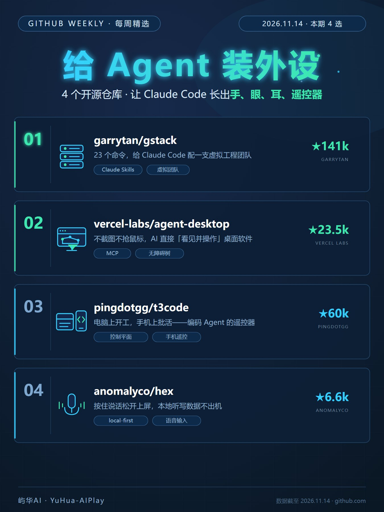
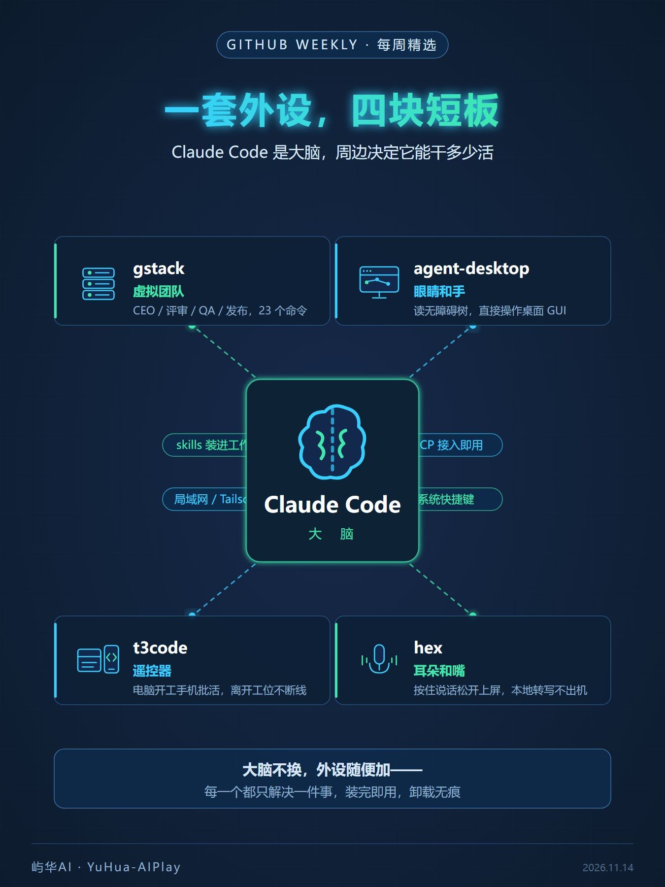
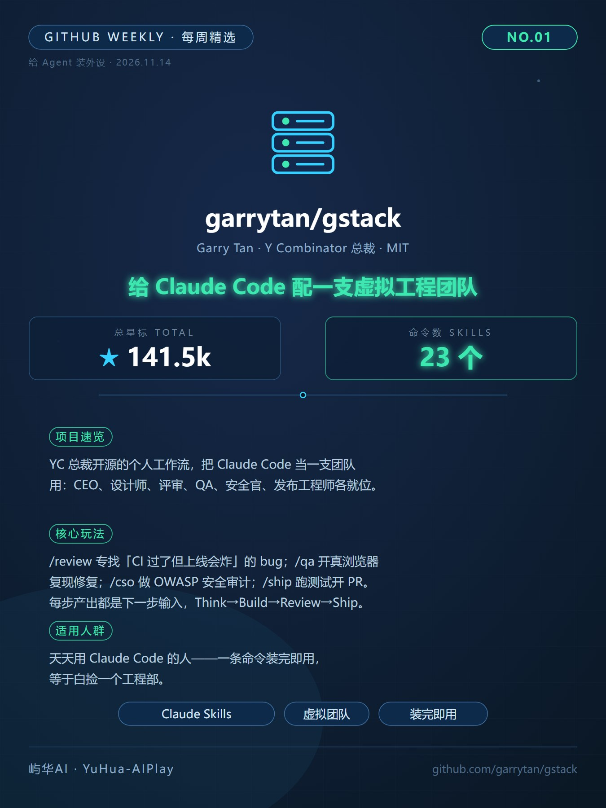
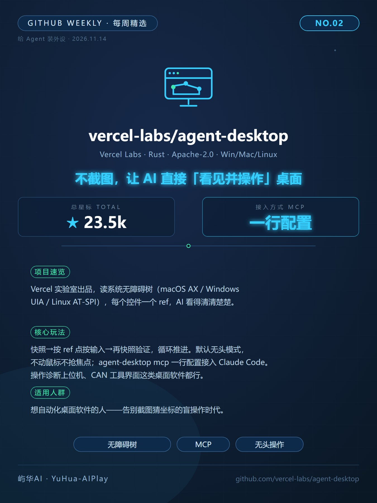
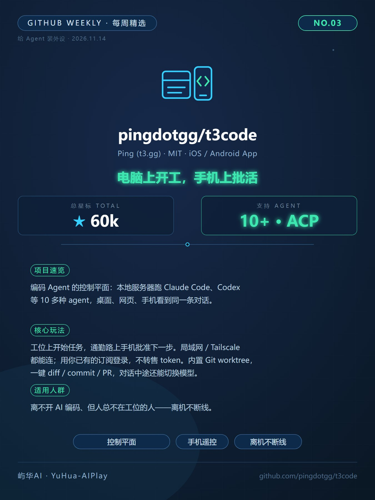
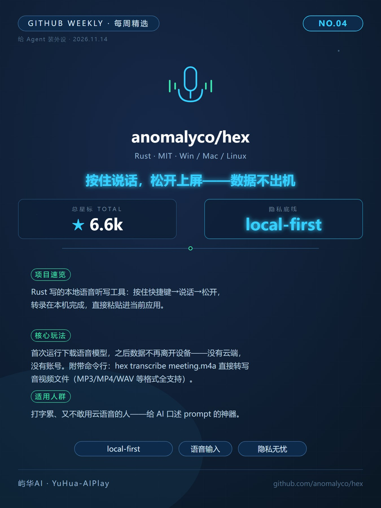

上周聊 GitHub 周榜，说 Agent 生态正从「拼模型」进入「拼周边」。这周翻榜单发现，周边不但有了，还凑成了一套——4 个仓库，正好补齐 AI 编程的四块短板：**没人干活、看不见桌面、离开工位就断线、打字太慢**。

4 张图看完这期。

它们不是四个孤立工具，而是围着同一个大脑转：Claude Code 还是那个 Claude Code，但配上外设之后，能干的事完全不一样了。

先看大脑的配置。gstack 是 YC 总裁 Garry Tan 开源的个人工作流——23 个命令，把 Claude Code 当一支团队用：评审找 bug、QA 开真浏览器复现、安全官做 OWASP 审计、发布工程师跑测试开 PR。装完即用，等于白捡一个工程部。

agent-desktop 则解决了另一件事：AI 一直在「盲操作」电脑，靠截图猜界面。这个项目让 AI 直接读系统无障碍树，每个控件都有名字，点哪、填哪，一次到位——默认不动鼠标不抢焦点，后台干活两不误。

t3code 让你在电脑上开工、地铁上用手机批准下一步，通勤不再断线。

hex 按住说话松开上屏，转录全程在本机完成，数据不出电脑——给 AI 口述 prompt，比打字快多了。

大脑不换，外设随便加。每一个都只解决一件事，装完即用，卸载无痕。

---

聊聊：你的 Claude Code 现在最缺哪块外设？评论区报上痛点。

下期继续翻榜，关注不迷路。这里是屿华 AI，零基础玩转科技工具。
