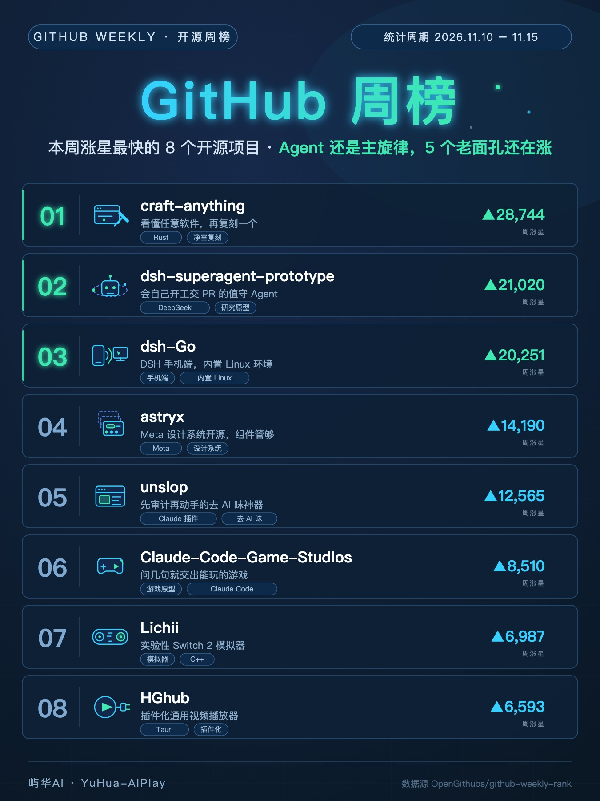
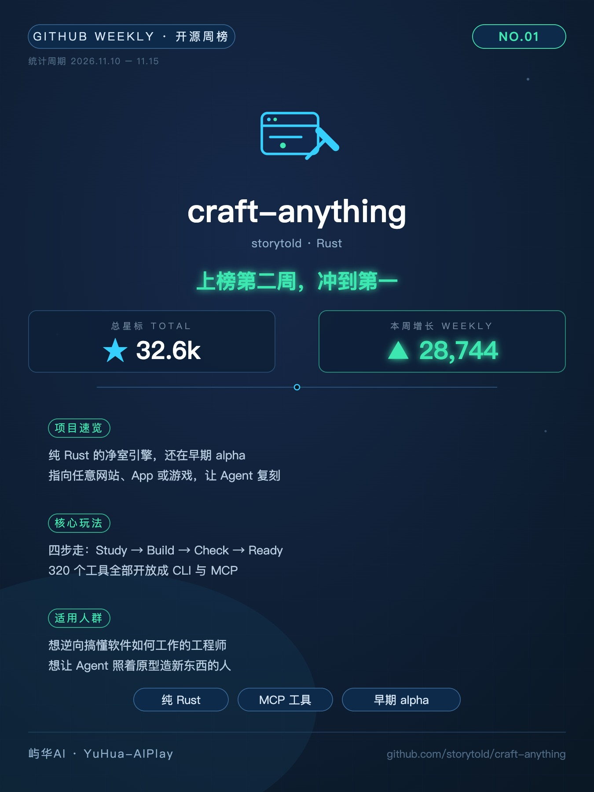
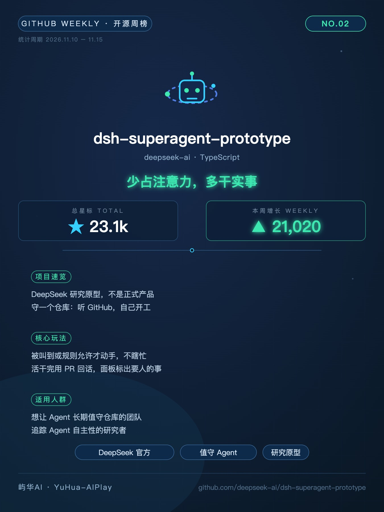
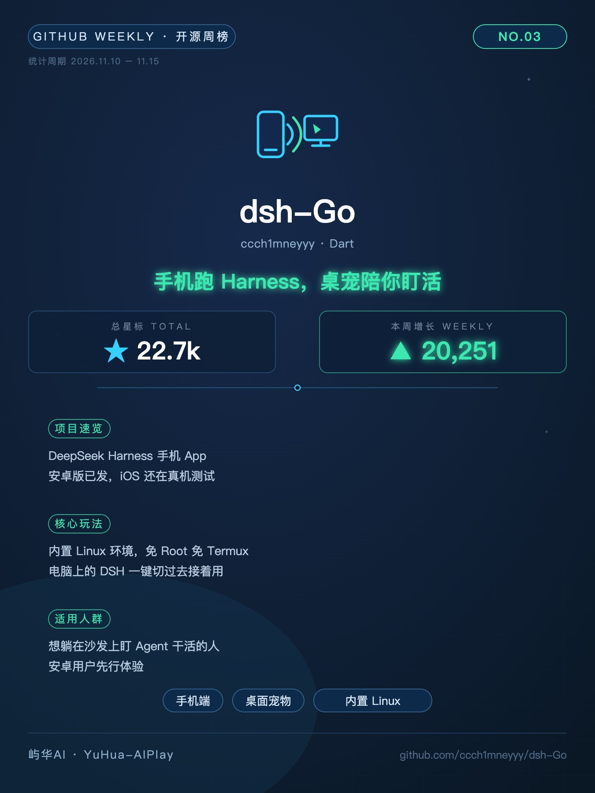
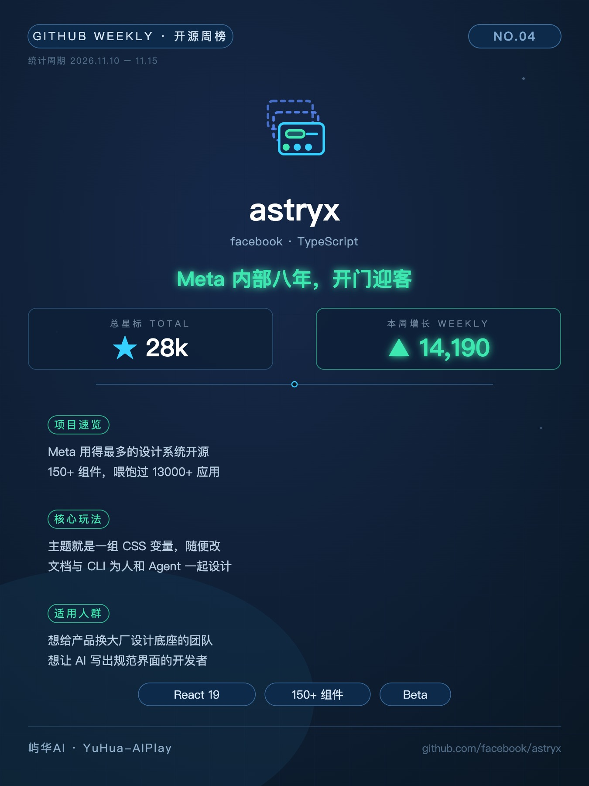
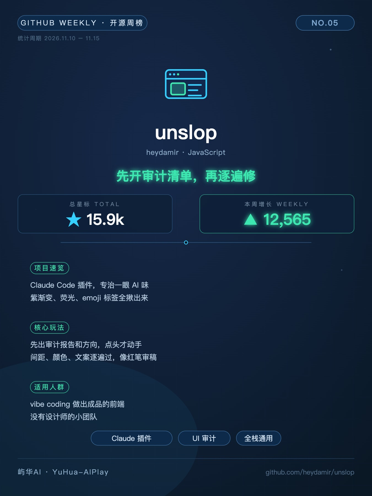
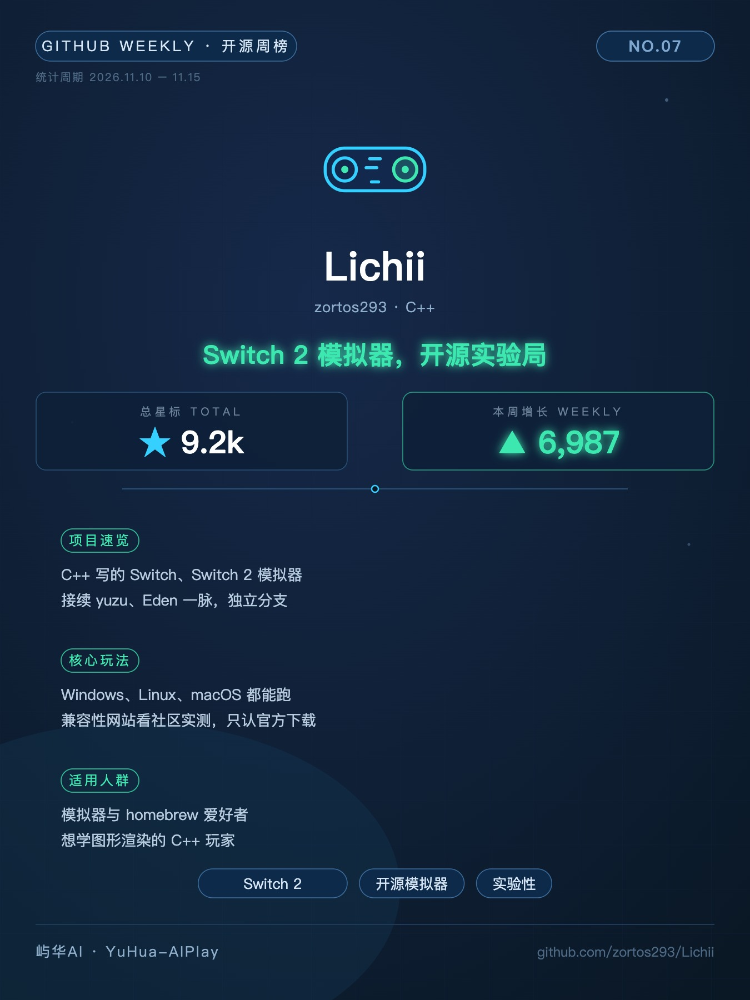
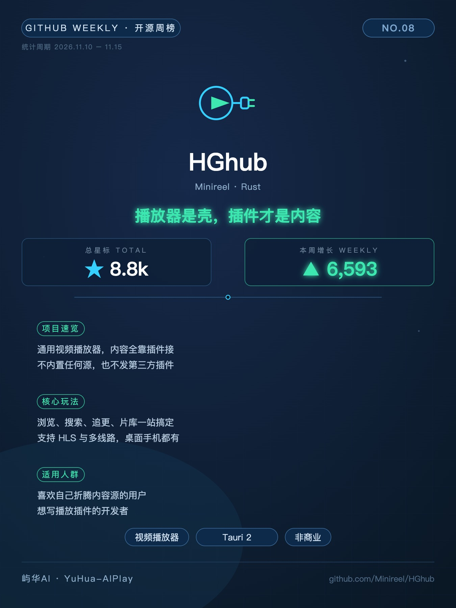

本周 GitHub 周榜，Agent 还是主旋律——前 8 名里 6 个和 Agent 有关，5 张上期老面孔还在涨，榜首 craft-anything 上周才排第 6。

新面孔有三个：Meta 的设计系统 astryx、Switch 2 模拟器 Lichii、插件化播放器 HGhub。

---

聊聊：这 5 个连涨两周的项目，你 star 了几个？

下一篇继续拆周榜宝藏项目，关注不迷路。这里是屿华 AI，零基础玩转科技工具。
