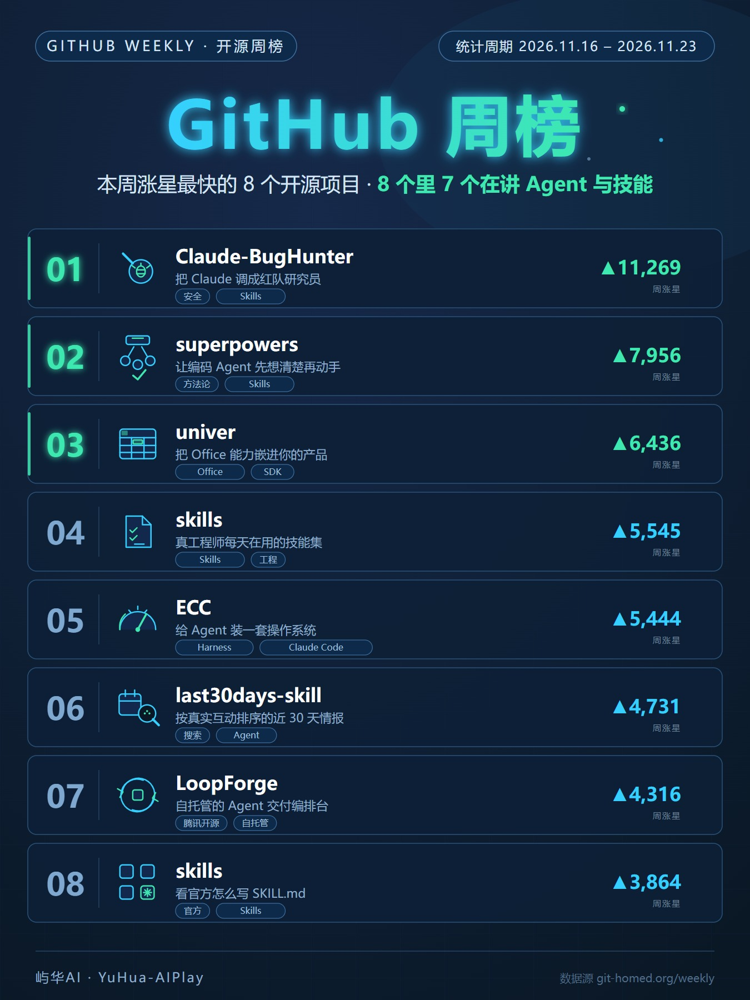
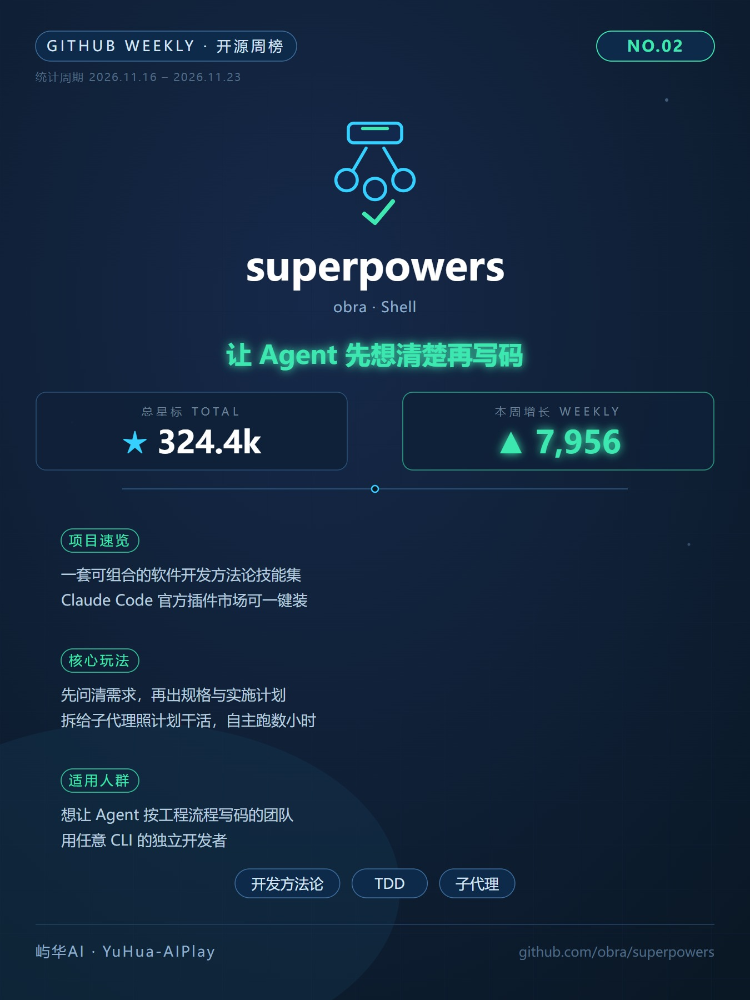
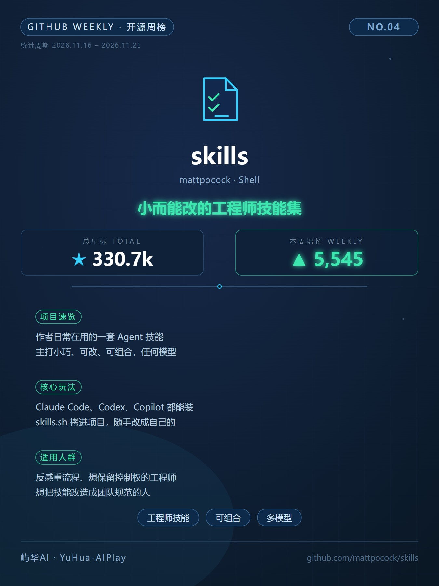
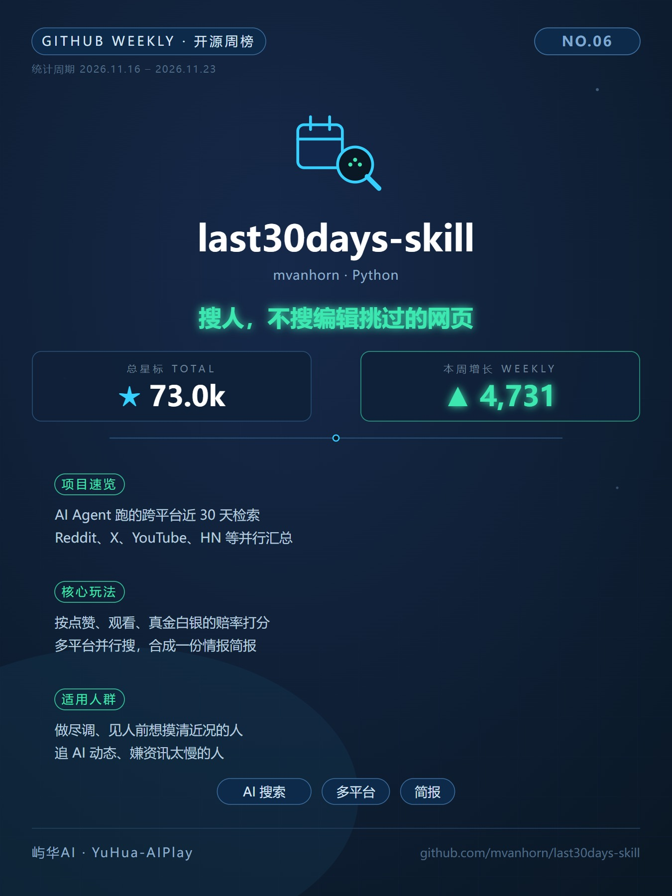
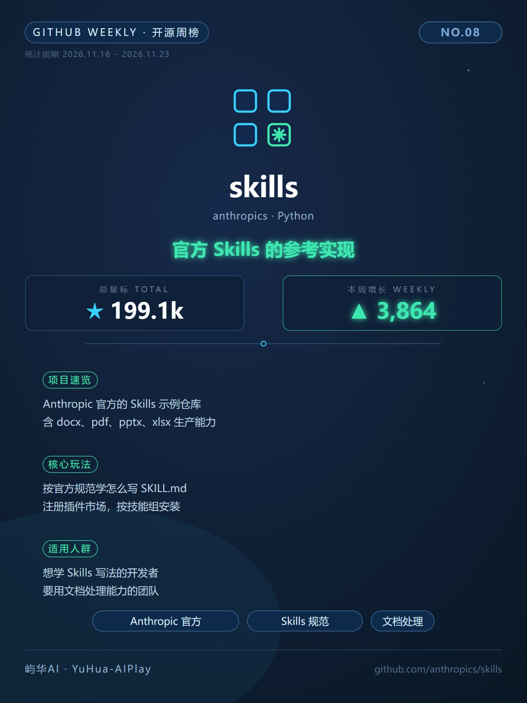

<!-- 数据口径：滚动 7 天，截至 2026-11-23 06:48 UTC，来源 https://git-homed.org/weekly -->

本周榜单几乎被 Agent 与 Skills 包场——8 个项目里 7 个在讲 Agent 或技能，唯一例外是能嵌进自家产品的 Office SDK。

榜首 Claude-BugHunter 一周涨 1.1 万星，靠的不是更强的模型，而是一套 83 个安全技能包；老面孔 superpowers、mattpocock/skills、ECC 继续在涨，腾讯的 LoopForge 作为新人挤进第 7。

---

聊聊：这 8 个项目里，你最想把哪一个装进自己的工作流？

下一篇继续拆周榜宝藏项目，关注不迷路。这里是屿华 AI，零基础玩转科技工具。
